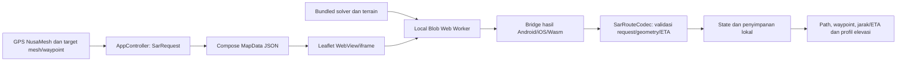

# Integrasi navigasi medan NusaSurvey ke NusaMesh

Tanggal: 15 Oktober 2026. Lingkup tahap ini adalah route path dan navigasi; fitur fencing, sektor, editor polygon, detektor jurang, dan buffer tebing tidak dipindahkan dari prototype.

**Pembaruan 17 Oktober 2026:** empat wilayah yang sudah dipelihara dibundel penuh. Panel Paket navigasi/unduhan dihapus; solver memakai data lokal. Rendering basemap dan pencarian dikembalikan seperti semula: tile OSM/geocoding online serta MBTiles/cache lokal. Paket routing bukan pengganti peta detail lengkap. Penambahan wilayah dilakukan sebelum build. Baca [cakupan bawaan dan alur offline](REGIONAL_NAVIGATION.md). Catatan integrasi awal berikut tetap menjelaskan model routing dan batas datanya.

## Alur pengguna

1. Buka **Peta**. Posisi sendiri berasal dari layanan lokasi NusaMesh; tujuan berasal dari unit/korban mesh, waypoint, atau titik yang diketuk pada peta.
2. Ketuk marker korban/unit atau titik, lalu **Arahkan** pada popup. Tombol Arahkan pada daftar unit/titik juga meminta route. Untuk titik peta bebas, gunakan **Arahkan ke titik peta** pada panel.
3. Solver lokal menghitung satu perjalanan gabungan jalan OSM, medan, dan transisi. Path muncul setelah query berhasil: biru ruas OSM, ungu medan, jingga transisi. Awal/tujuan rute diberi penanda; itu endpoint rute, bukan simulasi posisi orang.
4. Panel menampilkan jarak tersisa, ETA model, ascent/descent, jenis segmen, serta profil elevasi pada vertex rute. **Mulai navigasi** memakai pembaruan GPS dan heading yang tersedia; tidak ada gerakan dummy di aplikasi.
5. GPS lebih lama dari 60 detik menjeda navigasi aktif. Tujuan bergeser lebih dari 10 m atau posisi aktif keluar rute melampaui max(30 m, 2×accuracy) membuat rute stale. **Hitung ulang dari posisi sekarang** meminta query baru. Threshold tersebut kebijakan integrasi awal, bukan batas aman yang telah diuji lapangan.
6. Saat dekat akhir rute, status ARRIVED menyatakan mendekati koordinat; bukan konfirmasi korban ditemukan. Hentikan navigasi untuk menghapus plan aktif.

Rute disimpan lokal, dipulihkan PAUSED setelah aplikasi dibuka kembali, serta memakai koordinat tujuan terakhir. Tidak ada query otomatis hanya karena marker muncul atau plan dipulihkan. Data wilayah di luar cakupan/missing menghasilkan kegagalan eksplisit. Tidak dibuat fallback garis lurus yang diklaim sebagai route medan.

## Arsitektur



Solver dibundel dari `apps/geofence-prototype/src/routing/hybrid.js` sebagai IIFE JavaScript. Paket dan solver dibaca dari Compose resources, lalu worker dibentuk lokal; tidak memerlukan OSRM server atau internet untuk perhitungan. Leaflet yang sudah dipakai NusaMesh tetap menjadi renderer. Android menyajikan script melalui resource interception yang sudah ada; dokumen HTML tetap memiliki dua script, sesuai kontrak `splitScripts`.

Bridge menerima JSON dengan request ID. Kotlin menolak ID lama, input/endpoint tidak valid, jumlah segment tidak cocok, angka nonfinite/negatif, serta total distance/time tidak konsisten. Hasil juga ditolak jika posisi awal/tujuan berubah selama query. Job sebelumnya dihentikan ketika request diganti/dibatalkan; worker dan Blob URL dibersihkan.

`SarRoute` merupakan plan lokal terpisah dari `SharedRoute`/draft LoRa. Geometry lokal tidak melewati `simplifyForSharing`, sehingga belokan OSM asli dipertahankan. Tombol planning jalan kaki dialihkan ke Hybrid; provider kendaraan dan fungsi route/track lama tetap terpisah. Tidak menambahkan polygon/geofence operasi atau mengirim seluruh plan/raster melalui LoRa.

## Cakupan data dan kemampuan

Resources ada pada `composeApp/src/commonMain/composeResources/files/navigation/`: `solver.js`, `kaliurang-terrain.json`, dan `manifest.json`. Manifest mencatat hash paket/solver, model, source, dan waktu bundling.

Paket awal hanya AOI Kaliurang `[110.425, -7.601, 110.452, -7.569]`, grid 35 m UTM EPSG:32749, datum EGM2008, Copernicus GLO-30 release 2021, WorldCover 2021 v200, serta OSM paths/building footprints. File paket sama dengan prototype, bukan data elevasi dummy. Physical constraints air/bangunan/NoData/grade tetap bagian dari solver. Fitur admin untuk menggambar fencing/polygon tidak diimpor.

Untuk wilayah lain dibutuhkan paket medan yang sesuai dan adaptor pemilihan/impor paket berikutnya; integrasi awal tidak mengklaim routing seluruh Indonesia. Basemap offline tetap mengikuti fasilitas NusaMesh yang sudah ada (peta regional/cache/MBTiles); paket routing tidak otomatis menjadi paket tile detail.

Model ETA masih Langmuir + friction/surface asumsi. Belum ada STRIDE, CVaR, detektor tebing di samping rute, buffer ketidakpastian, atau jaminan bebas jurang. Waypoint Bahaya yang sudah ada tidak otomatis menjadi zona larangan routing pada tahap ini. Browser preview tidak mempunyai provider GPS/heading nyata bawaan; marker/plan pada pemeriksaan browser berasal fixture pengujian yang hanya disuntikkan oleh script test. Android/iOS memakai layanan lokasi aplikasi yang sudah ada.

## File yang berubah

| File/modul | Peran |
|---|---|
| `routing/SarNavigation.kt` | DTO request/plan, parser JSON, persist/restore, segment projection dan pemeriksaan status |
| `AppController.kt`, `domain/Models.kt` | State/request/result lifecycle, sumber posisi/target, GPS/freshness dan penyimpanan |
| `NusaMeshApp.kt`, `ui/MapScreen.kt` | Wiring aksi navigasi dan peta ke controller |
| `ui/SarNavigationCard.kt`, `ui/OfflineNavigation.kt` | Jarak/ETA, profil elevasi, start/pause/reroute, dan arah waypoint |
| `ui/LeafletMap.kt` | Assets, worker, popup Arahkan, route layer, bridge dan adaptasi ukuran viewport |
| `LeafletMap.android.kt`, `.ios.kt`, `.wasmJs.kt` | Callback bridge per platform |
| `composeApp/build.gradle.kts` | Dependency JSON Multiplatform 1.9.0 |
| `tools/navigation/` | Bundling dan pemeriksaan browser |

## Reproduksi dan pemeriksaan

Dari `apps/nusamesh`, setelah dependency npm prototype tersedia:

```powershell
node tools/navigation/bundle.mjs
./gradlew.bat :composeApp:testDebugUnitTest :composeApp:assembleDebug :composeApp:wasmJsBrowserDevelopmentWebpack --offline --console=plain
node tools/navigation/check-map.mjs
```

`--offline` hanya dapat dipakai jika dependency Gradle/npm/SDK sudah tersedia. Dependency Codec2 dipulihkan pada gitlink commit repo `06d4c11e699b0351765f10398abb4f663a984f36`; kode dependency tidak diubah. Source yang kosong semula menghalangi CMake build APK.

Untuk review web, gunakan `:composeApp:wasmJsBrowserDevelopmentRun` atau sajikan output webpack bersama `build/processedResources/wasmJs/main`. Pemeriksaan `check-app.mjs` memakai server lokal port 8081 dan fixture plan pada localStorage context browser terisolasi. Fixture ini tidak ditambahkan pada runtime aplikasi.

Hasil pengujian terakhir: 116 uji Kotlin/Android unit lulus, termasuk lima uji khusus codec/progress/status navigasi. Pemeriksaan peta lulus untuk popup action, worker offline, kesetaraan geometry/ETA dengan prototype (toleransi floating point), warna segmen, query di luar wilayah, dan pembatalan request. Pemeriksaan aplikasi Compose lulus untuk pemuatan resources, restore PAUSED, tidak ada query tanpa tindakan, serta reload plan. APK debug dan webpack development berhasil dibangun. Assets navigasi dalam APK juga diperiksa hash-nya.

APK: `composeApp/build/outputs/apk/debug/composeApp-debug.apk`. Build web production sempat terhalang dependency Binaryen 123 yang belum tercache; build development berhasil. Build/tes iOS membutuhkan macOS/Xcode dan belum dijalankan. Runtime GPS/BLE di ponsel serta pengujian medan lapangan belum dilakukan dalam integrasi ini; keberhasilan build/tes software tidak dianggap hasil operasi SAR.

Dasar sistem: [kontrak Hybrid](../../geofence-prototype/docs/HYBRID.md), [model terrain](../../geofence-prototype/docs/TERRAIN.md), [referensi gabungan CD](../../../systems/nusasurvey/docs/Referensi_Gabungan_Navigasi_NusaSurvey_CD.md).
