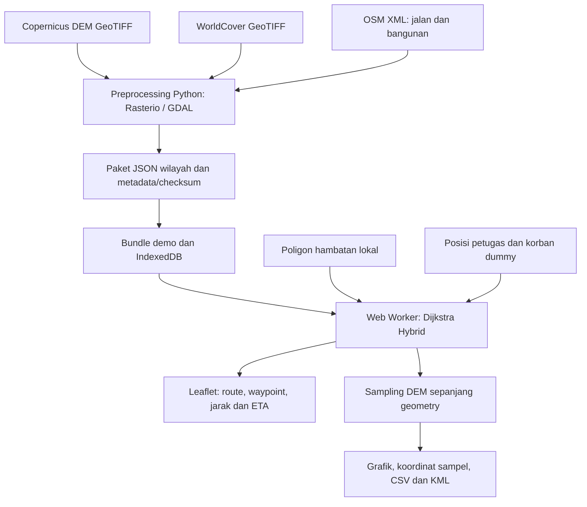

# Dokumentasi pengembangan NusaSurvey SAR

Tanggal pembaruan: 14 Oktober 2026. Lingkup: sistem dan prototype sebelum integrasi produksi. Titik masuk aplikasi: `apps/geofence-prototype`; aplikasi `apps/nusamesh` tidak diubah.

## 1. Tujuan, kebutuhan, dan cara membaca

NusaSurvey dirancang untuk memberi petugas panduan menuju koordinat korban melalui jalan/jalur terpetakan maupun medan tanpa jalan, berdasarkan elevasi, tutupan lahan, hambatan, dan kemampuan gerak tim. BLE–LoRa mesh direncanakan membawa koordinat serta laporan ringkas; paket raster dan peta disiapkan sebelum operasi, bukan dikirim sebagai tile melalui LoRa.

Dokumen kebutuhan utama: [Referensi SAR/geofence/mesh](specs/Referensi_SAR_Geofence_LoRa_Mesh.md), kemudian [Prompt implementasi](specs/Prompt_Implementasi_NusaSurvey_SAR.md). Dokumen ini mencatat realisasi, bukan menggantikan spesifikasi.

| Dokumen | Isi |
|---|---|
| [Inventaris sumber dan teknologi](Sumber_dan_Teknologi.md) | Perangkat runtime, data, source upstream, provenance, dan status pemakaian |
| [Landasan ilmiah dan daftar pustaka](references/Landasan_Ilmiah.md) | Jurnal, buku/prosiding, relevansi, batas bukti, dan pemetaan ke modul |
| [BibTeX](references/nusasurvey.bib) | Metadata referensi terpilih untuk impor ke pengelola pustaka |
| [Kajian lintas medan](architecture/Kajian_Routing_Lintas_Medan.md) | Alasan graph jalan dan medan digabung |
| [Teori antisipasi jurang](architecture/Dasar_Teori_Antisipasi_Jurang.md) | Geomorfometri, buffer, risiko, ketidakpastian, serta kebutuhan validasi |
| [Kontrak terrain](../../../apps/geofence-prototype/docs/TERRAIN.md) | Importer, paket, dan model waktu medan |
| [Kontrak Hybrid](../../../apps/geofence-prototype/docs/HYBRID.md) | Graph ruas–sel–transisi dan constraint |
| [Profil elevasi](../../../apps/geofence-prototype/docs/ELEVATION.md) | Sampling, grafik, CSV/KML, dan pembandingan Google Earth |
| [Verifikasi](../../../apps/geofence-prototype/docs/VALIDATION.md) | Pengujian yang dijalankan dan batas hasil |

## 2. Pekerjaan yang dilakukan

Urutan berikut adalah tahap perubahan dalam sesi pengembangan, bukan daftar commit atau estimasi waktu pengerjaan.

| Tahap | Pekerjaan | Hasil/artifact |
|---|---|---|
| Kebutuhan dan organisasi | Membaca spesifikasi, memisahkan routing dari geofence/transport, merapikan dokumen | Dokumen berada di `systems/nusasurvey`; prototype tetap di `apps/geofence-prototype` |
| Audit upstream | Mengambil dan membaca file terpilih OSRM, GDAL, GRASS, Earth Engine, dan WorldCover | 36 file berhasil diambil menurut manifest, termasuk dokumen/lisensi; bukan clone lengkap atau runtime siap pakai |
| Mesin medan lokal | Validator paket, Dijkstra berarah, model waktu, NoData, air, mask larangan, dan poligon hazard | `src/terrain/engine.js`, worker, fixture dan panel pengujian |
| Data nyata | Menyiapkan crop DEM/land-cover Kaliurang, grid UTM, geometri OSM, provenance dan checksum | Paket demo raster nyata yang dibundel; orang tetap dummy |
| Alur navigasi | Dua dot dahulu; klik korban membuka Arahkan; baru kemudian rute/ETA tampil | `NavigationConsole.jsx`; penyimpanan rute dan pemulihan panel/reload |
| Geometri jalan | Mengganti lintasan grid yang menyerupai jalan dengan pencarian pada edge OSM asli | `routing/mapped.js`; identitas way/node dan arah kaki dipertahankan |
| Perjalanan campuran | Menggabungkan graph jalan, sel medan, dan konektor tervalidasi dalam satu pencarian | `routing/hybrid.js`, menjadi default navigasi |
| Hambatan bangunan | Memasukkan footprint OSM closed ways; mencegah koneksi palsu struktur bertingkat ke tanah | 1.168 footprint; bridge/tunnel memiliki kebijakan transisi khusus |
| Visualisasi | Jalan biru, medan ungu, transisi jingga; panduan per segmen dan pembagian jarak | Route geometry, waypoint, bearing, sisa jarak dan ETA |
| Elevasi untuk evaluasi | Grafik tanpa smoothing, sampel bilinear pada rute, marker sampel, CSV dan KML | `ElevationProfile.jsx`, `elevationProfile.js` |
| Riset keselamatan | Menganalisis celah jalur datar di tepi jurang dan dasar buffer/risiko | Dokumen teori; belum menjadi detektor jurang pada runtime |

## 3. Status fitur saat ini

| Fitur | Status | Batas praktis |
|---|---|---|
| Routing medan tanpa OSM | Diimplementasikan dan diuji | Graph diskret; tergantung cakupan/kualitas paket |
| Jalan → medan → jalan/korban | Diimplementasikan dan diuji | Transisi diperiksa; bukan bukti medan bisa dilalui manusia |
| OSM exact geometry | Diimplementasikan dan diuji | Berlaku pada segmen berlabel OSM; bukan segmen medan |
| Elevasi/grade otomatis dari paket | Diimplementasikan | Data historis; bukan pengukuran jurang real-time |
| ETA dan profil beban | Diimplementasikan sebagai model asumsi | Belum kalibrasi gerak manusia SAR Indonesia |
| Bangunan, air, NoData, hazard | Diimplementasikan | Closed building ways; cakupan layer tidak lengkap |
| Laporan hambatan dan rerouting | Diimplementasikan untuk simulasi | Tombol depan rute membuat kotak simulasi; pencarian ulang harus diminta |
| Grafik elevasi/CSV/KML | Diimplementasikan dan diuji | Google Earth pembanding dataset, bukan ground truth lapangan |
| Reload/pencarian ulang offline | Diuji setelah persiapan | Basemap hanya tile yang sudah tercache |
| Geofence inti | Ada dan diuji | Fungsi sektor/assignment dan evaluasi coverage belum seluruhnya final |
| GPS/BLE/LoRa/ACK nyata | Belum diintegrasikan | Koordinat/gerakan/transport masih simulator |
| Deteksi tebing sekitar rute | Rancangan | Pemeriksaan grade sepanjang edge belum cukup untuk bahaya samping |
| Buffer ketidakpastian tebing | Rancangan | Belum ada parameter yang dikalibrasi atau hard buffer runtime |
| STRIDE, CVaR, D* Lite, AI kamera | Referensi/tahap lanjutan | Belum menjadi algoritma yang digunakan prototype |
| Self-host OSRM foot | Provider opsional tersedia | Server/PBF foot belum dijalankan; pengujian provider memakai mock |
| Integrasi NusaMesh produksi | Belum dilakukan | Dilakukan setelah pembuktian mesin dan perangkat |

## 4. Arsitektur aktual



Renderer peta tidak menghitung keterlintasan. DEM memasok elevasi, WorldCover memasok kategori medan, OSM memasok geometri jaringan dan sebagian hambatan. Dijkstra memilih lintasan dari graph dan bobot yang dibentuk aplikasi. Format output mirip kebutuhan layanan OSRM, tetapi solver Hybrid adalah implementasi lokal, bukan OSRM yang di-port atau dibungkus sebagai mesin semua medan.

Data paket menyimpan CRS horizontal, datum vertikal, versi, sumber, waktu pengamatan/unduh, dan checksum. Elevasi direproyeksi bilinear, kategori nearest-neighbor. Importer menolak upsampling, mempertahankan NoData, serta membatasi AOI/grid untuk prototype.

Hybrid memecah edge OSM pada proyeksi transisi tanpa menggeser jalan ke pusat sel. Pemeriksaan supercover menguji sel di sepanjang edge, termasuk sudut/batas; poligon diuji terhadap segmen geometris. Bridge/tunnel tidak boleh menjadi sambungan ke tanah hanya karena berimpit dalam XY.

## 5. Model dan parameter yang benar-benar digunakan

Untuk jarak horizontal d dan beda tinggi dz, baseline waktu mengikuti bentuk Langmuir yang didokumentasikan `r.walk`:

```text
grade = dz / d
T_walk = 0.72·d + b·dz
b = 6 untuk naik
b = 1.9998 untuk turun moderat
b = -1.9998 untuk turun lebih curam dari grade -0.2125
T_terrain = (T_walk + d·mean(friction_awal, friction_akhir)) / speedFactor
```

Profil nominal memakai speedFactor 1 dan batas grade 35°; profil peralatan 0,7 dan batas 25°. Semua batas tersebut merupakan konfigurasi prototype, bukan standar aman SAR. Friction tambahan dalam detik/meter: hutan 0,65; semak 0,9; rumput 0,1; pertanian/terbangun 0,2; terbuka 0; salju 1,2; lahan basah 1,5; mangrove 1,8; lumut 0,3. Air ditolak untuk medan/transisi. Koefisien friction tidak berasal dari pengukuran lokal maupun angka baku WorldCover.

Pada ruas OSM, faktor kecepatan kelas/surface ruas diterapkan ke waktu berbasis grade. Hybrid menggunakan penalti medan default 3 detik/meter untuk pemilihan rute; penalti itu tidak dimasukkan ke ETA. Biaya Dijkstra harus nonnegatif. Optimalitas hasil terbatas pada graph dan bobot yang dinyatakan, bukan semua lintasan kontinu atau tingkat keselamatan.

Model lama graph jalur masih ada sebagai pembanding/fitur legacy. Label dan kemampuan tiap provider harus dibaca terpisah dari default Hybrid.

## 6. Dataset demo dan reproduksi

AOI Kaliurang WGS84 `[west, south, east, north] = [110.425, -7.601, 110.452, -7.569]`. Grid UTM EPSG:32749 berukuran 102×86, resolusi 35 m, berisi 8.772 sel valid. Datum elevasi EGM2008. Elevasi grid sekitar 816–1.414 m. Sumber: Copernicus GLO-30 release 2021, WorldCover 2021 v200, snapshot OSM 14 Oktober 2026. Jalan tersaring berjumlah 209 ways dan 2.824 node graph.

Paket: [kaliurang-terrain.json](../../../apps/geofence-prototype/public/demo/kaliurang-terrain.json). Metadata/hash: [sources.json](../../../apps/geofence-prototype/public/demo/sources.json). DatasetVersion: `copdem2021-worldcover2021-osm-obstacles-v2`. Raw crop berada di direktori `data/` prototype yang diabaikan Git; runtime menggunakan paket bundled, bukan berkas parsial unduhan upstream.

Default demo memilih petugas di jaringan OSM dan korban di luar jaringan. Hasil setelah Arahkan sekitar 2.487 m, terdiri dari 2.207 m ruas OSM, 120 m medan, dan 160 m transisi; ETA model sekitar 87 menit. Angka ini contoh hasil, bukan waktu perjalanan sebenarnya atau konstanta untuk semua query.

Jalankan dari `apps/geofence-prototype`:

```powershell
npm install
npm run dev -- --host 127.0.0.1
```

Alamat dev lazimnya `http://127.0.0.1:5173/`; port dapat berubah jika sudah dipakai. Untuk pengujian versi build:

```powershell
npm test
npm run build
npx playwright install chromium
npm run test:browser
.venv/Scripts/python.exe tools/test_prepare_terrain.py
```

Setup Python/import ulang memerlukan requirements dan berkas input berizin; lihat [README prototype](../../../apps/geofence-prototype/README.md) serta kontrak terrain. Tidak perlu import ulang raster untuk menjalankan demo bundled.

## 7. Pengujian dan makna hasil

Run kode terakhir mencatat 43 uji domain/solver/export lulus, 10 alur browser lulus, dua uji importer lulus, serta build berhasil. Pengujian meliputi exact OSM geometry, off-road endpoint, hambatan sungai/jembatan, sudut sel, poligon subsel, NoData, profil/arah, versi hazard, sisa ETA, penyimpanan/offline, dan grafik/ekspor elevasi. Dokumentasi ini memakai hasil run tersebut, bukan klaim bahwa pengujian lapangan telah dijalankan.

Profil grafik diperiksa terhadap bidang elevasi analitik; KML diperiksa XML-nya dan urutan longitude/latitude. Path memakai clampToGround agar Google Earth memasok elevasi pembanding sendiri. Sampling maksimal 17,5 m pada grid 35 m adalah interpolasi, bukan tambahan resolusi sumber. [Preview desktop](../../../apps/geofence-prototype/docs/previews/hybrid-navigation.png) dan [preview elevasi mobile](../../../apps/geofence-prototype/docs/previews/elevation-mobile.png).

## 8. Tahap berikutnya dan rancangan evaluasi

1. Evaluasi DEMNAS atau DTM lebih detail untuk AOI, dengan metadata/datum/resolusi yang diperiksa.
2. Bangun slope/penurunan lokal di sekitar rute dan layer tebing terpetakan; pertahankan status dugaan bila belum diverifikasi.
3. Tambahkan buffer yang mencatat kebijakan dan ketidakpastian, kemudian masukkan sebagai hard constraint.
4. Sediakan penandaan bahaya sebenarnya berupa titik/garis/poligon; hubungkan ke rerouting dan peringatan kedekatan.
5. Validasi terhadap ground truth tebing: false negative, false positive, clearance, perubahan rute, dan biaya komputasi. Kalibrasi ETA melalui rekaman gerak manusia dilakukan terpisah.
6. Uji GPS/perangkat Android dan paket basemap penuh, baru integrasi BLE–LoRa serta NusaMesh.

Literatur mendukung komponen-komponen rancangan; integrasi serta parameter lokal menjadi kontribusi yang harus diuji. Tidak mengklaim kebaruan universal atau bahwa kombinasi ini belum pernah diteliti. Perbandingan Google Earth membantu memeriksa data, tetapi tidak menggantikan verifikasi lapangan.
