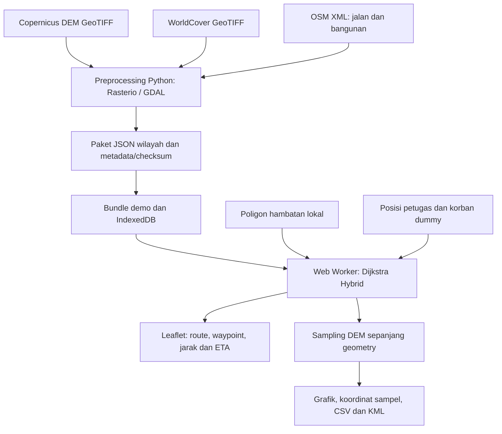
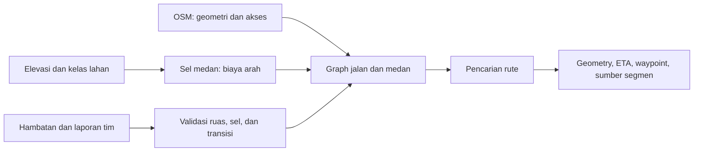
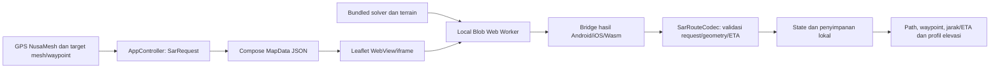

# Referensi Gabungan Navigasi NusaSurvey untuk Dokumen CD

Tanggal kompilasi: 14 Oktober 2026. Tambahan integrasi: 15 Oktober 2026.

Pembaruan 15 Oktober 2026: routing dan navigasi sudah diintegrasikan ke apps/nusamesh. Fencing/polygon tetap ditunda. Bab 16 mencatat integrasi awal NusaMesh dan Bab 17 mencatat dukungan paket wilayah Jawa Barat/Indonesia; pernyataan bahwa NusaMesh belum diubah pada salinan bertanggal 14 Oktober merekam status sebelum integrasi.

Dokumen ini mengumpulkan seluruh bahan navigasi yang telah disusun dalam satu berkas: pekerjaan pengembangan, kebutuhan sistem, arsitektur, teknologi/data, model routing, elevasi, pengujian, teori antisipasi jurang, penelitian terkait SAR/LoRa, serta daftar pustaka. Isi dokumen sumber disalin lengkap dengan tautan yang disesuaikan; dokumen asli tetap tersimpan.

## Status integrasi terbaru 15 Oktober 2026

Navigasi NusaMesh memakai GPS/target aplikasi dan routing lokal beberapa paket. Area operasi bawaan Jawa Barat: Gede?Cibodas, Tangkuban Parahu dan Papandayan, masing-masing 25.600 sel grid 35 m, ditambah Kaliurang. Layanan penyiapan serta unduh/penyimpanan paket offline tersedia untuk area Indonesia lainnya; awal dan tujuan harus tercakup satu paket. Build Android/web, 117 tes Kotlin, routing tiga area Jawa Barat, cache offline dan pemeriksaan Compose browser lulus. Fencing/polygon, stitching antar-paket, detektor jurang dan uji GPS/BLE lapangan belum selesai. Bab 17 menjadi acuan cakupan saat ini.

## Status prototype 14 Oktober 2026 (riwayat)

- Sudah diimplementasikan: routing lokal Hybrid jalan-medan-transisi, geometri OSM asli pada ruas jalan, elevasi/grade dari DEM, hambatan dan rerouting, navigasi simulator, grafik elevasi, ekspor CSV/KML, dan pemulihan/pencarian ulang offline pada paket yang disiapkan.
- Hasil run kode terakhir: 43 uji domain, 10 alur browser, dua uji importer, serta build lulus. Pengujian ini bukan pengujian lapangan tim SAR.
- Masih rancangan: deteksi jurang di sekitar rute, buffer ketidakpastian tebing, CVaR, STRIDE/LiDAR, dan D* Lite. Pembahasan teorinya tidak berarti fitur sudah dibuat.
- GPS, BLE, LoRa, dan ACK masih simulator. Server OSRM foot belum dijalankan. DEMNAS belum menjadi elevasi demo; demo memakai Copernicus dan WorldCover.
- Lingkup pengembangan berada pada geofence-prototype. Aplikasi produksi apps/nusamesh tidak diubah.

Jika dokumen kebutuhan atau catatan audit menyebut pekerjaan yang belum selesai, periksa konteksnya: kebutuhan mencatat target, audit mencatat tahap awal. Bab 1 dan 9 menjadi acuan status aktual. Beberapa penjelasan sengaja berulang karena kompilasi mempertahankan dokumen sumber secara lengkap.

## Pemetaan bahan ke isi CD

| Isi yang hendak disusun | Bab bahan |
|---|---|
| Konteks, tujuan, dan kebutuhan | 1, 10, 11 |
| Sistem yang dibangun dan arsitektur | 1, 5, 6, 7 |
| Teknologi dan sumber data | 2, 12, 14 |
| Landasan teori dan penelitian terkait | 3, 4, 5, 11 |
| Grafik dan pembandingan elevasi | 8 |
| Metode serta hasil pengujian | 1, 9 |
| Petunjuk penggunaan prototype | 13 |
| Referensi bibliografis untuk pengelola pustaka | 3, 15 |

Pemetaan ini membantu penyusunan isi; bukan klaim mengikuti template CD institusi tertentu.

## Daftar isi

- [16. Integrasi navigasi ke NusaMesh (pembaruan terbaru)](#bab-16)
- [1. Ringkasan pengembangan dan status aktual](#bab-1)
- [2. Inventaris teknologi, dataset, dan source](#bab-2)
- [3. Jurnal fondasi dan daftar pustaka](#bab-3)
- [4. Dasar teori antisipasi jurang](#bab-4)
- [5. Kajian routing lintas medan](#bab-5)
- [6. Paket terrain, preprocessing, dan model waktu](#bab-6)
- [7. Implementasi routing Hybrid](#bab-7)
- [8. Grafik elevasi dan pembandingan Google Earth](#bab-8)
- [9. Hasil pengujian dan keterbatasan](#bab-9)
- [10. Spesifikasi kebutuhan lengkap](#bab-10)
- [11. Referensi SAR, geofence, dan LoRa mesh](#bab-11)
- [12. Catatan audit source upstream](#bab-12)
- [13. Panduan menjalankan dan menggunakan prototype](#bab-13)
- [14. Catatan pengambilan source dan provenance](#bab-14)
- [15. Daftar pustaka BibTeX siap salin](#bab-15)


---

<a id="bab-1"></a>

## 1. Ringkasan pengembangan dan status aktual

Sumber salinan: [Dokumentasi_Pengembangan_NusaSurvey.md](Dokumentasi_Pengembangan_NusaSurvey.md).

### Dokumentasi pengembangan NusaSurvey SAR

Tanggal pembaruan: 14 Oktober 2026. Lingkup: sistem dan prototype sebelum integrasi produksi. Titik masuk aplikasi: `apps/geofence-prototype`; aplikasi `apps/nusamesh` tidak diubah.

#### 1. Tujuan, kebutuhan, dan cara membaca

NusaSurvey dirancang untuk memberi petugas panduan menuju koordinat korban melalui jalan/jalur terpetakan maupun medan tanpa jalan, berdasarkan elevasi, tutupan lahan, hambatan, dan kemampuan gerak tim. BLE–LoRa mesh direncanakan membawa koordinat serta laporan ringkas; paket raster dan peta disiapkan sebelum operasi, bukan dikirim sebagai tile melalui LoRa.

Dokumen kebutuhan utama: [Referensi SAR/geofence/mesh](#bab-11), kemudian [Prompt implementasi](#bab-10). Dokumen ini mencatat realisasi, bukan menggantikan spesifikasi.

| Dokumen | Isi |
|---|---|
| [Inventaris sumber dan teknologi](#bab-2) | Perangkat runtime, data, source upstream, provenance, dan status pemakaian |
| [Landasan ilmiah dan daftar pustaka](#bab-3) | Jurnal, buku/prosiding, relevansi, batas bukti, dan pemetaan ke modul |
| [BibTeX](#bab-15) | Metadata referensi terpilih untuk impor ke pengelola pustaka |
| [Kajian lintas medan](#bab-5) | Alasan graph jalan dan medan digabung |
| [Teori antisipasi jurang](#bab-4) | Geomorfometri, buffer, risiko, ketidakpastian, serta kebutuhan validasi |
| [Kontrak terrain](#bab-6) | Importer, paket, dan model waktu medan |
| [Kontrak Hybrid](#bab-7) | Graph ruas–sel–transisi dan constraint |
| [Profil elevasi](#bab-8) | Sampling, grafik, CSV/KML, dan pembandingan Google Earth |
| [Verifikasi](#bab-9) | Pengujian yang dijalankan dan batas hasil |

#### 2. Pekerjaan yang dilakukan

Urutan berikut adalah tahap perubahan dalam sesi pengembangan, bukan daftar commit atau estimasi waktu pengerjaan.

| Tahap | Pekerjaan | Hasil/artifact |
|---|---|---|
| Kebutuhan dan organisasi | Membaca spesifikasi, memisahkan routing dari geofence/transport, merapikan dokumen | Dokumen berada di `systems/nusasurvey`; prototype tetap di `apps/geofence-prototype` |
| Audit upstream | Mengambil dan membaca file terpilih OSRM, GDAL, GRASS, Earth Engine, dan WorldCover | 36 file berhasil diambil menurut manifest, termasuk dokumen/lisensi; bukan clone lengkap atau runtime siap pakai |
| Mesin medan lokal | Validator paket, Dijkstra berarah, model waktu, NoData, air, mask larangan, dan poligon hazard | `src/terrain/engine.js`, worker, fixture dan panel pengujian |
| Data nyata | Menyiapkan crop DEM/land-cover Kaliurang, grid UTM, geometri OSM, provenance dan checksum | Paket demo raster nyata yang dibundel; orang tetap dummy |
| Alur navigasi | Dua dot dahulu; klik korban membuka Arahkan; baru kemudian rute/ETA tampil | `NavigationConsole.jsx`; penyimpanan rute dan pemulihan panel/reload |
| Geometri jalan | Mengganti lintasan grid yang menyerupai jalan dengan pencarian pada edge OSM asli | `routing/mapped.js`; identitas way/node dan arah kaki dipertahankan |
| Perjalanan campuran | Menggabungkan graph jalan, sel medan, dan konektor tervalidasi dalam satu pencarian | `routing/hybrid.js`, menjadi default navigasi |
| Hambatan bangunan | Memasukkan footprint OSM closed ways; mencegah koneksi palsu struktur bertingkat ke tanah | 1.168 footprint; bridge/tunnel memiliki kebijakan transisi khusus |
| Visualisasi | Jalan biru, medan ungu, transisi jingga; panduan per segmen dan pembagian jarak | Route geometry, waypoint, bearing, sisa jarak dan ETA |
| Elevasi untuk evaluasi | Grafik tanpa smoothing, sampel bilinear pada rute, marker sampel, CSV dan KML | `ElevationProfile.jsx`, `elevationProfile.js` |
| Riset keselamatan | Menganalisis celah jalur datar di tepi jurang dan dasar buffer/risiko | Dokumen teori; belum menjadi detektor jurang pada runtime |

#### 3. Status fitur saat ini

| Fitur | Status | Batas praktis |
|---|---|---|
| Routing medan tanpa OSM | Diimplementasikan dan diuji | Graph diskret; tergantung cakupan/kualitas paket |
| Jalan → medan → jalan/korban | Diimplementasikan dan diuji | Transisi diperiksa; bukan bukti medan bisa dilalui manusia |
| OSM exact geometry | Diimplementasikan dan diuji | Berlaku pada segmen berlabel OSM; bukan segmen medan |
| Elevasi/grade otomatis dari paket | Diimplementasikan | Data historis; bukan pengukuran jurang real-time |
| ETA dan profil beban | Diimplementasikan sebagai model asumsi | Belum kalibrasi gerak manusia SAR Indonesia |
| Bangunan, air, NoData, hazard | Diimplementasikan | Closed building ways; cakupan layer tidak lengkap |
| Laporan hambatan dan rerouting | Diimplementasikan untuk simulasi | Tombol depan rute membuat kotak simulasi; pencarian ulang harus diminta |
| Grafik elevasi/CSV/KML | Diimplementasikan dan diuji | Google Earth pembanding dataset, bukan ground truth lapangan |
| Reload/pencarian ulang offline | Diuji setelah persiapan | Basemap hanya tile yang sudah tercache |
| Geofence inti | Ada dan diuji | Fungsi sektor/assignment dan evaluasi coverage belum seluruhnya final |
| GPS/BLE/LoRa/ACK nyata | Belum diintegrasikan | Koordinat/gerakan/transport masih simulator |
| Deteksi tebing sekitar rute | Rancangan | Pemeriksaan grade sepanjang edge belum cukup untuk bahaya samping |
| Buffer ketidakpastian tebing | Rancangan | Belum ada parameter yang dikalibrasi atau hard buffer runtime |
| STRIDE, CVaR, D* Lite, AI kamera | Referensi/tahap lanjutan | Belum menjadi algoritma yang digunakan prototype |
| Self-host OSRM foot | Provider opsional tersedia | Server/PBF foot belum dijalankan; pengujian provider memakai mock |
| Integrasi NusaMesh produksi | Belum dilakukan | Dilakukan setelah pembuktian mesin dan perangkat |

#### 4. Arsitektur aktual



Renderer peta tidak menghitung keterlintasan. DEM memasok elevasi, WorldCover memasok kategori medan, OSM memasok geometri jaringan dan sebagian hambatan. Dijkstra memilih lintasan dari graph dan bobot yang dibentuk aplikasi. Format output mirip kebutuhan layanan OSRM, tetapi solver Hybrid adalah implementasi lokal, bukan OSRM yang di-port atau dibungkus sebagai mesin semua medan.

Data paket menyimpan CRS horizontal, datum vertikal, versi, sumber, waktu pengamatan/unduh, dan checksum. Elevasi direproyeksi bilinear, kategori nearest-neighbor. Importer menolak upsampling, mempertahankan NoData, serta membatasi AOI/grid untuk prototype.

Hybrid memecah edge OSM pada proyeksi transisi tanpa menggeser jalan ke pusat sel. Pemeriksaan supercover menguji sel di sepanjang edge, termasuk sudut/batas; poligon diuji terhadap segmen geometris. Bridge/tunnel tidak boleh menjadi sambungan ke tanah hanya karena berimpit dalam XY.

#### 5. Model dan parameter yang benar-benar digunakan

Untuk jarak horizontal d dan beda tinggi dz, baseline waktu mengikuti bentuk Langmuir yang didokumentasikan `r.walk`:

```text
grade = dz / d
T_walk = 0.72·d + b·dz
b = 6 untuk naik
b = 1.9998 untuk turun moderat
b = -1.9998 untuk turun lebih curam dari grade -0.2125
T_terrain = (T_walk + d·mean(friction_awal, friction_akhir)) / speedFactor
```

Profil nominal memakai speedFactor 1 dan batas grade 35°; profil peralatan 0,7 dan batas 25°. Semua batas tersebut merupakan konfigurasi prototype, bukan standar aman SAR. Friction tambahan dalam detik/meter: hutan 0,65; semak 0,9; rumput 0,1; pertanian/terbangun 0,2; terbuka 0; salju 1,2; lahan basah 1,5; mangrove 1,8; lumut 0,3. Air ditolak untuk medan/transisi. Koefisien friction tidak berasal dari pengukuran lokal maupun angka baku WorldCover.

Pada ruas OSM, faktor kecepatan kelas/surface ruas diterapkan ke waktu berbasis grade. Hybrid menggunakan penalti medan default 3 detik/meter untuk pemilihan rute; penalti itu tidak dimasukkan ke ETA. Biaya Dijkstra harus nonnegatif. Optimalitas hasil terbatas pada graph dan bobot yang dinyatakan, bukan semua lintasan kontinu atau tingkat keselamatan.

Model lama graph jalur masih ada sebagai pembanding/fitur legacy. Label dan kemampuan tiap provider harus dibaca terpisah dari default Hybrid.

#### 6. Dataset demo dan reproduksi

AOI Kaliurang WGS84 `[west, south, east, north] = [110.425, -7.601, 110.452, -7.569]`. Grid UTM EPSG:32749 berukuran 102×86, resolusi 35 m, berisi 8.772 sel valid. Datum elevasi EGM2008. Elevasi grid sekitar 816–1.414 m. Sumber: Copernicus GLO-30 release 2021, WorldCover 2021 v200, snapshot OSM 14 Oktober 2026. Jalan tersaring berjumlah 209 ways dan 2.824 node graph.

Paket: [kaliurang-terrain.json](../../../apps/geofence-prototype/public/demo/kaliurang-terrain.json). Metadata/hash: [sources.json](../../../apps/geofence-prototype/public/demo/sources.json). DatasetVersion: `copdem2021-worldcover2021-osm-obstacles-v2`. Raw crop berada di direktori `data/` prototype yang diabaikan Git; runtime menggunakan paket bundled, bukan berkas parsial unduhan upstream.

Default demo memilih petugas di jaringan OSM dan korban di luar jaringan. Hasil setelah Arahkan sekitar 2.487 m, terdiri dari 2.207 m ruas OSM, 120 m medan, dan 160 m transisi; ETA model sekitar 87 menit. Angka ini contoh hasil, bukan waktu perjalanan sebenarnya atau konstanta untuk semua query.

Jalankan dari `apps/geofence-prototype`:

```powershell
npm install
npm run dev -- --host 127.0.0.1
```

Alamat dev lazimnya `http://127.0.0.1:5173/`; port dapat berubah jika sudah dipakai. Untuk pengujian versi build:

```powershell
npm test
npm run build
npx playwright install chromium
npm run test:browser
.venv/Scripts/python.exe tools/test_prepare_terrain.py
```

Setup Python/import ulang memerlukan requirements dan berkas input berizin; lihat [README prototype](#bab-13) serta kontrak terrain. Tidak perlu import ulang raster untuk menjalankan demo bundled.

#### 7. Pengujian dan makna hasil

Run kode terakhir mencatat 43 uji domain/solver/export lulus, 10 alur browser lulus, dua uji importer lulus, serta build berhasil. Pengujian meliputi exact OSM geometry, off-road endpoint, hambatan sungai/jembatan, sudut sel, poligon subsel, NoData, profil/arah, versi hazard, sisa ETA, penyimpanan/offline, dan grafik/ekspor elevasi. Dokumentasi ini memakai hasil run tersebut, bukan klaim bahwa pengujian lapangan telah dijalankan.

Profil grafik diperiksa terhadap bidang elevasi analitik; KML diperiksa XML-nya dan urutan longitude/latitude. Path memakai clampToGround agar Google Earth memasok elevasi pembanding sendiri. Sampling maksimal 17,5 m pada grid 35 m adalah interpolasi, bukan tambahan resolusi sumber. [Preview desktop](../../../apps/geofence-prototype/docs/previews/hybrid-navigation.png) dan [preview elevasi mobile](../../../apps/geofence-prototype/docs/previews/elevation-mobile.png).

#### 8. Tahap berikutnya dan rancangan evaluasi

1. Evaluasi DEMNAS atau DTM lebih detail untuk AOI, dengan metadata/datum/resolusi yang diperiksa.
2. Bangun slope/penurunan lokal di sekitar rute dan layer tebing terpetakan; pertahankan status dugaan bila belum diverifikasi.
3. Tambahkan buffer yang mencatat kebijakan dan ketidakpastian, kemudian masukkan sebagai hard constraint.
4. Sediakan penandaan bahaya sebenarnya berupa titik/garis/poligon; hubungkan ke rerouting dan peringatan kedekatan.
5. Validasi terhadap ground truth tebing: false negative, false positive, clearance, perubahan rute, dan biaya komputasi. Kalibrasi ETA melalui rekaman gerak manusia dilakukan terpisah.
6. Uji GPS/perangkat Android dan paket basemap penuh, baru integrasi BLE–LoRa serta NusaMesh.

Literatur mendukung komponen-komponen rancangan; integrasi serta parameter lokal menjadi kontribusi yang harus diuji. Tidak mengklaim kebaruan universal atau bahwa kombinasi ini belum pernah diteliti. Perbandingan Google Earth membantu memeriksa data, tetapi tidak menggantikan verifikasi lapangan.


---

<a id="bab-2"></a>

## 2. Inventaris teknologi, dataset, dan source

Sumber salinan: [Sumber_dan_Teknologi.md](Sumber_dan_Teknologi.md).

### Inventaris sumber, teknologi, dan peran pada NusaSurvey

Pembaruan: 14 Oktober 2026. Inventaris ini membedakan dependency runtime, data yang benar-benar digunakan, source yang dibaca, serta teknologi yang baru menjadi opsi. Detail kebutuhan ada pada [spesifikasi](#bab-10); realisasi ada pada [dokumentasi pengembangan](#bab-1).

#### 1. Teknologi aplikasi dan pipeline yang digunakan

| Komponen | Penggunaan aktual | Source/dokumentasi resmi dan bukti lokal |
|---|---|---|
| React 18 | UI navigasi, state dan panel evaluasi | [React](https://react.dev/); `apps/geofence-prototype/package.json` dan lockfile |
| Vite 5 | Dev server, build aplikasi/worker | [Vite](https://vite.dev/); package/lockfile dan build |
| Leaflet 1.9 | Peta, polyline, marker, popup dan layer | [Leaflet reference](https://leafletjs.com/reference.html); `src/main.jsx` |
| Leaflet Draw 1.0 | Alat gambar poligon pada panel operasi | [Repository](https://github.com/Leaflet/Leaflet.draw); fitur legacy tetap dipertahankan |
| JavaScript / Web Worker | Solver lokal dan pemrosesan routing di luar UI thread | [Web Workers](https://developer.mozilla.org/en-US/docs/Web/API/Web_Workers_API); `src/terrain/worker.js` |
| Python 3.13 / NumPy 2.2.6 | Pipeline persiapan raster/array grid | [NumPy](https://numpy.org/doc/); `tools/requirements.txt` |
| Rasterio 1.4.4 / GDAL | Membaca GeoTIFF, crop, reprojection/resampling, rasterize | [Rasterio reprojection](https://rasterio.readthedocs.io/en/stable/topics/reproject.html), [resampling](https://rasterio.readthedocs.io/en/stable/topics/resampling.html); `tools/prepare_terrain.py` dan `prepare_demo.py` |
| IndexedDB / localStorage | Paket wilayah, state operasi dan route plan | `src/terrain/storage.js`, state aplikasi; uji reload |
| Service Worker / Cache API | Precache aplikasi, worker dan demo; tile yang pernah dimuat | `public/` serta konfigurasi build; uji offline browser |
| Node test runner / Playwright Chromium | Pengujian domain dan UI/export/offline | [Node test runner](https://nodejs.org/api/test.html), [Playwright](https://playwright.dev/); `tests/` |
| SVG React | Grafik elevasi interaktif tanpa smoothing | `ElevationProfile.jsx`; bukan grafik random atau image raster |
| CSV / KML | Ekspor data sampel dan geometry pembanding | [KML altitude modes](https://developers.google.com/kml/documentation/altitudemode); `elevationProfile.js` |

Versi npm aktual mengikuti lockfile; rentang di package.json bukan identitas source upstream GIS. Binary GDAL digunakan melalui Rasterio; source GDAL yang disimpan untuk audit bukan hasil build yang dijalankan prototype.

#### 2. Data yang dipakai dalam demo

| Dataset | Peran | Versi, sifat, dan batas |
|---|---|---|
| [Copernicus DEM](https://dataspace.copernicus.eu/explore-data/data-collections/copernicus-contributing-missions/collections-description/COP-DEM) GLO-30 | Elevasi, grade, ETA dan profil | Demo memakai release 2021; DSM global sekitar 30 m, dapat mencakup vegetasi/bangunan; bukan DTM langkah manusia |
| [ESA WorldCover](https://esa-worldcover.org/en/data-access) | Kategori land-cover untuk friction asumsi | 2021 v200, 10 m, 11 kelas; tidak memberikan kecepatan SAR atau kepadatan semak bawah tajuk |
| [OpenStreetMap](https://www.openstreetmap.org/copyright) | Ruas/node jalan asli, akses kaki, bridge/tunnel, closed building ways | Snapshot Kaliurang 14 Oktober 2026; 209 ways jalan dan 1.168 bangunan; multipolygon dan fitur yang belum dipetakan belum lengkap |
| Poligon laporan lokal | Menolak segmen terdampak hambatan | Dibuat simulator; sumber dan verifikasi laporan dicatat, bukan observasi sensor nyata |
| Fixture sintetis | Pengujian hill/forest/river/crossing deterministik | `synthetic=true`; hanya panel pengujian, bukan terrain demo utama |
| Koordinat orang dummy | Menguji route input, pemilihan korban dan gerakan | Dataset terrain tetap nyata; posisi bukan korban/petugas nyata |

Sumber raw untuk crop demo:

- [Copernicus tile S08 E110](https://copernicus-dem-30m.s3.amazonaws.com/Copernicus_DSM_COG_10_S08_00_E110_00_DEM/Copernicus_DSM_COG_10_S08_00_E110_00_DEM.tif).
- [WorldCover tile S09 E108](https://esa-worldcover.s3.eu-central-1.amazonaws.com/v200/2021/map/ESA_WorldCover_10m_2021_v200_S09E108_Map.tif).
- [OSM Map API AOI demo](https://api.openstreetmap.org/api/0.6/map?bbox=110.425,-7.601,110.452,-7.569). Memanggil URL sekarang tidak menjamin snapshot identik; pakai berkas/hash yang dicatat untuk reproduksi.

Provenance raw crop dan hash paket berada di [sources.json](../../../apps/geofence-prototype/public/demo/sources.json). WorldCover dicatat CC BY 4.0; OSM ODbL dan atribusi contributor; Copernicus memakai lisensi produk publik yang ditautkan pada metadata. Atribusi sumber harus mengikuti ketentuan dataset. Tidak menyebut seluruh dataset sebagai source code aplikasi.

#### 3. Source upstream yang diimpor dan dibaca

Lokasi: `systems/nusasurvey/research/source/`. Tiap direktori memuat manifest commit/URL/checksum dan lisensi upstream. Jumlah file mencakup source, dokumentasi, dan lisensi yang berhasil diambil.

| Upstream | Commit yang diaudit | File berhasil | Pengaruh pada rancangan | Status runtime |
|---|---|---:|---|---|
| [OSRM](https://github.com/Project-OSRM/osrm-backend) | `f2147ead8d9c6a2c724120113d9c56ab85963262` | 10 | Profil foot/access/surface, snapping, route/error API, meshing area eksperimental | Provider tambahan tersedia; server belum dijalankan |
| [GDAL](https://github.com/OSGeo/gdal) | `13310f750da0a09bbc944067b7d7fa8b8b27b110` | 8 | Warp, resampling, DEM/slope, rasterize | Dipakai melalui Rasterio, bukan build commit ini |
| [GRASS](https://github.com/OSGeo/grass) | `ba898e78d725dce81c6218dac1ceffee7f93e29f` | 7 | r.walk/r.path, heap/relaxation, model biaya arah dan NoData | Solver JS lokal; binary GRASS belum dibandingkan |
| [Earth Engine API](https://github.com/google/earthengine-api) | `9ec29fe12a009862f25c6613a5fc8648b89aacaf` | 6 | Client image/export task dan metadata | Opsional preprocessing; tidak dijalankan |
| [WorldCover tutorial](https://github.com/ESA-WorldCover/esa-worldcover-datasets) | `82bdd1d342685de9ff1782dff96ad875844a142f` | 5 | Downloader/STAC/class labels | Pipeline lokal memakai raster resmi; repo bukan solver SAR |

Pengambilan file terpilih dilakukan karena clone/ZIP penuh terputus. `research/incomplete-downloads/` menyimpan hasil tidak lengkap dan tidak menjadi dependency build. Kegiatan ini merupakan pembacaan/analisis source, bukan klaim seluruh upstream sudah diinstal atau seluruh kode sudah di-port. [Analisis detail](#bab-12).

#### 4. Sumber yang dipelajari tetapi belum dipakai runtime

- [DEMNAS BIG](https://www.big.go.id/en/content/product/demnas): opsi data Indonesia, 0,27 arc-second, EGM2008. Raster DEMNAS belum diimpor ke demo; grid yang ada tetap Copernicus.
- [GRASS r.slope.aspect](https://grass.osgeo.org/grass-stable/manuals/r.slope.aspect.html): acuan analisis permukaan untuk dugaan tebing; layer sekitar rute belum dibuat.
- STRIDE/LiDAR, STEP/CVaR, D* Lite, dan model berbasis kamera: landasan/tahap lanjutan, bukan dependency saat ini. [Pemetaan pustaka](#bab-3).
- Google Earth: alat pembandingan manual melalui KML/CSV, bukan sumber elevasi runtime atau API yang diam-diam dipanggil.
- CalTopo/SARTopo, ATAK, QField, Meshtastic–TAK, SARCOP dan produk lain pada referensi awal: pembanding alur kerja SAR/GIS/mesh, bukan sistem yang seluruh source-nya diimpor atau fitur yang otomatis tersedia di prototype.
- MapLibre/Turf/Meshtastic protobuf: kandidat/adaptor pembanding pada spesifikasi; UI prototype memakai Leaflet dan fungsi geometri lokal. Firmware NusaNode tidak otomatis kompatibel dengan protokol pihak lain.

#### 5. Pemisahan sumber dan kontribusi implementasi

Dataset memberikan pengamatan/kategori; library menyediakan renderer dan pemrosesan GIS; literatur memberikan model/algoritma serta bukti eksperimen. Implementasi NusaSurvey menggabungkannya melalui paket lokal, graph Hybrid, validasi transisi, state navigasi, pengelolaan versi hambatan, dan ekspor evaluasi. Nilai friction, speedFactor, batas grade, dan penalti preferensi adalah asumsi prototype yang dicatat, bukan angka yang diklaim berasal dari jurnal/dataset.


---

<a id="bab-3"></a>

## 3. Jurnal fondasi dan daftar pustaka

Sumber salinan: [Landasan_Ilmiah.md](references/Landasan_Ilmiah.md).

### Landasan ilmiah dan daftar pustaka terpilih

Penelusuran/pembaruan: 14 Oktober 2026. Prioritas jurnal 2023–2026; buku dan algoritma klasik tetap digunakan untuk teori dasar. Ringkasan menyatakan relevansi dan batas penerapan. Metadata terpilih tersedia pada [nusasurvey.bib](#bab-15). Dokumen teknis/dataset bukan jurnal dan tidak boleh diperlakukan sebagai bukti eksperimen manusia.

#### 1. Jurnal fondasi utama

##### J1 — STRIDE: model perjalanan manusia, 2024

Campbell, M. J., Cutler, S. L., & Dennison, P. E. (2024). *A singular, broadly-applicable model for estimating on- and off-path walking travel rates using airborne lidar data*. Scientific Reports, 14, 21393. DOI: **10.1038/s41598-024-71359-6**. [Artikel](https://www.nature.com/articles/s41598-024-71359-6).

**Landasan:** kecepatan berjalan dipengaruhi slope, kepadatan vegetasi, dan kekasaran permukaan. **Pemetaan:** pengembangan model waktu medan/ETA manusia. **Batas:** memerlukan masukan LiDAR; kelas WorldCover tidak setara dengan kepadatan vegetasi atau roughness meteran. Tidak membuktikan rute bebas jurang. **Status NusaSurvey:** dipelajari sebagai arah model; STRIDE belum diimplementasikan. Artikel lengkap berhasil dibaca pada penelusuran sebelumnya; sebagian akses ulang mengalami redirect/error.

##### J2 — STEP: risiko medan dan ketidakpastian, jurnal 2024

Dixit, A., Fan, D. D., Otsu, K., Dey, S., Agha-Mohammadi, A.-A., & Burdick, J. W. (2024). *STEP: Stochastic Traversability Evaluation and Planning for Risk-Aware Off-road Navigation; Results from the DARPA Subterranean Challenge*. Field Robotics, 4, 182–210. DOI: **10.55417/fr.2024006**. [Metadata penulis](https://arxiv.org/abs/2303.01614), [naskah lengkap](https://arxiv.org/html/2303.01614v1).

**Landasan:** traversability, risiko geometris, negative obstacles, ketidakpastian pengamatan/posisi, dan CVaR. **Pemetaan:** layer bahaya serta perencanaan konservatif. **Batas:** sistem robot memakai sensor/perception dan dinamika yang berbeda dari manusia; celah pengamatan tidak langsung dianggap sebagai jurang tanpa pemeriksaan coverage. **Status:** landasan rancangan, belum ada CVaR/sensor negative-obstacle pada prototype. Versi arXiv mula-mula 2023; tahun sitasi jurnal yang terverifikasi adalah 2024.

##### J3 — Gerak petugas SAR empiris, 2026

Hashimoto, A., Aung, E., Koester, R., & Abaid, N. (2026). *Speed, slope, and synchrony: Empirical insights into SAR searcher behavior*. PLOS One, 21(6), e0339541. Terbit 15 Juni 2026. DOI: **10.1371/journal.pone.0339541**. [Artikel lengkap](https://journals.plos.org/plosone/article?id=10.1371/journal.pone.0339541).

**Landasan:** analisis GPS petugas pada 61 tracks dari 13 kasus yang diseleksi dari 64 insiden; jenis pencarian dan koordinasi memengaruhi model gerak. **Pemetaan:** kalibrasi profil tim, ETA, dan evaluasi penyisiran. **Batas:** kecepatan dalam studi bukan konstanta SAR Indonesia. Studi tidak menemukan perbedaan statistik median uphill/downhill pada dataset tersebut; ini alasan membandingkan asumsi model dengan data, bukan menganggap formula arah prototype sudah benar universal. **Status:** kandidat utama validasi manusia; koefisien studi belum dimasukkan ke runtime.

#### 2. Jurnal pendukung komunikasi dan tracking

##### J4 — Tracking SAR Indonesia melalui LoRa, 2024

Andrianto, A. Ari (2024). *Implementation of Internet of Things (IoT) in Tracking the Position of Search and Rescue Teams in Sukoharjo District Using LoRa*. SMATIKA Jurnal, 14(1), 86–95. DOI halaman penerbit: **10.32664/smatika.v14i01.1222**. [Artikel](https://jurnal.ubhinus.ac.id/SMATIKA/article/view/1222).

**Landasan:** prototyping posisi tim SAR melalui IoT/LoRa. **Pemetaan:** pertukaran lokasi dan tampilan posko. **Batas:** arsitektur pada catatan studi memakai gateway/server; tidak menjadi bukti routing medan, mesh multihop offline, maupun deteksi jurang. **Status:** referensi kebutuhan transport; bukan protokol yang sudah di-port ke NusaNode. Catatan awal menemukan perbedaan DOI kepala PDF dan halaman artikel; BibTeX mengikuti halaman penerbit.

##### J5 — Propagasi LoRa manusia–UAV di hutan, 2023

Bianco, G. M., & Marrocco, G. (2023). *Body-UAV Near-Ground LoRa Links through a Mediterranean Forest*. IEEE Transactions on Antennas and Propagation. DOI: **10.1109/TAP.2023.3260580**. [Metadata dan naskah penulis](https://arxiv.org/abs/2303.12754).

**Landasan:** pengaruh tubuh, gerakan, dan vegetasi pada link LoRa; pengukuran PDR/path loss. **Pemetaan:** rencana pengujian radio dan penempatan node. **Batas:** eksperimen 868 MHz dan body–UAV bukan mesh darat NusaNode 923 MHz. Tidak menyalin angka jangkauan sebagai kemampuan perangkat sendiri. **Status:** referensi pengujian komunikasi, belum eksperimen hardware NusaSurvey.

##### J6 — Dataset SAR LoRa avalanche, 2024

Girolami, M., dkk. (2024). *An Experimental Dataset for Search and Rescue Operations in Avalanche Scenarios Based on LoRa Technology*. IEEE Access, 12, 171015–171035. DOI yang dicatat pada kajian awal: **10.1109/ACCESS.2024.3497654**. [Dataset penulis v2](https://zenodo.org/records/13932869).

**Landasan:** disiplin eksperimen RSSI/SNR, posisi referensi, kondisi media, dan pencatatan data SAR. **Pemetaan:** template pencatatan ground truth radio. **Batas:** lingkungan salju berbeda dari Indonesia; uraian eksperimen bersumber dokumentasi dataset, PDF jurnal penuh belum berhasil diperiksa. Daftar penulis lengkap/metadata final perlu dilengkapi dari penerbit sebelum sitasi formal; tidak dimasukkan ke BibTeX terpilih.

#### 3. Buku, prosiding algoritma, dan preprint

| ID | Sumber | Peran dan batas | Status |
|---|---|---|---|
| T1 | LaValle, S. M. (2006), *Planning Algorithms*, Cambridge University Press; [Bab 4.3.2](https://msl.cs.uiuc.edu/planning/node161.html) | Configuration space dan Minkowski sum untuk perluasan hambatan. Buku teori, bukan jurnal eksperimen jurang manusia. Margin lokal perlu ditentukan sendiri. | Landasan buffer; buffer tebing belum dibuat |
| T2 | Koenig, S., & Likhachev, M. (2002), *D* Lite*, AAAI, 476–483; [halaman institusi](https://publications.ri.cmu.edu/d-lite) | Pencarian ulang inkremental saat graph berubah; tidak menentukan apakah data medan aman. | Rencana optimasi; sekarang Dijkstra penuh |
| T3 | Tremblay, J.-F., Alhosh, J., Petit, L., Lotfi, F., Landauro, L., & Meger, D. (2024), *Topological mapping for traversability-aware long-range navigation in off-road terrain*; [arXiv:2410.01925](https://arxiv.org/abs/2410.01925) | Node topologi dengan informasi keterlintasan; acuan hierarki lokal/global pada robot. Status yang diperiksa preprint, bukan jurnal SAR. | Acuan arsitektur; model vision belum dipakai |

Kandidat prosiding geofence LoRa 2026, LoRa–UAV meta-RL, rescue boat, dan publikasi tambahan lain tetap dicatat pada [referensi SAR awal](#bab-11). Status abstrak/full text serta batas bukti tidak ditingkatkan hanya karena judul relevan.

Model Transformer ETA pegunungan 2025 juga dicatat pada [kajian lintas medan](#bab-5). Studi menggunakan kendaraan, sehingga bukan pilihan baseline kecepatan jalan kaki SAR.

#### 4. Sumber teknis yang mendukung implementasi, bukan jurnal

| Sumber | Konsep yang dipakai | Hubungan dengan kode |
|---|---|---|
| [GRASS r.walk](https://grass.osgeo.org/grass-stable/manuals/r.walk.html) | Biaya waktu berarah Aitken/Langmuir, friction, Dijkstra dan NoData | Implementasi lokal pada `engine.js`; koefisien lahan/profil tambahan masih asumsi |
| [GRASS r.slope.aspect](https://grass.osgeo.org/grass-stable/manuals/r.slope.aspect.html) | Gradient, slope permukaan, aspect, curvature; pendekatan Horn | Landasan analisis bahaya sekitar rute, belum layer runtime |
| [OSRM source/API](https://github.com/Project-OSRM/osrm-backend) | Profil foot, snapping, kontrak route dan status gagal | Referensi provider/graph terpetakan, bukan solver DEM universal |
| [Rasterio](https://rasterio.readthedocs.io/en/stable/topics/reproject.html) / [GDAL](https://gdal.org/) | Reprojection, alignment, resampling/rasterize | Pipeline persiapan wilayah |
| [Copernicus DEM](https://dataspace.copernicus.eu/explore-data/data-collections/copernicus-contributing-missions/collections-description/COP-DEM), [WorldCover](https://esa-worldcover.org/en/data-access), [DEMNAS](https://www.big.go.id/en/content/product/demnas) | Spesifikasi produk data, resolusi/datum/kategori | Dua pertama dipakai demo; DEMNAS opsi lanjutan |
| [KML altitude modes](https://developers.google.com/kml/documentation/altitudemode), [Google Earth profile](https://support.google.com/earth/answer/148134?hl=en) | Format pembandingan geometri/elevasi | Ekspor clampToGround dan evaluasi manual |

#### 5. Cara memakai untuk laporan TA

- **Landasan teori:** graph/least-cost path, waktu manusia, geomorfometri, geofence, buffer, dan ketidakpastian. Gunakan J1–J3 untuk gerak/risiko, T1–T2 untuk teori geometri/algoritma, serta dokumentasi teknis untuk implementasi.
- **Penelitian terkait:** pisahkan routing manusia, traversability robot, tracking LoRa, dan geofence. Jangan menyebut hasil salah satu kategori sebagai pembuktian kategori lainnya.
- **Metode:** nyatakan sumber/versi data, profil, friction, batas grade, penalti, dan constraint; diagram arsitektur ada di dokumentasi pengembangan.
- **Pengujian:** pisahkan pengujian software, akurasi data elevasi, kalibrasi ETA, deteksi tebing, dan komunikasi hardware. Run simulator bukan uji operasi SAR.
- **Kontribusi yang dapat diuji:** integrasi graph jalan–medan–transisi, constraint versi hambatan, navigasi offline wilayah terbatas, dan ekspor evaluasi. Antisipasi jurang merupakan perluasan yang masih harus dibuat/dibuktikan. Belum mengklaim konsep pertama di dunia atau probabilitas keselamatan tertentu.


---

<a id="bab-4"></a>

## 4. Dasar teori antisipasi jurang

Sumber salinan: [Dasar_Teori_Antisipasi_Jurang.md](architecture/Dasar_Teori_Antisipasi_Jurang.md).

### Dasar teori antisipasi jurang pada routing NusaSurvey

Tanggal penelusuran: 14 Oktober 2026. Status: landasan dan usulan desain; deteksi tebing sekitar rute serta buffer ketidakpastian belum diimplementasikan. Prototype sudah mempunyai biaya arah perjalanan, batas grade, hambatan poligon, dan pencarian ulang graph Hybrid.

#### Ruang lingkup klaim

Kombinasi analisis bentuk medan, perluasan area hambatan, dan pencarian lintasan memiliki dasar yang dapat dirujuk. Tidak ada sumber di bawah yang membuktikan prototype NusaSurvey aman untuk semua jurang. Penentuan ambang penurunan, ukuran lingkungan, dan lebar buffer merupakan adaptasi yang memerlukan data dan pengujian lokal.

#### 1. Geomorfometri: arah perjalanan berbeda dari kemiringan permukaan

Untuk permukaan elevasi z(x,y) dalam koordinat metrik, kemiringan permukaan dapat dinyatakan:

```text
slope_surface = atan(sqrt((dz/dx)^2 + (dz/dy)^2))
grade_travel  = (z_tujuan - z_awal) / jarak_horizontal
```

Grade perjalanan dapat mendekati nol ketika seseorang mengikuti kontur, walaupun permukaan di sampingnya sangat curam. Maka pemeriksaan grade setiap edge tidak menggantikan pemeriksaan lereng/penurunan di sekitar edge.

[GRASS r.slope.aspect](https://grass.osgeo.org/grass-stable/manuals/r.slope.aspect.html) menghitung slope, aspect, curvature, dan turunan elevasi. Dokumentasinya menyebut lingkungan 3×3 dan formula Horn untuk turunan pertama. Ini referensi metode/implementasi GIS, bukan jurnal validasi deteksi jurang manusia. Curvature atau slope tinggi sendiri tidak membuktikan keberadaan jurang.

Adaptasi yang diusulkan: ukur penurunan ke beberapa arah dan skala jarak, kemudian gabungkan dengan slope, fitur tebing terpetakan, dan laporan lapangan untuk membentuk layer dugaan bahaya. Skala harus sesuai resolusi efektif data. Klasifikasi berbasis ambang perlu divalidasi terhadap tebing nyata dan lokasi bukan tebing, termasuk artefak DSM dari pohon/bangunan.

#### 2. Configuration space: obstacle inflation dan buffer

LaValle, *Planning Algorithms*, Bab 4.3, memformalkan ruang konfigurasi yang bebas hambatan melalui geometri tubuh dan obstacle. Pada kasus translasi, konstruksi menggunakan Minkowski sum dengan refleksi bentuk tubuh. [Bab 4.3.2 buku penulis](https://msl.cs.uiuc.edu/planning/node161.html).

Untuk wilayah bahaya H dan cakram margin B(r), bentuk buffer sederhana:

```text
H_buffer = H ⊕ B(r)
lintasan harus tidak memotong H_buffer
```

Ini memberi dasar geometris untuk menjaga clearance. Untuk NusaSurvey, r bukan angka aman universal. Ia adalah parameter kebijakan dan ketidakpastian: ukuran/gerak tim, batas area bahaya, kualitas peta, serta posisi pengguna. Jika ketidakpastian diperlakukan sebagai himpunan berbatas, himpunan tersebut dapat dimasukkan ke konstruksi perluasan. Jika memakai distribusi probabilitas, perlu tingkat cakupan dan kalibrasi; nilai accuracy dari GPS tidak otomatis merupakan batas kesalahan pasti.

Model buffer lingkaran simetris adalah penyederhanaan konservatif. Ia dapat menutup akses yang sebenarnya bisa dilewati; akses sempit atau struktur bertingkat memerlukan pemeriksaan tambahan. Tidak boleh membuka pengecualian hanya karena suatu garis diberi tag jalan pada OSM.

#### 3. Traversability dan risk-aware planning

Dixit, Fan, Otsu, Dey, Agha-Mohammadi, dan Burdick. *STEP: Stochastic Traversability Evaluation and Planning for Risk-Aware Off-road Navigation; Results from the DARPA Subterranean Challenge*. Field Robotics 4 (2024), 182–210, DOI 10.55417/fr.2024006. Metadata jurnal terverifikasi di [halaman penulis arXiv](https://arxiv.org/abs/2303.01614); [naskah lengkap](https://arxiv.org/html/2303.01614v1).

STEP memodelkan risiko geometris dan ketidakpastian, termasuk slope, step, slippage, dan negative obstacles. Deteksi negative obstacles memakai celah pengamatan LiDAR beserta pemeriksaan cakupan/occlusion, bukan sekadar menganggap seluruh data kosong sebagai jurang. Framework menggunakan CVaR untuk mempertimbangkan ekor kerugian. Pengujian dilakukan pada robot roda dan berkaki di lingkungan subterranean; koefisiennya tidak dapat langsung dipakai untuk manusia SAR.

Adaptasi awal NusaSurvey sebaiknya berupa constraint dan clearance yang dapat diaudit. CVaR menjadi tahap berikutnya jika distribusi kesalahan/kerugian dapat diestimasi. Skor kategori atau confidence rekaan tidak cukup untuk mengklaim implementasi CVaR maupun probabilitas keselamatan.

#### 4. Biaya perjalanan manusia dan least-cost path

Campbell, Cutler, dan Dennison. *A singular, broadly-applicable model for estimating on- and off-path walking travel rates using airborne lidar data*. Scientific Reports 14, 21393 (2024), DOI 10.1038/s41598-024-71359-6. [Artikel](https://www.nature.com/articles/s41598-024-71359-6).

STRIDE memakai slope, kepadatan vegetasi, dan kekasaran permukaan untuk memodelkan kecepatan jalan kaki di jalur maupun luar jalur. Relevansinya adalah biaya perjalanan manusia; ini bukan classifier jurang atau bukti buffer tertentu aman. Masukan LiDAR dan kalibrasi lokal tidak dapat digantikan begitu saja oleh kelas tutupan lahan.

Sebagai baseline implementasi, [GRASS r.walk](https://grass.osgeo.org/grass-stable/manuals/r.walk.html) menggabungkan waktu arah naik/turun dengan friction, lalu menghitung minimum biaya melalui Dijkstra. Prototype memiliki implementasi lokal model waktu serupa; binary GRASS belum dijalankan sebagai pembanding numerik.

#### 5. Formulasi awal untuk NusaSurvey

Formulasi berikut merupakan sintesis desain, bukan rumus keselamatan baku dari satu paper:

```text
c(e) = ∞                               jika e memotong bahaya/buffer terlarang
c(e) = t(e) + λr·R(e) + λu·U(e)         untuk edge yang masih diizinkan
P*   = argmin_P Σ c(e)
ETA  = Σ t(e), bukan Σ c(e)
```

R(e) adalah paparan risiko yang definisinya harus dinyatakan; U(e) adalah penalti ketidakpastian. Bobot mengonversi komponen ke unit biaya yang konsisten, wajib nonnegatif untuk baseline Dijkstra. Bahaya yang ditetapkan terlarang tidak boleh dilintasi hanya karena alternatifnya lebih jauh. Jika tidak ada lintasan dalam graph yang memenuhi constraint, keluarkan noTraversablePath.

#### 6. Bukti yang harus dikumpulkan

- Fixture jalur datar di samping penurunan curam: baseline grade dapat lolos, layer bahaya dan buffer harus menghindarkan lintasan.
- Uji offset posisi serta lokasi tepi bahaya dan variasi resolusi DEM.
- Uji gap kecil, NoData, artefak vegetasi/bangunan, jalur sempit, dan jembatan agar penolakan tidak hanya mengandalkan bentuk raster.
- Ground truth tebing melalui survei/laporan terverifikasi: ukur tebing terlewat (false negative), false positive, dan clearance terhadap bahaya yang dipetakan. Clearance peta tidak otomatis sama dengan clearance lapangan.
- Bandingkan rute, waktu, keberhasilan menemukan alternatif, serta runtime/RAM terhadap baseline; validasi ETA manusia terpisah dari validasi deteksi bahaya.

Klaim awal yang dapat diuji: sistem menghindari zona dugaan/terverifikasi bahaya dan buffer sesuai data serta kebijakan yang dinyatakan. Klaim bahwa semua jurang terdeteksi memerlukan bukti yang jauh lebih kuat.


---

<a id="bab-5"></a>

## 5. Kajian routing lintas medan

Sumber salinan: [Kajian_Routing_Lintas_Medan.md](architecture/Kajian_Routing_Lintas_Medan.md).

### Kajian routing jalan dan medan NusaSurvey

Tanggal penelusuran: 14 Oktober 2026. Lingkup implementasi tetap `apps/geofence-prototype`; integrasi NusaMesh mengikuti setelah mesin dibuktikan.

#### Kesimpulan dan gap prototype

Kebutuhan dalam Prompt_Implementasi_NusaSurvey_SAR.md memungkinkan perjalanan tanpa jalan terpetakan. OSM adalah sumber jaringan dan fitur geografis; OSRM adalah mesin routing. Untuk NusaSurvey, jaringan OSM perlu dihubungkan dengan graph keterlintasan medan, sehingga satu pencarian dapat memilih jalan, keluar menuju medan, dan kembali ke jalan.

Pada audit sebelum implementasi, kode menyediakan `routeMapped` dan `routeTerrain` secara terpisah. Mode pertama mempertahankan geometri ruas OSM, tetapi menolak posisi di luar jaringan. Mode kedua mencari lintasan grid dengan biaya lereng dan friction kelas lahan. Mask preferensi jalan pada grid belum setara dengan mempertahankan geometri jalan asli. Pemilihan dua mode oleh pengguna belum memenuhi perjalanan campuran otomatis.

Dokumen ini merekam kajian dan rancangan. Status bagian yang telah diimplementasikan dicatat pada pembaruan di bawah; keterlintasan lapangan belum dibuktikan.

Pembaruan implementasi 14 Oktober 2026: provider Hybrid sudah dibuat di prototype, menggabungkan ruas OSM, sel medan, dan transisi dengan pemeriksaan supercover serta footprint bangunan. Default navigasi sudah memakainya. Bagian desain di bawah merekam arah arsitektur; STRIDE/LiDAR, Pareto risiko, dan D* Lite masih tahap lanjutan. Lihat [kontrak implementasi](#bab-7) dan [validasi](#bab-9).

#### Literatur yang diperiksa

##### 1. Model jalan kaki STRIDE — jurnal 2024

Campbell, Cutler, dan Dennison. *A singular, broadly-applicable model for estimating on- and off-path walking travel rates using airborne lidar data*. Scientific Reports 14, 21393 (13 September 2024).

Model menggabungkan kemiringan, kepadatan vegetasi, dan kekasaran permukaan untuk memperkirakan kecepatan berjalan di jalur maupun di luar jalur. Studi memakai tiga eksperimen lapangan dan validasi silang antartransek. Masukan detailnya berasal dari LiDAR; kelas hutan WorldCover tidak dapat menggantikan kepadatan vegetasi bawah tajuk. Eksperimen transek pendek juga membatasi penerapan ETA perjalanan panjang. Relevan sebagai arah model manusia, dengan kalibrasi lokal untuk medan, beban, dan durasi perjalanan SAR.

[Artikel lengkap dan DOI](https://www.nature.com/articles/s41598-024-71359-6). Artikel menunjuk [paket R stride](https://github.com/mickeycampbell/stride); source paket belum berhasil dibaca pada penelusuran ini dan belum diimpor sebagai dependency.

##### 2. Traversability dan topologi — preprint 2024

Tremblay dkk. *Topological mapping for traversability-aware long-range navigation in off-road terrain*, arXiv:2410.01925, 2 Oktober 2024.

Penulis memakai node topologi dan edge berisi informasi keterlintasan, dengan pengamatan visual dan GPS untuk navigasi robot di hutan. Relevansi untuk NusaSurvey adalah memisahkan perencanaan wilayah luas dari pemeriksaan keterlintasan lokal. Studi robot tersebut bukan validasi kecepatan manusia atau keselamatan tim SAR. Halaman yang diperiksa adalah preprint; status publikasi jurnal belum diverifikasi.

[Abstrak dan tautan full text](https://arxiv.org/abs/2410.01925).

##### 3. Model Transformer ETA pegunungan — jurnal 2025, bukan baseline manusia

Qu dkk. *Transformer-based travel time estimation method for plateau and mountainous environments*. Scientific Reports 15, 4235 (4 Februari 2025).

Studi menggunakan lintasan kendaraan, fitur medan/cuaca, dan pembelajaran dari dataset plateau serta pegunungan. Dapat menjadi referensi eksperimen ETA berbasis rekaman perjalanan setelah data lokal terkumpul. Tidak dipilih sebagai model awal jalan kaki SAR: jenis geraknya berbeda dan membutuhkan data pelatihan.

[Artikel dan DOI](https://www.nature.com/articles/s41598-025-88626-9).

##### 4. D* Lite — algoritma konferensi 2002

Koenig dan Likhachev, AAAI 2002. Pencarian inkremental memakai hasil pencarian sebelumnya saat graph berubah. Relevan ketika laporan tim menutup ruas atau sel. Ini referensi algoritma dasar, bukan jurnal SAR terbaru; keunggulan runtime pada paket dan perangkat NusaSurvey harus diukur sendiri.

[Publikasi institusi penulis](https://publications.ri.cmu.edu/d-lite).

#### Dokumentasi dan batas data

- [GRASS r.walk](https://grass.osgeo.org/grass-stable/manuals/r.walk.html) menyediakan biaya anisotropik: perjalanan naik dan turun berbeda, elevasi digabung dengan friction. Cocok sebagai pembanding numerik untuk model awal. Prototype memiliki implementasi lokal rumus serupa, bukan menjalankan GRASS runtime.
- [Copernicus DEM](https://dataspace.copernicus.eu/explore-data/data-collections/copernicus-contributing-missions/collections-description/COP-DEM) adalah DSM yang mencakup vegetasi dan bangunan. GLO-30 tidak menyediakan detail tanah skala langkah. Jangan menghitung kekasaran meteran dari data 30 m lalu menyebutnya setara LiDAR.
- [ESA WorldCover](https://esa-worldcover.org/en/data-access) menyediakan kelas tutupan lahan 10 m. Kelas lahan menjadi proxy friction, bukan bukti suatu lokasi bisa dilewati.
- Source OSRM yang sudah diimpor pada commit `f2147ead8d9c6a2c724120113d9c56ab85963262` memiliki meshing area pedestrian eksperimental, `visgraph+dijkstra`, default nonaktif. Ini dapat menghubungkan ruang terbuka terpetakan; bukan pemodelan seluruh medan dari DEM. Lihat [source lokal areas.md](../research/source/osrm/docs/areas.md).

#### Desain yang diusulkan

Satu graph berisi tiga jenis edge: ruas OSM asli, perpindahan antar sel medan, dan transisi jalan–medan. Ini sintesis desain NusaSurvey dari kebutuhan dan referensi di atas; bukan algoritma yang diklaim langsung berasal dari satu jurnal.



1. Pertahankan node ID dan seluruh geometri OSM. Sampel elevasi mengikuti ruas tanpa mengganti bentuk ruas menjadi garis antarpusat grid.
2. Bangun sel medan yang memiliki data, biaya arah, dan status boleh dilalui. Air, bangunan, larangan akses, serta poligon bahaya menjadi constraint sesuai profil. Penyeberangan memerlukan koneksi yang diketahui, misalnya jembatan; sel air tidak dibuka karena jalan dekat.
3. Buat titik transisi pada ruas yang benar-benar berdekatan dengan sel. Pecah edge OSM pada titik tersebut. Periksa seluruh segmen penghubung terhadap sel yang dilintasi, hambatan vektor, dan grade; jarak dekat saja tidak cukup. Awal dan tujuan di luar jalan masuk lewat pemeriksaan yang sama.
4. Jalankan Dijkstra sebagai baseline gabungan; tambah A* dengan heuristic admissible setelah ekuivalensi hasil diuji. Hasil boleh jalan → medan → jalan. Simpan jenis, sumber, dan alasan biaya setiap segmen.
5. Pisahkan durasi fisik dari skor preferensi/risiko. Minimalkan waktu dengan constraint terlebih dahulu. Alternatif konservatif boleh memakai batas paparan risiko dan penalti terdefinisi; penalti bukan detik ETA dan kategori risiko bukan probabilitas keselamatan.
6. Saat laporan hambatan masuk, naikkan hazardVersion, tandai hasil lama outdated, dan hitung ulang. Mulai dari pencarian penuh yang benar; bandingkan D* Lite setelah biaya pembaruan graph terukur.
7. Kembalikan ketidakpastian secara eksplisit melalui sumber, umur data, resolusi, model, dan status verifikasi. Rentang ETA statistik memerlukan kalibrasi; jangan mengarang persentase confidence.

Alur UI tetap dua dot → pilih korban → Arahkan → rute dan ETA → Mulai navigasi. Mesin otomatis menyambungkan jalan dan medan; pilihan pengguna berikutnya dapat berupa profil tim atau preferensi perjalanan. Segmen jalan dan medan perlu dibedakan pada peta agar pengguna mengetahui kapan meninggalkan jalur terpetakan.

#### Pembuktian sebelum mengganti default

| Skenario | Bukti yang diperlukan |
|---|---|
| Kedua titik di jalan | Setiap segmen jalan cocok dengan geometri OSM asli |
| Korban di luar jalan | Rute campuran mencapai koordinat target melalui transisi tervalidasi |
| Tidak ada jalan | Solver tetap mencari lintasan medan berdasarkan data |
| Jalan dan korban terpisah sungai | Tidak ada koneksi menembus air tanpa crossing yang diizinkan |
| Jalan pada jembatan | Constraint permukaan air tidak memutus jembatan yang memang dapat dilalui; posisi keluar tetap diperiksa |
| Hambatan lebih kecil dari sel | Uji potong segmen terhadap poligon mencegah lolos di antara sampel |
| Data hilang atau wilayah terputus | Status missingData/noTraversablePath, tanpa garis penghubung rekaan |
| Hambatan baru pada rute aktif | Versi dan geometry berubah atau hasil gagal eksplisit |
| Solver dioptimalkan | Biaya dibandingkan dengan Dijkstra; ukur waktu dan memori pada perangkat target |
| ETA manusia | Bandingkan prediksi dengan rekaman perjalanan lokal, arah naik/turun, dan profil beban |

Kemampuan lintas medan berarti dapat merencanakan perjalanan pada medan yang tercakup data dan memenuhi constraint. Itu tidak berarti semua medan pasti dapat dilalui. Prioritas implementasi berikutnya adalah graph gabungan dan validasi transisi; model LiDAR/ML menyusul ketika masukan dan rekaman kalibrasinya tersedia.


---

<a id="bab-6"></a>

## 6. Paket terrain, preprocessing, dan model waktu

Sumber salinan: [TERRAIN.md](../../../apps/geofence-prototype/docs/TERRAIN.md).

### Kontrak terrain package dan mesin routing

Navigasi utama memakai provider `Hybrid` yang menggabungkan ruas OSM asli, sel medan, dan transisi tervalidasi. Lihat [kontrak Hybrid](#bab-7). Provider `MappedOSM` dan `Terrain` tetap menjadi pembanding. Route MappedOSM menjaga geometry jalan/jalur OSM, memakai interpolation elevasi bilinear untuk model grade, menolak snap lebih dari 3 m, serta memvalidasi polygon hazard pada setiap edge. Bagian di bawah menjelaskan provider Terrain. Rute baru dihitung setelah pengguna memilih titik korban dan menekan Arahkan; memuat paket wilayah tidak otomatis membuat route.

#### Pipeline

GeoTIFF DEM (DEMNAS/Copernicus atau sumber berizin) + GeoTIFF WorldCover -> Rasterio/GDAL clip/reproject -> grid UTM -> JSON lokal -> IndexedDB -> Dijkstra di Web Worker -> route plan -> navigasi.

Earth Engine boleh digunakan untuk menyiapkan ekspor GeoTIFF sebelum operasi; bukan dependency runtime browser. Tidak ada kode server Earth Engine yang di-port. Source GDAL/GRASS upstream dipakai sebagai bahan pembacaan; binary GDAL digunakan melalui Rasterio, sedangkan solver JavaScript merupakan implementasi lokal dengan model yang terdokumentasi. GRASS binary belum dijalankan untuk perbandingan hasil.

#### Persiapan GeoTIFF

```powershell
.\.venv\Scripts\python.exe tools/prepare_terrain.py --dem data/dem.tif --land-cover data/worldcover.tif --aoi WEST SOUTH EAST NORTH --metadata data/metadata.json --resolution 30 --margin 300 --out data/terrain-v1.json
```

Ganti WEST SOUTH EAST NORTH dengan angka AOI sebenarnya dalam WGS84. Contoh metadata tersedia di `tools/metadata.example.json`; nama sumber, tanggal pengamatan/unduh, lisensi dan datum harus sesuai data. CLI menerima satu raster DEM dan satu raster land-cover; mosaic beberapa tile dilakukan sebelumnya. Output baru tidak menimpa paket yang sudah ada.

Grid diproyeksikan ke UTM berdasarkan pusat AOI, dibatasi 100.000 sel dan rentang AOI maksimal 0,2 derajat per sumbu. Semua jarak solver dihitung dalam meter secara geodesik antara koordinat sel; derajat tidak dijumlahkan sebagai meter. Elevasi harus sudah dalam meter. Datum vertikal dipertahankan, tidak diubah otomatis. Dataset DSM tidak dianggap ground DTM.

Importer menolak resolusi grid yang lebih halus dari perkiraan resolusi metrik sumber paling kasar. Elevasi bilinear dan kategori nearest-neighbor mengikuti fungsi [Rasterio reprojection](https://rasterio.readthedocs.io/en/stable/topics/reproject.html) dan [resampling](https://rasterio.readthedocs.io/en/stable/topics/resampling.html). Mask NoData dipertahankan sebagai null. Footprint, cell corners, transform, sumber, checksum file input, statistik AOI, dan kebijakan resampling disimpan dalam paket.

#### Schema version 1

```text
schemaVersion: 1
id, datasetVersion, synthetic, crs, verticalDatum, sources[], preparedAt
grid: { rows, cols, resolutionM, transform? }
footprint: polygon koordinat internal [latitude, longitude]
coordinates: pusat sel row-major, [latitude, longitude][]
cellCorners?: polygon setiap sel (hasil importer GeoTIFF)
elevationM: number | null per sel
landCover: kode WorldCover | null per sel
blocked: boolean per sel
```

Semua array raster berukuran rows x cols. Penerimaan paket memeriksa schema, field metadata, koordinat, ukuran array, nilai elevasi/kategori, serta jarak tetangga. Tidak menerima file di atas 32 MB dari UI. JSON ini merupakan intermediate package untuk AOI kecil, belum format chunk produksi HP.

Land-cover 80 (air), mask blocked, dan polygon hazard blockingPolicy=block merupakan larangan. Kategori unknown/NoData ditolak secara konservatif. Geometry hazard diperiksa terhadap edge dan konektor endpoint, sehingga barrier tipis di antara pusat sel tetap tidak boleh dilintasi. Diagonal membutuhkan dua sel orthogonal valid. Pada fixture sungai, satu sel crossing sudah diberi kategori traversable; keputusan ini sintetis, bukan deteksi jembatan otomatis dari satelit.

#### Model waktu

Acuan formula: [GRASS r.walk](https://grass.osgeo.org/grass-stable/manuals/r.walk.html). Implementasi membaca grade arah perjalanan per edge; bukan hanya slope visualisasi.

```text
grade = (z_to - z_from) / distance_horizontal_m
coefficient = 6 (naik), 1.9998 (turun moderat), -1.9998 (turun grade < -0.2125)
walking_seconds = 0.72 * distance_horizontal_m + coefficient * elevation_delta_m
seconds = (walking_seconds + average_friction_seconds_per_m * distance_horizontal_m) / speedFactor
```

Friction nominal (detik/meter): hutan 0,65; semak 0,9; rumput 0,1; pertanian/terbangun 0,2; terbuka 0; salju 1,2; wetland 1,5; mangrove 1,8; lumut 0,3. Angka ini asumsi pengembangan, bukan hasil pengukuran. Profil nominal speedFactor=1 dan batas grade 35 derajat; peralatan speedFactor=0,7 dan 25 derajat. Batas ini constraint model, bukan ambang universal keselamatan.

Objective time meminimalkan seconds ditambah penalti preferensi bila paket menyediakannya. Paket Kaliurang memakai mask koridor jalur OSM yang dirasterisasi all-touched dan penalti 3 detik ekuivalen/meter di luar koridor. Penalti ini hanya masuk routingWeight, bukan durationEstimate. Objective distance mengabaikan penalti preferensi dan menjadi baseline jarak dengan hard constraints sama; ETA model tetap dihitung. Solver memakai Dijkstra/heuristic nol.

Konektor posisi asli ke pusat sel dibatasi sekitar setengah diagonal sel (maksimum 0,8 x resolusi). Elevasi konektor diasumsikan sama dengan pusat sel; bukan survei subsel. Tidak ada smoothing lintasan. Ascent/descent menggunakan sampel grid tanpa filtering, diberi peringatan noise DEM. Statistik 3D memakai hypot(jarak horizontal, delta elevasi), bukan pengukuran permukaan detail.

#### Navigasi dan perubahan data

Progress diproyeksikan ke segmen polyline; ETA tersisa menjumlahkan waktu segmen tersisa. Bearing waypoint menggunakan utara, tidak ada heading kompas palsu. Deviasi terkonfirmasi 5 detik di atas max(30 m, 2 x akurasi GPS) membuat rute outdated. GPS hilang menjeda navigasi. Query worker dibatalkan ketika panel ditutup; hasil lama tidak boleh mengganti target/versi hazard yang lebih baru.

Hambatan, profil, target, atau paket baru membatalkan kesiapan rute. Rerouting menggunakan tombol eksplisit. Kegagalan query mempertahankan rute lama dengan status STALE; navigasi tidak bisa dilanjutkan sampai rute baru tersedia. Rerouting otomatis target bergerak dengan threshold/time gate, routing hybrid optimum, provider GPS nyata, dan transfer route terfragmentasi melalui mesh belum diimplementasikan.

#### Hasil query

`routeTerrain` menerima pack, from, to, profileId, objective, hazards, hazardVersion, dan targetPositionTimestamp. Hasil available berisi geometry, segments, length, length3d, durationEstimate, ascent/descent, elevationProfile, coverLengths, dataCoverage, warnings, modelVersion, packageVersion, hazardVersion, waktu query, dan jumlah sel explored. Gagal dibedakan menjadi missingData, noTraversablePath, atau unavailable. Pembatalan/stale dikelola lapisan UI.

Ekspor request/result menyertakan versi input dan profil; paket JSON diekspor terpisah untuk reproduksi. Metrik computeMs hanya runtime query, bukan latency radio. Memory HP, perbandingan GRASS binary, dataset nyata dan waktu perjalanan lapangan belum diukur.


---

<a id="bab-7"></a>

## 7. Implementasi routing Hybrid

Sumber salinan: [HYBRID.md](../../../apps/geofence-prototype/docs/HYBRID.md).

### Routing gabungan jalan dan medan

Provider `Hybrid` adalah default navigasi prototype. Implementasi berada di `src/routing/hybrid.js`, dieksekusi melalui Web Worker lokal. Input mengikuti provider lama: `pack`, `from`, `to`, `profileId`, `hazards`, `hazardVersion`, `targetPositionTimestamp`. Field opsional `terrainPenaltySecondsPerM` bernilai default 3 dan harus nonnegatif.

#### Graph dan constraint

- Node sel memakai grid terrain package; jaringan jalan memakai node ID, geometri, akses kaki, surface, serta arah `oneway:foot` OSM.
- Untuk setiap sel, ruas terdekat dalam 0,8 resolusi grid dicari memakai indeks spasial. Proyeksi yang lolos validasi memecah edge asli. Node jalan tidak digeser ke pusat grid. Transisi dapat terjadi pada lebih dari satu ruas dekat, bukan hanya satu kandidat nearest.
- Endpoint di luar jalan dihubungkan ke sel dan ruas dekat setelah validasi penuh; hasil mulai dan berakhir pada koordinat input. Endpoint yang tepat di jalan masuk lewat titik proyeksi ruas. Tidak ada snap dengan garis akses yang diasumsikan valid.
- Sel yang dilintasi segmen diperiksa menggunakan supercover: semua sel di sepanjang segmen, kedua sisi batas, dan empat sel di sudut diagonal. Poligon diperiksa secara geometris, sehingga obstacle lebih kecil dari resolusi raster tetap menghalangi edge.
- Elevasi bilinear disampel pada perpotongan batas dan pusat sel. Waktu dihitung secara berarah untuk setiap bagian; grade berlebihan, NoData, kelas unknown, atau mask blocked menolak edge.
- Air menolak edge medan dan transisi. Ruas OSM dengan tag bridge/tunnel dapat melintasi air, tetapi tetap tunduk pada mask blocked, NoData, dan laporan hazard. Untuk mencegah junction palsu antara permukaan dan struktur pada koordinat XY sama, transisi bridge/tunnel hanya diizinkan pada node yang juga berbagi ruas permukaan. Tujuan tepat pada ruas struktur masih dapat diakses lewat ruas tersebut.
- `pack.obstacles` opsional berisi `{id, kind, polygon, source?, osmWayId?}`. Semua polygon merupakan hambatan fisik; bangunan dapat dilewati hanya oleh ruas tunnel terpetakan. Paket Kaliurang menambahkan footprint way bangunan tertutup dari XML OSM. WorldCover kelas terbangun tidak seluruhnya diblokir, karena kelas tersebut juga mencakup ruas dan ruang terbuka.

Dijkstra mencari minimum biaya pada graph yang terbentuk. `weight = seconds + terrainPenaltySecondsPerM * distanceM` untuk medan/transisi, dan `weight = seconds` untuk ruas OSM. `seconds` adalah model berjalan Langmuir dengan friction kelas lahan atau faktor surface jalan. Penalti preferensi tidak masuk ETA. Optimalitas berlaku untuk graph diskret dan bobot tersebut, bukan semua lintasan kontinu atau keselamatan lapangan.

#### Hasil dan navigasi

Output sukses: `status=available`, `engine=Hybrid`, `geometry`, `segments`, `length`, `length3d`, `durationEstimate`, `ascent`, `descent`, `elevationProfile`, `lengthsByKind`, `routingWeight`, versi paket/model/hazard, profil tim, serta peringatan sumber. Segmen menyimpan `kind=osm|terrain|transition`; segmen OSM juga menyimpan `osmWayId` dan `edgeIndex`. Durasi/jarak kumulatif digunakan panduan waypoint dan sisa ETA. Hasil gagal memiliki geometry kosong serta status `missingData`, `noTraversablePath`, atau `unavailable`.

Peta membedakan jalan biru, medan ungu putus-putus, dan transisi jingga. Awal hanya dua dot; korban harus dipilih dan diarahkan. Rute diminta bertahan setelah pindah panel/reload; navigasi aktif dijeda saat pemulihan. Hambatan baru membuat rute stale; pengguna menghitung ulang dari posisi sekarang. Pencarian penuh dijalankan kembali, belum D* Lite.

Demo Kaliurang memakai korban di luar jaringan OSM. Hasil default sekitar 2.487 m: 2.207 m ruas OSM, 120 m medan, 160 m transisi; ETA model sekitar 87 menit. Angka dapat berubah bila paket/profil/bobot berubah. Data elevasi/tutupan lahan nyata; posisi orang disimulasikan.

#### Batas implementasi

Belum memakai STRIDE/LiDAR, pembelajaran ETA, Pareto risiko, atau replanning inkremental. Model friction dan preferensi merupakan asumsi terbuka, bukan hasil pengukuran tim SAR. DEM Copernicus adalah DSM 30 m; grid 35 m tidak menangkap detail langkah, tebing kecil, atau ketinggian deck jembatan/tunnel. Footprint bangunan hanya way tertutup; multipolygon, pagar, dan area akses privat belum diimpor sebagai poligon. Tidak adanya obstacle pada data bukan verifikasi keterlintasan. Sel data hilang tetap ditolak.

Paket saat ini AOI kecil, maksimal 100.000 sel; ukuran graph/RAM dan performa perangkat Android belum dibuktikan. Basemap offline hanya tile yang tercache. Server OSRM, GPS nyata, dan BLE–LoRa tetap pekerjaan terpisah. Kajian sumber dan arah lanjutan ada di [dokumen arsitektur](#bab-5).


---

<a id="bab-8"></a>

## 8. Grafik elevasi dan pembandingan Google Earth

Sumber salinan: [ELEVATION.md](../../../apps/geofence-prototype/docs/ELEVATION.md).

### Profil elevasi dan pembandingan Google Earth

Setelah memilih korban dan menekan **Arahkan ke korban**, navigasi menampilkan grafik elevasi tepat di bawah ringkasan jenis rute. Sebelum rute tersedia, grafik dan ekspor tidak ditampilkan. Rute lama yang stale/calculating tetap memiliki profil dengan penanda bahwa hasilnya perlu diperbarui.

Sumbu X adalah jarak horizontal kumulatif sepanjang geometri rute, bukan jarak garis lurus petugas–korban. Sumbu Y adalah elevasi DEM dalam meter dengan datum paket, EGM2008 untuk Kaliurang. Warna mengikuti segmen: biru OSM, ungu medan, jingga transisi. Tidak ada smoothing kurva atau perubahan geometri jalan.

Gerakkan pointer di grafik atau gunakan slider untuk memilih sampel. Readout menunjukkan elevasi satu desimal, jarak, koordinat latitude/longitude, jenis segmen, dan grade bertanda dalam persen dari sampel sebelumnya. Penanda hijau pada peta menunjukkan koordinat yang sama. Grade sampel adalah turunan data DEM, bukan hasil pengukuran kemiringan aktual.

#### Sumber dan sampling

`buildElevationProfile` di `src/terrain/elevationProfile.js` menyampel polyline menggunakan interpolasi bilinear yang sama dengan context terrain Hybrid. Semua vertex rute dipertahankan. Setiap segmen dibagi dengan interval maksimal setengah resolusi grid: 17,5 m untuk grid Kaliurang 35 m. Jarak sampel aktual bisa lebih pendek karena panjang segmen berbeda dan vertex OSM dipertahankan. Sampling lebih rapat tidak meningkatkan resolusi sumber DEM.

Sampel elevasi hilang tetap null, garis terputus pada NoData. Versi paket yang berbeda dari hasil rute ditolak. Grafik menyertakan sumber, datum, resolusi grid, estimasi resolusi sumber, serta interval sampling. CSV mengekspor nilai hingga tiga desimal untuk perbandingan numerik; jumlah desimal bukan pernyataan akurasi pengukuran.

Copernicus GLO-30 merupakan DSM yang mencakup vegetasi dan bangunan, berbeda dari DTM tanah terbuka. Data historis dan grid puluhan meter tidak cukup untuk memverifikasi setiap jurang atau perubahan lapangan. [Dokumentasi sumber](https://dataspace.copernicus.eu/explore-data/data-collections/copernicus-contributing-missions/collections-description/COP-DEM).

#### Ekspor dan langkah pembandingan

1. Tekan **Unduh rute KML** untuk rute yang sedang ditampilkan.
2. Buka file di Google Earth Pro. Pilih path **Rute korban - profil tanah Google Earth**, lalu gunakan **Show Elevation Profile**. [Panduan resmi Google Earth](https://support.google.com/earth/answer/148134?hl=en).
3. Tekan **Unduh elevasi CSV**. Bandingkan titik dengan koordinat yang sama, bukan hanya bentuk kurva atau persentase panjang rute. Google Earth dapat menyampel jarak pada interval yang berbeda.
4. KML juga mempunyai folder titik **Sampel DEM NusaSurvey**, default tersembunyi. Aktifkan untuk menginspeksi titik dan nilai DEM melalui ExtendedData.

Path KML menggunakan koordinat longitude, latitude, 0 dan `altitudeMode=clampToGround`. Dengan demikian tanah Google Earth menentukan elevasi path, bukan angka DEM NusaSurvey yang dipaksakan sebagai altitude absolute. [Dokumentasi altitude modes KML](https://developers.google.com/kml/documentation/altitudemode).

CSV menyimpan indeks sampel, jarak meter, latitude, longitude, elevasi DEM, grade persen, jenis segmen, ID way OSM, resolusi grid, interval sampling maksimum, datum vertikal, sumber DEM/resolusi sumber, versi paket, waktu hasil rute, dan status rute. Format menggunakan UTF-8 BOM, newline CRLF, serta quoting CSV. Ekspor lokal dapat dilakukan offline setelah aplikasi/paket disiapkan.

Google Earth adalah pembanding dataset lain, bukan ground truth lapangan. Perbedaan sumber, DSM/DTM, datum, resolusi, dan metode sampling harus diperhatikan ketika menilai selisih elevasi. Pengukuran lapangan tetap diperlukan untuk membuktikan akurasi dan keterlintasan.

#### Verifikasi

- Uji bidang elevasi analitik: interpolasi sesuai persamaan bidang, endpoint/vertex tidak bergeser, jarak kumulatif benar, interval tidak melampaui batas.
- Uji NoData, route tanpa panjang, dan penolakan versi paket berbeda.
- Uji ekspor CSV/KML: pemisahan nilai DEM dari altitude Google Earth, urutan longitude/latitude, serta escaping XML.
- Uji browser: grafik hanya setelah Arahkan, slider memilih endpoint korban dan penanda peta, angka awal/akhir cocok dengan solver, download CSV/KML benar dan XML valid, layout 390 px tidak overflow.


---

<a id="bab-9"></a>

## 9. Hasil pengujian dan keterbatasan

Sumber salinan: [VALIDATION.md](../../../apps/geofence-prototype/docs/VALIDATION.md).

### Verifikasi tahap routing medan

Tanggal: 14 Oktober 2026. Lingkungan: Windows, Node 24, Vite 5, Chromium headless melalui Playwright, Python 3.13, Rasterio 1.4.4. Aplikasi NusaMesh tidak diubah.

#### Hasil

| Pemeriksaan | Hasil |
|---|---|
| `npm run build` | Lulus; worker menjadi asset terpisah |
| `npm test` | 43 uji lulus |
| `npm run test:browser` | 10 alur browser lulus, termasuk profil/ekspor elevasi, reload dan rerouting offline |
| `.venv/Scripts/python.exe tools/test_prepare_terrain.py` | 2 uji importer lulus |

Uji domain: medan tanpa jaringan jalan; determinisme; waktu naik/turun; profil peralatan; slope hard constraint; sungai dengan crossing; diagonal corner cutting; endpoint NoData/di luar AOI; barrier tipis antar pusat sel; perubahan hazard; konektor endpoint; perbedaan objective jarak/waktu; progress polyline dan sisa waktu per segmen; crossing ditutup; paket malformed; OSRM opsional/error/snapping/hazard; geofence satu event per crossing, ketidakpastian batas, pembatalan pending, dan baseline segera.

Uji browser: halaman utama memuat dua titik tanpa route/ETA; klik korban membuka tindakan Arahkan tanpa menghitung otomatis; menekan Arahkan menghasilkan route campuran jalan–medan, tiga warna segmen, pembagian jarak, dan ETA. Posisi dummy bergerak saat navigasi aktif; rute bertahan saat pindah tab dan reload offline; rerouting worker lokal tetap berjalan offline. Target baru menghapus rute lama sampai diarahkan kembali. Laporan penutupan menghasilkan alternatif tervalidasi atau kegagalan eksplisit. Pembanding road-only menolak korban di luar jaringan. Empat alur panel mesin memeriksa fixture, closure crossing, import malformed, GPS hilang, dan layout mobile 390 px.

Empat uji khusus graph memeriksa bahwa setiap segmen geometry berada pada edge OSM asli dengan ID way yang sesuai, menolak target di luar jaringan, menghitung ulang dari tengah ruas, dan menghormati polygon hambatan tanpa mengarang konektor akses.

Lima belas uji Hybrid menambahkan perjalanan tanpa jaringan, jalan ke korban luar jalan, sambungan antar komponen jalan, sungai/jembatan, larangan keluar struktur ke tanah pada titik tanpa junction, seluruh sel di sepanjang konektor, sudut diagonal, polygon subsel, footprint bangunan, NoData/kelas unknown/grade, endpoint exact, pembanding shortest diagonal analitik, profil beban/arah, oneway kaki, hazard-version rerouting, dan geometry/provenance dataset Kaliurang.

Tiga uji profil elevasi memeriksa interpolasi terhadap bidang analitik, geometri/vertex dan jarak kumulatif, interval sampling, NoData/versi paket, serta CSV/KML dengan altitude clampToGround untuk pembandingan independen. [Kontrak dan cara pembandingan](#bab-8) mencatat perbedaan dataset dan batas validasi.

Uji importer memakai GeoTIFF sintetis dengan CRS UTM, elevasi numerik, lubang NoData, dan kategori 10/30. Hasil reprojection dicek terhadap validator JavaScript browser. Upsampling dan provenance kosong ditolak. Ini menguji pipeline file, bukan kualitas DEMNAS/WorldCover wilayah tertentu.

Demo utama memakai Kaliurang nyata: Copernicus DEM GLO-30 Public (release 2021), WorldCover 2021 v200, 209 ways OSM akses kaki, dan 1.168 footprint bangunan tertutup OSM. Graph jalur menyimpan 2.824 node OSM dengan identitas aslinya. Paket elevasi memiliki 8.772 sel valid pada grid UTM 35 m. Korban dummy default berada lebih dari 60 m dari jaringan OSM. Query Hybrid setelah Arahkan menghasilkan sekitar 2.487 m, 243 titik geometry, dan ETA model 5.203 detik (87 menit): 2.207 m ruas OSM, 120 m medan, dan 160 m transisi. Angka ini hasil dataset/model, bukan waktu perjalanan lapangan. Checksum paket dan sumber disimpan pada `public/demo/sources.json`. Screenshot: [hybrid-navigation.png](../../../apps/geofence-prototype/docs/previews/hybrid-navigation.png).

#### Batas yang masih ada

- Raster Kaliurang sudah diimpor dan dipakai dalam solver; kualitas keterlintasan saat ini dan ETA lapangan belum diuji.
- Solver GRASS binary belum dijalankan sebagai baseline numerik; model mengacu dokumentasi/source yang dibaca.
- Server OSRM self-hosted dengan PBF foot belum disiapkan; provider diuji melalui respons mock.
- Hybrid graph sudah menggabungkan jalan–medan–transisi dengan Dijkstra; optimalitas hanya pada graph diskret dan bobot yang dinyatakan. D* Lite, alternatif Pareto risiko, STRIDE/LiDAR, dan kalibrasi ETA belum dibuat.
- Footprint bangunan hanya closed ways; multipolygon, pagar, area privat, dan hambatan yang belum dipetakan belum menjadi layer constraint lengkap. Ketinggian deck jembatan/tunnel tidak tersedia pada DSM.
- GPS/BLE/LoRa/ACK tetap simulator, belum uji perangkat atau GPS background.
- Tidak ada reroute otomatis saat target bergerak; input berubah membuat rute outdated dan pengguna menghitung ulang.
- Peta dasar offline hanya tile yang tercache; belum paket basemap seluruh AOI.
- Geofence inti sudah diperbaiki, tetapi assignment dan transport simulator lama belum memenuhi seluruh kontrak produksi.
- Coverage lama belum union buffer GIS; pelaporan adaptif dan evaluasi radio belum dibuat.
- Paket JSON dan penyimpanan localStorage adalah pendekatan prototype AOI kecil; format chunk, RAM, dan performa HP produksi masih perlu dirancang/diukur.


---

<a id="bab-10"></a>

## 10. Spesifikasi kebutuhan lengkap

Sumber salinan: [Prompt_Implementasi_NusaSurvey_SAR.md](specs/Prompt_Implementasi_NusaSurvey_SAR.md).

### Prompt Implementasi NusaSurvey — Mesin Navigasi Medan untuk Pertolongan SAR

#### Cara memakai

Untuk pengarahan awal yang to the point, salin bagian “Prompt singkat siap pakai”. Lampirkan dokumen ini sebagai spesifikasi rinci. Prioritas utama adalah mesin routing medan dan navigasi SAR; fitur koordinasi mengikuti setelah alur navigasi bekerja. Lampirkan repo aplikasi dan spesifikasi protokol NusaNode bila tersedia.

#### Prompt singkat siap pakai

Bangun **NusaSurvey**, sistem navigasi buatan sendiri dengan fungsi seperti OSRM, khusus untuk mengarahkan tim SAR menuju korban saat pertolongan kebencanaan.

**Target utama:** aplikasi menerima posisi petugas dan koordinat korban, menghitung kandidat rute berdasarkan data medan, lalu memberikan panduan perjalanan, jarak sepanjang rute, dan estimasi waktu tempuh. Sistem harus dapat merencanakan lintasan ketika tidak ada jalan atau jalur terpetakan, selama data medan tersedia dan constraint memungkinkan.

Implementasikan berurutan:
1. Impor paket wilayah berisi elevasi, tutupan lahan, jalan/jalur, dan hambatan. Simpan lokal dengan sumber, resolusi, tanggal, dan versi.
2. Bangun mesin routing medan sendiri memakai graph/grid serta Dijkstra atau A*. Biaya mempertimbangkan grade naik/turun, tutupan lahan, kemampuan gerak tim, dan hambatan. Zona yang dilarang dilalui menjadi hard constraint.
3. Sediakan layanan routing milik aplikasi: input posisi awal, tujuan, profil tim, dan versi data; output geometry rute, waypoint, jarak, estimasi waktu, profil elevasi, serta keterbatasan data.
4. Integrasikan rute pada peta dan navigasi aktif: posisi aktual petugas, arah waypoint berikutnya, jarak tersisa, waktu tersisa, serta deteksi keluar rute.
5. Izinkan petugas melaporkan hambatan, tandai rute terdampak sebagai outdated, dan hitung ulang memakai data terbaru.
6. Buktikan perhitungan dan navigasi offline pada wilayah terbatas dengan paket data lokal. Jika perhitungan hanya berjalan di posko, nyatakan kemampuan itu terpisah dari rerouting lokal di HP.
7. Integrasikan koordinat korban dan laporan melalui BLE–LoRa mesh. Pertahankan adaptor simulator bila hardware belum tersedia.
8. Tambahkan sektor pencarian, geofence, dan pencatatan penyisiran sebagai pendukung alur SAR.

**Peran OSRM:** referensi arsitektur/API dan baseline untuk jalan/jalur terpetakan. Self-hosted OSRM boleh menjadi provider tambahan. Mesin routing medan milik NusaSurvey merupakan deliverable inti. Penggunaan library GIS dan algoritma open source diperbolehkan; algoritma tidak perlu ditemukan ulang.

**Hasil pertama yang harus didemonstrasikan:** pilih dua titik pada wilayah yang memiliki data elevasi tetapi tidak memiliki jalur jalan; mesin menghasilkan kandidat lintasan yang mengikuti model biaya dan menghindari hambatan, menghitung jarak serta ETA, lalu aplikasi memandu posisi petugas sepanjang rute. Tambahkan hambatan baru dan demonstrasikan perubahan rute atau status tidak ada lintasan yang memenuhi constraint.

Gunakan data nyata bila tersedia; fixture sintetis wajib diberi label. ETA memakai model yang dinyatakan. Rute hasil perhitungan diberi status belum diverifikasi lapangan. Jangan menyebut hasil selesai jika baru berupa dashboard, garis lurus, atau respons API OSRM tanpa implementasi mesin routing medan.

Baca bagian N untuk sumber data, resource resmi, kontrak routing, dan pengujian. Audit repo terlebih dahulu, lalu kerjakan alur inti sampai dapat diuji. Fitur administratif dan statistik tambahan mengikuti setelah navigasi berfungsi.

Dokumen ini merupakan spesifikasi pengembangan, bukan klaim sistem sudah layak digunakan pada operasi SAR nyata. Fitur inti harus bisa diuji melalui simulator bila perangkat belum terhubung.

#### Evaluasi screenshot referensi

Screenshot menunjukkan dashboard dengan peta operasi dan panel korban. Dari gambar saja, fungsi tombol dan sumber datanya tidak dapat diverifikasi. Perubahan yang perlu diminta:

- Tampilkan poligon sektor, anggota tim, lintasan, korban, dan zona bahaya secara jelas, bukan hanya titik node.
- Pecah “Mesh health 98,2%” menjadi indikator yang dapat dibuktikan: last heard node, link RSSI/SNR bila tersedia, delivery ratio dari ACK, dan delay dengan jumlah sampel.
- Coverage harus dihitung dari lintasan dan asumsi buffer, bukan angka tetap.
- False positive hanya muncul dalam mode evaluasi dengan ground truth; operasi biasa tidak bisa mengetahui kebenaran semua alarm secara otomatis.
- Bedakan jarak dari basecamp dengan jarak dari posisi petugas. Navigasi harus memakai posisi petugas.
- ETA 04:12 untuk jarak 815 m memerlukan asumsi kecepatan dan lintasan. Jangan menampilkan ETA presisi tanpa dasar.
- Registrasi BLE melalui ND-02 menunjukkan node pelayanan; tidak membuktikan sumber koordinat korban maupun lintasan radio yang benar-benar dilewati.
- Tampilkan akurasi sebagai nilai yang dilaporkan provider lokasi, bukan jaminan batas kesalahan.
- Peta “offline” harus diuji tanpa jaringan setelah sumber daya peta disiapkan.

---

### Prompt utama

Anda adalah engineer routing geospasial dan aplikasi lapangan. Bangun atau perbaiki **NusaSurvey**, mesin navigasi dengan fungsi seperti OSRM yang ditujukan untuk perjalanan tim SAR menuju korban di wilayah kebencanaan. Utamakan mesin routing medan sendiri, perhitungan jarak/waktu, dan panduan perjalanan. Gunakan bagian N sebagai spesifikasi inti dan bagian lain untuk fitur operasi pendukung. Hasil harus dapat digunakan dan diuji dengan penyimpanan lokal serta state yang konsisten.

#### A. Konteks dan tujuan

NusaSurvey bertujuan mengarahkan tim SAR menuju korban pada wilayah terdampak bencana, termasuk medan tanpa jalur terpetakan. Navigasi menggunakan data elevasi, tutupan lahan, serta hambatan dan harus mendukung operasi lokal ketika layanan seluler tidak tersedia. BLE–LoRa mesh menyediakan pertukaran informasi; perhitungan rute dikerjakan aplikasi/mesin routing pada perangkat komputasi.

Arsitektur yang direncanakan:
- HP korban/petugas terhubung ke node NusaNode melalui BLE.
- Node meneruskan paket melalui LoRa mesh.
- Aplikasi bertukar lokasi, status, sektor penugasan, dan pesan darurat.
- Peta dasar disiapkan sebelum operasi dan tidak dikirim sebagai tile melalui LoRa.
- Registrasi pengguna dan perpindahan koneksi BLE tersedia melalui firmware/protokol bila sudah diimplementasikan.

Tujuan pengguna:
1. Komandan membuat operasi, membagi wilayah pencarian, menugaskan tim, dan melihat laporan.
2. Petugas menerima penugasan, menyisir sektor, mencatat temuan, dan mendapat peringatan geofence.
3. Korban mengirim lokasi serta permintaan bantuan.
4. Petugas mendapat panduan arah/jarak menuju korban dan waypoint yang ditentukan.
5. Semua aktivitas tetap tersimpan ketika komunikasi terputus.

Jangan menjadikan fitur routing jalan sebagai syarat agar panduan arah/jarak bekerja. Panduan arah langsung tidak menjamin medan dapat dilalui.

#### B. Mulai dari repo yang ada

Sebelum mengubah kode:
- Baca README dan instruksi repo; identifikasi framework, platform, peta, storage, serta integrasi BLE yang sudah ada.
- Pertahankan stack dan fungsi yang telah bekerja.
- Buat daftar singkat fitur yang sudah ada, belum ada, dan perlu adaptor.
- Kerjakan dalam repo yang ada; hindari mengganti seluruh aplikasi hanya untuk mengikuti screenshot.
- Bila tidak ada repo, nyatakan asumsi platform. Pisahkan antarmuka komandan desktop/tablet dan petugas mobile dalam satu model domain.
- Jangan menjanjikan BLE, GPS background, dan offline identik di semua browser. Nyatakan kemampuan platform yang diuji.
- Bila format paket firmware belum tersedia, buat transport simulator dan kontrak adaptor. Jangan menyebut simulator sebagai koneksi perangkat nyata.

#### C. Peran dan alur operasi

##### Komandan

Alur:
buat operasi → tetapkan area → buat sektor → beri penugasan → kirim penugasan → terima konfirmasi → pantau → verifikasi temuan/penyisiran → tutup operasi.

Fitur:
- Nama operasi, ID, deskripsi, basecamp, tanggal, dan status.
- Sektor poligon yang dapat digambar, diedit, dinamai, diberi warna dan tim.
- Validasi minimal tiga titik, poligon tidak berpotongan dengan dirinya sendiri, serta peringatan overlap antar sektor.
- Sektor memiliki versi; pengubahan batas mempertahankan audit.
- Status penugasan: draft, dikirim, diterima, aktif, dilaporkan selesai, diverifikasi.
- Status pengiriman berbeda dari status pekerjaan.
- Penugasan belum “diterima” sampai ada konfirmasi penerima yang tepat.
- Dashboard menampilkan korban butuh bantuan, tim aktif, laporan posisi yang lama, penugasan belum diterima, dan alarm belum ditindaklanjuti.
- Pergantian tim atau sektor menghasilkan revision baru.
- Permintaan menutup operasi aktif harus menjelaskan konsekuensi terhadap logging.

##### Petugas SAR

Alur:
pilih operasi → hubungkan node → pilih identitas → terima sektor → mulai penyisiran → catat temuan → navigasi ke target bila ditugaskan → laporkan hasil.

Fitur:
- Peta mobile layar penuh dengan tombol yang mudah digunakan.
- Sektor sendiri, posisi sendiri, lintasan, korban, waypoint, zona bahaya.
- Mulai/pause/lanjut/selesai penyisiran dengan state yang benar.
- Track lokal tetap direkam saat mesh terputus selama GPS tersedia.
- Status GPS dan status koneksi radio terpisah.
- “Selesai penyisiran” adalah laporan petugas, bukan bukti semua korban ditemukan.
- Catat temuan dengan koordinat, waktu, kategori, catatan, dan status kirim.
- Kategori awal: korban, akses terhalang, bahaya, titik kumpul, dan informasi lapangan.
- Foto tersimpan lokal; transfer gambar menjadi modul tambahan. Jangan otomatis mengirim gambar besar melalui LoRa.
- Tombol SOS petugas memerlukan konfirmasi singkat; status ACK dan upaya kirim ditampilkan.

##### Korban

Layar minimal:
- Kirim lokasi dan minta bantuan.
- Pilih kondisi serta jumlah orang bila diketahui.
- Tampilkan lokasi tersedia/tidak tersedia, kapan diambil, dan status penerimaan.
- Jika GPS tidak tersedia, kirim SOS tanpa koordinat bila protokol mengizinkan.
- Tampilkan “lokasi belum tersedia”; jangan menggunakan koordinat node sebagai GPS korban.
- Jangan menyimpulkan korban aman dari tidak adanya pembaruan.

Role selector pada simulator merupakan fasilitas demo. Role pada koneksi nyata harus berasal dari konfigurasi atau otorisasi yang dapat dijelaskan.

#### D. Peta dan geofence

Layers yang dapat dihidupkan/dimatikan:
sektor, tim, korban, nodes, tracks, zona bahaya, temuan, waypoints.

Interaksi:
pan/zoom, fokus diri, fokus korban, fokus sektor, pilih marker, legend, dan fit operasi. Jangan otomatis memusatkan ulang peta ketika pengguna sedang menggeser.

Tampilkan lingkaran akurasi bila tersedia. Koordinat bertimestamp. Lokasi yang lama diberi style berbeda.

Geofence:
- Gunakan posisi GPS petugas untuk pemeriksaan batas sektor yang ditugaskan.
- Implementasikan baseline point-in-polygon, kemudian hysteresis spasial dan waktu konfirmasi yang dapat dikonfigurasi.
- Bedakan status inside, outside, pending crossing, uncertain, dan GPS unavailable.
- Jika ketidakpastian lokasi beririsan dengan batas, jelaskan status uncertain; implementasikan aturan yang eksplisit.
- Pending crossing batal jika pengguna kembali sebelum waktu konfirmasi terpenuhi.
- Satu crossing menghasilkan satu event, bukan alarm berulang setiap sampel.
- Evaluasi lokal tidak menunggu ACK radio.
- Kirim event ke posko dengan prioritas yang ditentukan adaptor.
- Bedakan alarm keluar sektor dan masuk zona bahaya.
- Timestamp event, sectorVersion, posisi pemicu, konfigurasi algoritma, dan ID pengguna tersimpan.
- Batas buffer/TTT tidak di-hardcode sebagai parameter optimal. Sediakan profil evaluasi.
- Jika aplikasi di-background dan platform tidak mendukung evaluasi, tampilkan batas kemampuan; jangan mengklaim alarm berjalan.

#### E. Navigasi menuju korban

Ketika target dipilih:
- Hitung jarak geodesik dari posisi petugas ke koordinat korban.
- Hitung bearing dengan referensi utara yang konsisten.
- Jika heading kompas tersedia, panah relatif mengikuti selisih bearing dan heading.
- Jika heading tidak tersedia, tampilkan arah numerik pada peta north-up; jangan memutar panah secara palsu.
- Tampilkan timestamp, usia lokasi, sumber koordinat, dan akurasi kedua posisi.
- Jika korban berpindah dan update valid diterima, perbarui target.
- Jika target lama, tampilkan “menuju lokasi terakhir”; petugas memilih lanjut atau meminta update.
- Jika koordinat tidak valid/tidak tersedia, nonaktifkan navigasi dan beri alasan.
- Dukungan waypoint manual berurutan, berikutnya/sebelumnya, serta catatan medan.
- Mendekati radius target berarti “mendekati koordinat”, bukan “korban ditemukan”.
- Petugas mengonfirmasi ditemukan, perlu bantuan tambahan, atau tidak ditemukan.
- Simpan track perjalanan untuk kembali menelusuri lintasan yang direkam. Jangan mengklaim lintasan pasti aman setelah kondisi berubah.

Navigasi rute dan estimasi waktu tempuh merupakan fitur yang diminta. Implementasikan sesuai bagian N: ETA dihitung dari segmen rute dan model gerak yang dinyatakan, bukan jarak garis lurus dibagi kecepatan tetap untuk seluruh medan. Bila data tidak memadai, tampilkan ETA tidak tersedia atau estimasi dengan keterbatasan yang jelas.

#### F. Coverage penyisiran

- Coverage dihitung dari union buffer segmen track yang valid, dipotong batas sektor.
- Radius buffer adalah asumsi jangkauan pengamatan, dapat diubah dan ditampilkan.
- Hindari double counting area overlapping.
- Jangan menghubungkan dua titik yang berjeda terlalu lama atau terlalu berjauhan seolah track kontinu.
- GPS buruk, track pause, dan data hilang tidak otomatis menambah cakupan.
- Tampilkan “cakupan geometris berdasarkan lintasan”, bukan “probabilitas korban ditemukan”.
- Jika belum ada track, tampilkan belum ada data.
- Perubahan sektor menghitung ulang coverage terhadap versi sektor yang dipilih.
- Status lapangan “diperiksa” tetap dapat dicatat petugas; pisahkan dari overlay geometris.

#### G. Transport BLE–LoRa dan operasi offline

Buat lapisan:
domain → aplikasi/storage → UI; transport menyediakan simulator atau perangkat nyata.

Kontrak minimal:
connect/disconnect, kirim paket, terima paket, status koneksi, capability perangkat, dan delivery update. Petakan ke API firmware yang sebenarnya sebelum mengaktifkan adaptor perangkat.

Pesan domain:
position report, SOS, assignment revision, assignment ACK, geofence event, finding report, status, dan delivery ACK.

Setiap pesan menyertakan:
messageId, operationId, senderId, recipientId/group bila tersedia, type, createdAt, sequence, payload, serta schemaVersion.

Ketentuan:
- Deduplicate messageId.
- ACK radio dan ACK aplikasi/penugasan adalah status berbeda.
- Paket lama tidak boleh menimpa posisi baru.
- Simpan waktu pengambilan GPS dan waktu penerimaan.
- Kebijakan timestamp mencatat clock quality; jangan menghitung delay satu arah seolah jam sinkron jika tidak.
- Status kirim: queued, sent, acknowledged, failed/expired; jangan menampilkan delivered tanpa bukti.
- Retry dibatasi; cegah antrean tak terbatas.
- Prioritaskan SOS dan event penting sesuai kemampuan firmware; tampilkan jika firmware belum mendukung prioritas.
- Lokasi biasa dapat dikoaleskan ke yang terbaru. Event SOS/temuan tidak hilang akibat koalescing.
- Penugasan ditujukan ke tim/pengguna yang jelas.
- Sector revision memiliki aturan penerimaan versi dan konfirmasi.
- Saat reconnect, sinkronkan tanpa menggandakan event.
- Jangan melakukan relay radio ulang lewat aplikasi tanpa aturan protokol yang mencegah loop.

Pelaporan posisi:
mode interval tetap untuk baseline; mode adaptif memakai perubahan jarak/arah atau kejadian, dengan interval minimum dan maximum silence. Semua parameter dapat dikonfigurasi. Ini kebijakan laporan; sampling track lokal bisa lebih rapat.

Offline:
operasi, sektor, track, korban terakhir, catatan, antrean, dan audit tersimpan lokal. Reload/restart tidak menghapusnya.
Peta yang belum diunduh ditandai tidak tersedia; fungsi kompas/koordinat tetap bekerja.
Sektor dan update ringkas dibawa mesh; berkas peta dasar melalui persiapan sebelum operasi.

#### H. Model data minimum

| Entitas | Field utama |
|---|---|
| Operation | id, name, basecamp, status, createdAt |
| Sector | id, operationId, polygon, version, label, createdBy |
| Assignment | id, sectorId, sectorVersion, teamId, status, deliveryStatus |
| Person/Team | id, role, teamId, callsign |
| Position | subjectId, lat, lon, capturedAt, receivedAt, accuracyReported, source, sequence |
| Node | id, lastHeard, capabilities, radioMetrics jika tersedia |
| TrackSession | id, operatorId, operationId, state, points, gaps |
| VictimReport | id, personId, position optional, condition, assistanceStatus |
| Finding | id, category, coordinate optional, note, createdAt, deliveryStatus |
| GeofenceEvent | id, actorId, sectorId, version, type, triggeredAt, acknowledgedBy |
| Waypoint | id, operationId, coordinate, order, note |
| Message | id, type, payload, state, attempts, createdAt, ACK metadata |
| Audit | actorId, action, entityId, before/after revision, time |

Gunakan satuan yang eksplisit dan koordinat WGS84. Definisikan serialisasi berbeda bila GeoJSON memakai [longitude, latitude] dan model internal lat/lon.

#### I. Layar wajib

1. Daftar/buat operasi.
2. Persiapan lapangan: kesiapan peta, GPS, node, identitas, penyimpanan.
3. Peta komandan dan daftar kebutuhan tindakan.
4. Editor sektor dan penugasan.
5. Daftar tim dan posisi terakhir.
6. Daftar korban dengan status bantuan.
7. Detail korban dan navigasi.
8. Layar penyisiran petugas.
9. Form temuan/SOS.
10. Inbox penugasan dan konfirmasi.
11. Event geofence dan tindak lanjut.
12. Koneksi node dan antrean pengiriman.
13. Riwayat, ekspor, dan konfigurasi evaluasi.

Setiap layar harus menangani loading, empty, error, offline, data lama, dan simulator. UI berbahasa Indonesia. Tombol punya label jelas dan perubahan state terlihat. Gunakan kontras yang terbaca di lapangan; warna bukan satu-satunya penanda.

#### J. Simulator untuk pengembangan dan demonstrasi

Buat fixture dengan koordinat nyata yang konsisten, bukan statistik dekoratif:
- Satu operasi, dua sektor, dua tim, empat node, dan beberapa target.
- Jalankan pergerakan terkontrol masuk/keluar sektor.
- Simulasikan jitter dekat batas, GPS unavailable, lokasi lama, pesan duplikat, out-of-order, relay putus, reconnect, assignment revision, dan pembaruan korban.
- Kejadian memiliki log dan hasil yang dapat direproduksi.
- Seluruh mode simulator diberi badge SIMULASI.
- “Test event” hanya berada pada mode evaluasi.
- PDR/false alarm hanya dihitung dengan denominator/ground truth yang tersedia.
- Simulator bukan emulasi RF yang membuktikan jangkauan perangkat.

#### K. Ekspor dan metrik TA

Ekspor:
GeoJSON sektor/temuan; GPX track; CSV posisi, event, delivery, dan pengujian; JSON arsip operasi.

Tampilkan konfigurasi dan satuan:
interval laporan, threshold pergerakan, buffer geofence, waktu konfirmasi, firmware version, jumlah sampel, dan kualitas waktu.

Metrik:
PDR paket unik dengan ACK yang sesuai; duplicate count; retry; delay jika waktu sinkron; AoI berdasarkan timestamp yang dapat dipercaya; alarm lokal vs alarm posko; coverage geometris; energi hanya bila sensor pengukuran tersedia.

Jangan menampilkan false positive nol tanpa ground truth, baterai palsu, hop count tebakan, atau “semua node terhubung” berdasarkan satu pesan lama.

#### L. Kriteria penerimaan

Buktikan dengan skenario, tes domain yang relevan, dan inspeksi UI:

1. Operasi dan sektor yang dibuat tetap tersedia setelah restart.
2. Sektor dapat digambar/edit, divalidasi, ditugaskan, dan dikonfirmasi penerima.
3. Track petugas bertambah hanya saat sesi aktif dan input GPS valid.
4. Keluar sektor memicu event sesuai hysteresis/TTT; berdiri dekat batas tidak menyebabkan spam.
5. Event lokal tetap muncul saat radio putus dan tersinkron setelah reconnect.
6. Tombol navigasi memakai posisi petugas; jarak/bearing diperiksa dengan pasangan koordinat yang diketahui.
7. Target lama terlihat lama; posisi korban tanpa GPS tidak diganti lokasi node.
8. ACK penugasan tidak disamakan dengan ACK radio.
9. Data duplikat/out-of-order tidak merusak posisi, versi sektor, atau riwayat.
10. Coverage berasal dari track, tidak double count, dan tidak menutup gap.
11. Peta yang telah disiapkan bekerja offline; peta yang belum siap memberi informasi yang jujur.
12. Ekspor dapat dibuka dan field/timestamp cocok dengan operasi.
13. Tampilan mobile dapat dipakai tanpa overflow atau tombol tertutup.
14. Adaptor simulator dan adaptor perangkat terpisah; fitur hardware yang belum diuji dicantumkan.

#### M. Tahap pengerjaan dan laporan akhir

Kerjakan berurutan:
1. Audit repo, paket wilayah, model routing, persistence, dan fixture uji.
2. Mesin routing medan sendiri dan kontrak service/API sesuai bagian N.
3. Peta, pilihan target, statistik rute, ETA, dan navigasi aktif.
4. Laporan hambatan, rerouting, serta verifikasi kemampuan offline.
5. Integrasi BLE–LoRa sesuai protokol; OSRM jalan/jalur menjadi provider tambahan dan baseline bila diperlukan.
6. Sektor penugasan, geofence, track penyisiran, ekspor, dan evaluasi improvement.

Jangan berhenti pada tahap mockup dashboard. Jika dependensi hardware belum tersedia, selesaikan fitur yang tidak bergantung padanya dan laporkan blocker spesifik.

Laporan akhir mencakup:
fitur yang bekerja, cara menjalankan, hasil verifikasi, batas platform/hardware, dan daftar modul yang masih simulator. Sertakan petunjuk demonstrasi satu operasi dari dibuat sampai ditutup.

---

#### N. Navigasi mandiri: OSRM, elevasi, hambatan, dan medan tanpa jalur

Bagian ini memperluas kebutuhan navigasi. Pertahankan geofence dan alur SAR sebelumnya. Hasil harus membantu petugas membandingkan lintasan menuju korban, melihat jarak dan waktu tempuh, serta memperbarui lintasan ketika hambatan ditemukan.

##### N1. Dasar arsitektur dan koreksi pemahaman OSRM

OSRM bukan hanya layanan API publik. Source code mesin routing tersedia, memakai C++, dan profil perilaku rutenya memakai Lua. Data dasarnya dapat disiapkan sendiri dari OpenStreetMap. Profil foot dapat memproses jalur pejalan kaki yang ada di data, bukan hanya jalan raya. Dokumentasi juga menyediakan mekanisme memasukkan elevasi saat memproses segmen. Namun, tanpa representasi konektivitas medan, mesin tersebut tidak otomatis membentuk lintasan yang dapat dilalui di seluruh hutan. [R1–R4]

Bangun mesin routing medan sendiri sebagai deliverable inti. OSRM self-hosted merupakan provider tambahan dan baseline, bukan syarat untuk memulai implementasi inti. Target akhir mendukung routing gabungan dengan tiga mode:

| Mode | Mesin | Output |
|---|---|---|
| Jalan/jalur terpetakan | OSRM yang di-host sendiri, profil foot yang diperiksa | Rute pada jaringan terpetakan dan instruksi langkah |
| Medan tanpa jalur | Graph/grid lokal dari elevasi, tutupan lahan, dan hambatan | Kandidat lintasan berdasarkan model biaya medan |
| Gabungan | Graph jalan/jalur dan graph medan dengan konektor valid | Perjalanan yang berpindah dari jalur terpetakan ke medan |

Pertahankan mode arah langsung sebagai fallback berlabel. Jangan mengubah garis lurus menjadi rute jalan atau lintasan terverifikasi. Kegagalan OSRM bukan bukti bahwa korban tidak dapat dijangkau. Keberhasilan menghitung lintasan medan juga bukan bukti bahwa seluruh lintasannya dapat dilalui.

##### N2. Infrastruktur OSRM tambahan untuk jalur terpetakan

Implementasikan konfigurasi layanan sendiri, bukan bergantung pada endpoint demo publik:

1. Ambil ekstrak OSM regional berformat .osm.pbf; crop wilayah operasi dengan margin yang cukup agar rute tidak terpotong di batas data.
2. Pilih profil foot.lua dari versi OSRM yang dipin. Periksa aturan path, footway, track, steps, access, surface, dan crossing sesuai data.
3. Jalankan pipeline MLD: osrm-extract dengan profil → osrm-partition → osrm-customize → osrm-routed --algorithm mld. Gunakan perintah aktual dari dokumentasi versi yang dipin.
4. Sediakan Docker/config, script preparation, manifest tanggal data, dan petunjuk menjalankan di laptop/komputer posko.
5. Minta geometry rute, distance, duration, steps, serta annotations yang diperlukan. Render dan kelola navigasinya dalam aplikasi sendiri.
6. Validasi jarak snapping endpoint. Endpoint yang tersnap jauh dari petugas/korban harus terlihat di peta; segmen akses menuju titik asli tidak boleh diabaikan atau dianggap otomatis dapat dilalui.
7. Label URL tidak mengganti profil hasil preprocessing: mengganti kata driving menjadi walking tidak otomatis mengubah server yang disiapkan untuk mobil.
8. Laporkan NoRoute/NoSegment, timeout, dan server tidak terjangkau secara berbeda.
9. Jika profil mengubah preferensi risiko, bedakan routing weight dari duration; penalti risiko bukan waktu perjalanan fisik.

OSRM di LAN posko bekerja tanpa internet hanya ketika perangkat dapat menjangkau server LAN tersebut. LoRa tidak otomatis menyediakan koneksi HTTP ke server. Petugas yang hanya terhubung BLE–LoRa membutuhkan mesin lokal pada HP atau rute yang telah disiapkan; jangan mengklaim self-hosted OSRM berarti semua HP dapat menghitung ulang offline.

##### N3. Sumber data elevasi dan hambatan

Sediakan modul impor paket wilayah. Catat source, resolusi asli, tanggal observasi, tanggal unduh, CRS, datum vertikal, lisensi/atribusi, checksum, dan status validasi.

| Data | Sumber awal | Pemakaian dan batasnya |
|---|---|---|
| Jalan, jalur, sungai, bangunan, crossing | OpenStreetMap/Geofabrik | Konektivitas dan kandidat barrier; kelengkapan berbeda antarwilayah [R5] |
| Elevasi Indonesia | DEMNAS BIG, 0,27 arc-second, datum EGM2008 | Kandidat utama topografi lokal; resolusi bukan jaminan akurasi atau keterbaruan [R6] |
| Elevasi global alternatif | Copernicus DEM GLO-30 | DSM sekitar 30 m yang mencakup vegetasi/bangunan; tidak identik dengan tanah kosong [R7] |
| Tutupan lahan | ESA WorldCover 2021 v200, 10 m | Kelas hutan, semak, air, dan lain-lain untuk biaya lintasan; bukan peta kepadatan semak atau kondisi hari ini [R8] |
| Pemrosesan/ekspor cloud sebelum operasi | Google Earth Engine | Pilih dataset, clip AOI, ekspor raster numerik GeoTIFF untuk dipakai lokal [R9] |
| Hambatan pascabencana | Laporan SAR dengan geometri, waktu, dan tingkat verifikasi | Penutupan akses, longsor, banjir, jembatan putus, dan zona larangan |
| Detail tambahan jika tersedia | Survei drone/LiDAR atau DTM lokal berizin | Memperbaiki representasi medan; kualitas diperiksa sebelum dipakai |

Google Earth untuk inspeksi visual berbeda dari Earth Engine untuk analisis dataset. Jangan menganggap screenshot citra atau tampilan 3D sebagai raster elevasi numerik yang siap dihitung. Google Earth Engine bukan dependency runtime di lapangan: ekspor paket sebelumnya. Tampilkan atribusi dan metadata yang diwajibkan sumber data.

Data satelit tidak otomatis mengidentifikasi akar pohon, lubang kecil, batu, semak rapat, kedalaman banjir, atau runtuhan terbaru. Tampilkan informasi tidak diketahui sebagai unknown. Jangan menyimpulkan clear hanya karena hambatan tidak terpetakan.

Belum ada AOI lokasi pengujian yang dipilih. Jangan mengarang elevasi minimum/maksimum atau jumlah rintangan wilayah tertentu. Buat pemilih AOI/bounding box dan tool statistik; hasil aktual baru dihitung setelah dataset wilayah tersedia. Fixture buatan diberi label sintetis.

##### N4. Pipeline persiapan medan

Gunakan GDAL/Rasterio untuk preprocessing dan GRASS GIS r.walk sebagai referensi implementasi/pembanding routing berdasarkan elevasi dan friction. Tidak perlu mengganti stack aplikasi yang ada. [R10–R12]

Tahapan:
1. Clip AOI plus margin, cek NoData dan cakupan data.
2. Reproject untuk perhitungan jarak/lereng ke CRS lokal metrik yang sesuai; jangan menyamakan derajat dengan meter.
3. Selaraskan grid, origin, extent, dan resolusi. Land-cover kategorikal menggunakan resampling kategorikal seperti nearest-neighbor, bukan bilinear.
4. Jangan mengklaim raster 30 m menjadi akurat 5 m hanya karena upsampling.
5. Hitung slope untuk visualisasi/aturan medan; simpan satuan derajat atau persen dengan jelas.
6. Hitung perubahan elevasi arah perjalanan pada setiap edge. Biaya dari A ke B dapat berbeda dari B ke A.
7. Rasterize hambatan dengan pemeriksaan konservatif; barrier tipis tidak boleh hilang hanya karena garis jatuh di sela pusat sel.
8. Bangun graph/grid yang terbatas pada paket wilayah, dengan aturan koneksi diagonal yang tidak memotong sudut hambatan.
9. Buat terrain package berversi dan manifest. Siapkan indeks/chunk untuk pembacaan terbatas di HP.
10. Profilkan ukuran data, penggunaan RAM, durasi preprocessing, dan waktu query sebelum memilih resolusi operasional.

##### N5. Model biaya routing medan

Implementasikan Dijkstra sebagai baseline. A* dapat menjadi optimasi dengan heuristic yang merupakan lower bound konsisten dengan model biaya; jika sulit menjaminnya, gunakan heuristic nol. Jangan membuat heuristic jarak saja untuk biaya yang satuannya tidak cocok.

Untuk edge i→j, definisikan:
- d_ij: jarak horizontal dalam meter.
- s_ij = (z_j - z_i) / d_ij: grade arah perjalanan.
- v_ij: estimasi kecepatan positif berdasarkan model gerak, grade, dan tutupan lahan.
- t_ij = d_ij / v_ij: waktu segmen dalam detik jika model menggunakan jarak horizontal.
- c_ij = t_ij + penalti preferensi dengan bobot dan unit yang dinyatakan; hindari menjumlahkan indeks tanpa skala.

Model harus mengikuti konvensi jarak yang sama saat dikalibrasi. Pisahkan estimasi waktu dari penalti pemilihan rute. Sediakan model terdokumentasi dari r.walk atau model walking lain yang diverifikasi; jangan menetapkan koefisien sebagai karakteristik SAR Indonesia tanpa pengujian.

Hard constraint: zona larangan, barrier yang dikonfirmasi tidak bisa dilalui, dan batas kemampuan tim yang disetujui. Jangan memberi biaya tinggi tetapi tetap dapat dilewati untuk zona yang harus dilarang.

Soft constraint: medan sulit, preferensi jalur terpetakan, kondisi yang belum diverifikasi. Penalty tutupan lahan adalah asumsi model, bukan bukti semua hutan memiliki hambatan sama. Gunakan slope limit yang configurable dan terdokumentasi, bukan ambang universal aman.

NoData tidak diperlakukan sebagai elevasi nol. Mode konservatif menolak lintasan melintasi area tanpa data; mode eksplorasi harus menandainya dan tidak mengeluarkan ETA seolah lengkap.

##### N6. Routing gabungan dan perubahan hambatan

Jangan cukup mengambil titik akhir OSRM lalu menarik garis lurus ke korban.

- Bentuk kandidat konektor jalan/jalur ke grid yang diperiksa terhadap barrier, jarak, elevasi, dan footprint data.
- MVP dapat membandingkan beberapa kombinasi OSRM + segmen terrain yang valid; beri label kandidat, bukan optimum global.
- Optimasi lanjutan dapat mencari lintasan pada graph gabungan. Biaya kedua graph harus comparable.
- Bedakan sektor penugasan dengan larangan lintas. Keluar sektor dapat memicu alarm tanpa memblokir seluruh navigasi kecuali aturan operasi menyatakan demikian.
- Laporan hambatan memiliki geometri, reporter, observedAt, severity, verificationState, dan expiry/reviewAt.
- Hambatan yang memotong rute membuat rute outdated dan memicu perhitungan ulang bila mesin tersedia.
- Perubahan barrier pada rute OSRM tidak cukup ditampilkan sebagai overlay. Rute harus ditolak/divalidasi ulang, graph diperbarui, atau planner gabungan mencari alternatif. Jangan mengklaim arbitrary polygon exclusion tersedia langsung di OSRM standar.
- Jangan menghaluskan lintasan sampai memotong sungai atau zona terlarang. Periksa ulang tiap segmen geometry setelah simplification.

##### N7. Statistik lintasan dan ETA

Panel rute wajib memisahkan:
1. Jarak garis lurus menuju koordinat terakhir korban.
2. Panjang horizontal sepanjang rute.
3. Jarak 3D berbasis DEM bila dihitung, dengan keterangan resolusi/model.
4. Elevasi awal/akhir, min/max, total ascent/descent, dan profil ketinggian sepanjang jarak rute.
5. Grade arah perjalanan dan statistik lereng medan; keduanya bukan metrik yang sama.
6. Proporsi panjang rute per kelas tutupan lahan, unknown fraction, dan panjang di zona belum diverifikasi.
7. Hambatan dekat/memotong lintasan: kategori, jarak sepanjang rute, waktu observasi, dan verifikasi.
8. Waktu bergerak = jumlah t_ij. Pisahkan tambahan berhenti, membawa peralatan/korban, dan durasi penyisiran.
9. Engine, profile, datasetVersion, hazardVersion, dan waktu pembuatan rute.

Ascent/descent dari DEM perlu filtering yang terdokumentasi agar noise tidak diakumulasi sebagai tanjakan. Jangan menyamakan persentase hutan dengan persentase pasti tidak bisa dilalui.

ETA adalah estimasi model, bukan jaminan. Sediakan skenario kecepatan/penalty optimistis, nominal, dan konservatif jika parameter tersedia; label rentang skenario, bukan confidence interval statistik tanpa kalibrasi. Bila target lama atau route data kurang, jelaskan keterbatasan dan tampilkan unknown bila perlu.

##### N8. UX navigasi aktif

Alur: pilih korban → pilih profil tim → hitung kandidat → bandingkan → pilih rute → mulai → pantau kemajuan → laporkan hambatan → hitung ulang.

Tampilkan jarak tersisa sepanjang rute, jarak ke waypoint berikutnya, arah, estimasi waktu tersisa, profil elevasi, dan status koneksi/route freshness. Untuk rute medan, gunakan instruksi waypoint/bearing yang sesuai; jangan mengarang nama jalan atau perintah belok presisi.

Lokasi GPS aktual tetap terlihat. Progress tidak boleh tersnap jauh ke jalur sampai menutupi posisi asli. Deteksi keluar rute memakai jarak ke polyline, toleransi GPS, dan waktu konfirmasi. Heading yang hilang tidak diganti data acak.

Recompute target bergerak dengan threshold/time gate agar tidak melakukan query pada setiap jitter GPS. Jika rute baru tidak tersedia, tampilkan rute sebelumnya berlabel outdated; jangan diam-diam menggantinya dengan garis lurus.

##### N9. Offline dan perangkat komputasi

Implementasi posko awal: OSRM lokal dan worker terrain pada laptop/komputer, paket wilayah disiapkan sebelum operasi.

Implementasi petugas:
- Route geometry, waypoint, metadata, dan peta wilayah disimpan lokal sehingga navigasi rute terpilih tidak memerlukan internet.
- Agar dapat menghitung ulang saat terpisah dari posko, implementasikan solver terrain lokal pada perangkat untuk AOI terbatas; ukur performanya pada HP target.
- Jika solver lokal belum dibuat, jelaskan bahwa perangkat hanya mengikuti rute tersimpan dan menampilkan bearing. Mode ini tidak memenuhi kriteria offline rerouting.
- LoRa membawa posisi, kejadian, dan rute ringkas yang dibatasi ukuran. Paket rute terfragmentasi memerlukan checksum, ID/version, ACK dan recovery sesuai firmware. Rute penuh yang belum diterima tidak boleh ditampilkan sebagai lengkap.
- Jangan mengirim DEM, imagery, atau seluruh graph melalui LoRa sebagai mekanisme normal.

##### N10. Kontrak service dan data tambahan

Buat RoutingProvider dengan implementasi OSRM, Terrain, Hybrid, dan BearingFallback. Kontrak route mengembalikan geometry, steps/waypoints, length, durationEstimate, ascent/descent, dataCoverage, warnings, modelVersion, dan engine. Status: available, unavailable, missingData, noTraversablePath, stale, atau cancelled.

Entitas tambahan:
- TerrainPackage: AOI, CRS, gridSize, sumber, tanggal, license, datasetVersion, checksum.
- Hazard: geometry, observedAt, verification, blockingPolicy, version.
- MovementProfile: model, parameter, batas kemampuan, calibratedOn optional.
- RoutePlan: targetPositionTimestamp, engine/profile, geometry, statistics, packageVersion, hazardVersion.
- NavigationSession: routeId, state, progress, deviations, logs.

Simpan request/result dan versi data untuk reproduksi eksperimen. Input di luar AOI atau target dalam barrier menghasilkan penjelasan, bukan rute palsu.

##### N11. Uji dan evaluasi improvement navigasi

Uji fixture deterministik:
- Dataran terbuka tanpa jalan menghasilkan terrain route jika data tersedia.
- Bukit membuat perubahan waktu dan pilihan rute sesuai model; A→B dan B→A diperiksa.
- Sungai terlarang dengan satu crossing valid tidak boleh ditembus di titik lain.
- Barrier menutup seluruh akses menghasilkan noTraversablePath.
- Konektor/snapping jauh, NoData, posisi di luar paket, GPS jitter, target lama, dan server LAN hilang ditangani.
- Perubahan hambatan membatalkan rute terkait.
- Geofence sektor tidak otomatis diperlakukan sebagai barrier.
- Rute hasil simplification tetap memenuhi constraint.
- Airplane mode dengan paket lokal menguji follow route dan reroute sebagai kemampuan terpisah.

Bandingkan baseline OSRM foot, arah langsung sebagai pembanding geometris, terrain berbasis jarak, terrain berbasis waktu/elevasi, dan model dengan hambatan/tutupan lahan. Jangan memaksa baseline NoRoute menjadi angka waktu nol.

Metrik: keberhasilan menemukan kandidat yang valid terhadap constraint, panjang rute, ascent/descent, waktu komputasi, RAM, ukuran paket, pelanggaran barrier, waktu perjalanan aktual, MAE estimasi waktu, dan rasio lintasan yang dikonfirmasi dapat dilalui. Uji lapangan dengan lintasan terkendali dan catatan petugas; DEM bukan ground truth keterlintasan.

Report tanggal data dan perubahan kondisi lapangan. Klaim improvement hanya terhadap baseline dan skenario yang diuji. Tidak adanya hambatan dalam database tidak membuktikan keselamatan.

##### N12. Resource resmi untuk implementasi

| ID | Resource | Peran |
|---|---|---|
| R1 | [OSRM backend source](https://github.com/Project-OSRM/osrm-backend) | Mesin C++, Docker, pipeline self-hosted |
| R2 | [OSRM profile docs](https://github.com/Project-OSRM/osrm-backend/blob/master/docs/profiles.md) | Lua, weight/duration, preprocessing, elevasi |
| R3 | [Profil foot](https://github.com/Project-OSRM/osrm-backend/blob/master/profiles/foot.lua) | Dasar routing pejalan kaki |
| R4 | [OSRM API](https://project-osrm.org/docs/) | Geometry, distance, duration, steps dan error |
| R5 | [Ekstrak OSM Indonesia](https://download.geofabrik.de/asia/indonesia.html) | Bahan .osm.pbf, bukan hasil API rute |
| R6 | [DEMNAS BIG](https://www.big.go.id/en/content/product/demnas) | Spesifikasi elevasi Indonesia dan akses resmi |
| R7 | [Copernicus DEM](https://dataspace.copernicus.eu/explore-data/data-collections/copernicus-contributing-missions/collections-description/COP-DEM) | Alternatif elevasi global |
| R8 | [ESA WorldCover download](https://esa-worldcover.org/en/data-access), [repo tutorial](https://github.com/ESA-WorldCover/esa-worldcover-datasets) | Tutupan lahan raster |
| R9 | [Earth Engine image export](https://developers.google.com/earth-engine/guides/exporting_images), [WorldCover catalog](https://developers.google.com/earth-engine/datasets/catalog/ESA_WorldCover_v200) | Clip dan ekspor data sebelum operasi |
| R10 | [GDAL slope](https://gdal.org/en/stable/programs/gdal_raster_slope.html) | Turunan lereng dari raster elevasi |
| R11 | [Rasterio reprojection](https://rasterio.readthedocs.io/en/stable/topics/reproject.html), [resampling](https://rasterio.readthedocs.io/en/stable/topics/resampling.html) | Penyelarasan data raster |
| R12 | [GRASS r.walk](https://grass.osgeo.org/grass-stable/manuals/r.walk.html), [r.path](https://grass.osgeo.org/grass-stable/manuals/r.path.html) | Cost routing arah perjalanan dan ekstraksi lintasan |

Resource diperiksa 14 Oktober 2026. Pin versi dependensi dan gunakan dokumentasi versinya. Sumber data tersedia untuk dipilih; dokumen ini belum mengunduh dataset wilayah atau menghitung statistik lapangan aktual.

#### Prompt lanjutan 1 — Audit setelah implementasi pertama

Audit aplikasi terhadap spesifikasi NusaSurvey. Jalankan alur komandan, petugas, dan korban. Buat tabel fitur dengan status: berfungsi, parsial, simulasi, atau belum tersedia. Periksa setiap tombol, sumber angka dashboard, persistence, geofence, navigasi, dan ekspor. Perbaiki masalah yang dapat direproduksi. Jangan menyebut fitur selesai hanya karena komponen UI ada.

#### Prompt lanjutan 2 — Uji keadaan gagal

Jalankan skenario GPS hilang, lokasi korban lama, mesh putus, paket duplikat/out-of-order, perubahan sektor, dan restart ketika pesan masih antre. Periksa apakah informasi UI konsisten dan data dapat dipulihkan. Tambahkan pengujian domain untuk kasus yang dapat menyebabkan salah lokasi, alarm berulang, atau penugasan salah versi. Laporkan hasil serta keterbatasan.

#### Prompt lanjutan 3 — Integrasi NusaNode

Baca spesifikasi BLE dan format paket firmware yang diberikan. Petakan pesan aplikasi ke field firmware, batas payload, fragmentasi, ACK, prioritas, dan identitas pengguna. Implementasikan adaptor tanpa mengubah format firmware secara diam-diam. Jika kemampuan tidak tersedia, buat daftar perubahan firmware yang diperlukan beserta dampaknya. Verifikasi dengan perangkat bila tersedia; pisahkan bukti simulator dan perangkat.

#### Prompt lanjutan 4 — Evaluasi improvement TA

Implementasikan konfigurasi baseline dan usulan improvement yang dapat dibandingkan pada input identik. Mulai dari geofence dasar vs hysteresis/TTT, dan pelaporan posisi interval tetap vs adaptif. Ekspor event, denominator, konfigurasi, dan waktu. Pisahkan hasil simulator dari pengujian radio lapangan. Jangan membuat persentase improvement sebelum data diperoleh.


---

<a id="bab-11"></a>

## 11. Referensi SAR, geofence, dan LoRa mesh

Sumber salinan: [Referensi_SAR_Geofence_LoRa_Mesh.md](specs/Referensi_SAR_Geofence_LoRa_Mesh.md).

### Referensi Sistem dan Penelitian: Geofence, Penyisiran SAR, dan Navigasi Korban melalui BLE–LoRa Mesh

Tanggal penelusuran: 13 Oktober 2026.

#### 1. Tujuan dan kesimpulan penelusuran

Rencana NusaNode: node LoRa mesh disebar di wilayah terdampak; HP korban dan petugas mengaksesnya melalui BLE; koordinat korban, penugasan sektor, dan status dikirim melalui mesh; petugas menyisir wilayah yang ditentukan dan memperoleh panduan menuju korban.

Sistem yang relevan tidak hanya OSRM, CalTopo, dan CompassRespond. Ada ATAK, QField, SARCOP, ArcGIS Field Maps, ARTEMIS, dan integrasi Meshtastic–TAK. Namun, kemampuan dan bukti penerapannya berbeda. Tidak semua menyediakan geofence otomatis, tidak semua open source, dan tidak semua menggunakan LoRa.

Penelitian yang mengimplementasikan bagian-bagian ide ini sudah ada: tracking SAR berbasis LoRa, geofence pendaki berbasis LoRa, pencarian LoRa–UAV, serta geofence keselamatan perairan. Dalam penelusuran ini, belum terverifikasi satu publikasi yang sekaligus menguji geofence sektor tim darat, panduan korban, BLE–LoRa mesh, dan mobilitas pengguna. Ini batas penelusuran, bukan bukti bahwa kombinasi tersebut belum pernah diteliti.

Prioritas referensi ilmiah adalah 2023–2026, mengikuti kebutuhan referensi terbaru TA. Dokumentasi perangkat lunak tidak diperlakukan sebagai jurnal.

#### 2. Pisahkan fungsi sebelum menentukan kebaruan

| Fungsi | Pertanyaan yang dijawab | Implementasi yang dibutuhkan |
|---|---|---|
| Registrasi pengguna | Pengguna sedang dilayani node mana? | Tabel user–node dan pembaruan registrasi |
| Lokalisasi | Pengguna berada di koordinat mana? | GPS HP/perangkat atau metode estimasi posisi |
| Tracking | Bagaimana posisi berubah terhadap waktu? | Koordinat, timestamp, identitas, rekaman lintasan |
| Pembagian sektor | Tim mana bertugas di wilayah mana? | Poligon sektor dan penugasan |
| Geofence | Posisi berada di dalam/luar batas? | Pemeriksaan titik terhadap poligon dan aturan notifikasi |
| Navigasi langsung | Ke arah mana dan sejauh apa korban? | Koordinat petugas dan korban, bearing dan jarak |
| Routing medan | Lintasan mana yang dapat dilalui? | Data elevasi, tutupan lahan, hambatan, dan biaya lintasan |
| Evaluasi penyisiran | Bagian mana yang sudah diperiksa? | Lintasan, asumsi jangkauan pengamatan, laporan tim |

Geofence tidak menghitung rute. Koordinat sebuah titik tidak menunjukkan bahwa lintasan menuju titik itu dapat dilalui. Rekaman lintasan juga tidak membuktikan seluruh sektor sudah diperiksa atau korban pasti terdeteksi.

#### 3. Sistem, repo, dan dokumentasi

##### S1. CalTopo/SARTopo — acuan alur kerja SAR

Menyediakan objek sektor pencarian dan penugasan, rekaman lintasan, serta navigasi langsung atau mengikuti garis. Studi kasus Inyo County SAR di Mt. Williamson menunjukkan penggunaan peta medan dan lintasan terdahulu dalam penyelamatan pegunungan. Jangan menganggap kasus itu membuktikan penggunaan alarm geofence. [D1–D4]

- [Membuat search segments dan assignments](https://training.caltopo.com/firstresponse/course/segment)
- [Mengelola tracks dan data lapangan](https://training.caltopo.com/firstresponse/course/tracks)
- [Fungsi navigasi](https://training.caltopo.com/all_users/mobile/navigation)
- [Kasus Inyo County SAR](https://caltopo.com/rescue)

Status kode: repo publik aplikasi utama belum ditemukan dalam penelusuran ini. Gunakan sebagai acuan kebutuhan operasional.

##### S2. ATAK-CIV — aplikasi koordinasi dengan source code

ATAK menyediakan kesadaran situasional, navigasi, pertukaran informasi lokasi, dan geofence dengan pemicu. Source code tersedia di organisasi TAK Product Center. [D5–D6]

- [Repo ATAK-CIV](https://github.com/TAK-Product-Center/atak-civ)
- [Petunjuk build](https://github.com/TAK-Product-Center/atak-civ/blob/main/BUILDING.md)
- [Penjelasan fitur](https://www.civtak.org/atak-about/)

Relevansi: acuan geofence, penanda korban, dan koordinasi tim pada peta. Tidak otomatis kompatibel dengan protokol firmware NusaNode.

##### S3. Meshtastic–TAK — jembatan mesh dan peta

Meshtastic Android mempunyai modul Local TAK Server untuk menjembatani data mesh dan format Cursor on Target (CoT). Repo pluginmeshtastic menawarkan koneksi perangkat langsung melalui BLE/USB. [D7–D8]

- [Repo Meshtastic Android](https://github.com/meshtastic/Meshtastic-Android)
- [Docs Local TAK Server](https://github.com/meshtastic/Meshtastic-Android/blob/main/core/takserver/README.md)
- [Plugin langsung BLE/USB](https://github.com/meshtastic/pluginmeshtastic)
- [Plugin terdahulu](https://github.com/meshtastic/ATAK-Plugin)

Catatan versi: dokumentasi Local TAK Server menyebut perubahan API yang memengaruhi plugin lama. Periksa README dan kompatibilitas versi sebelum mencoba APK. Integrasi ini menjadi pembanding arsitektur, bukan bukti bahwa semua fitur SAR sudah diuji di lapangan. NusaNode dengan protokol sendiri memerlukan adaptor.

##### S4. QField/QGIS — acuan kode geofence dan navigasi lapangan

QField menyediakan geofence berdasarkan poligon: memberi tahu pengguna saat masuk/keluar atau memperingatkan ketika berada di dalam/luar zona. Navigasinya membantu menuju fitur/titik target. Ini perangkat GIS lapangan; dokumentasi fitur tidak membuktikan pemakaian khusus oleh tim SAR tertentu. [D9–D11]

- [Repo QField](https://github.com/opengisch/QField)
- [Docs geofence](https://docs.qfield.org/how-to/navigation-and-positioning/geofencing/)
- [Docs navigasi](https://docs.qfield.org/how-to/navigation-and-positioning/navigation/)
- [Pengumuman implementasi geofence QField 3.4, 2024](https://qfield.org/blog/2024/10/08/qfield-3.4-ebo-geofencing-and-processing-out-of-the-box/)

Relevansi: contoh nyata perilaku geofence, tampilan peringatan, dan integrasi batas poligon. Tambahan komunikasi mesh tetap harus dirancang.

##### S5. SARCOP — koordinasi dan sektor pencarian kebencanaan

Search and Rescue Common Operating Platform mendukung pertukaran informasi lintas lembaga. Layanan datanya memiliki search segments dan waypoints. Jangan menyamakan layer sektor dengan fitur alarm geofence. [D12–D13]

- [NAPSG Foundation](https://www.napsgfoundation.org/)
- [Pelatihan yang membahas SARCOP](https://www.napsgfoundation.org/inspire2023)
- [Contoh skema search segments](https://services.arcgis.com/0ZRg6WRC7mxSLyKX/ArcGIS/rest/services/20230322_Testing_Segments/FeatureServer/0)

Status kode: repo publik lengkap platform belum ditemukan. Berguna untuk struktur sektor, status, dan informasi operasi.

##### S6. CompassRespond — tracking radio dan geofence

Produk menyediakan lokasi radio, peta offline, replay lintasan, dan geofence masuk/keluar yang dapat ditentukan saat respons. SAR termasuk penggunaan yang disebut penyedia. Halaman tersebut belum cukup untuk membuktikan operasi SAR tertentu menggunakan alarmnya. [D14]

- [Dokumentasi produk dan FAQ](https://compasscom.com/products/compassrespond/)

Pembanding: fungsi geofence lokal dan koordinasi radio. Ini produk komersial; bukan repo open source.

##### S7. ArcGIS Field Maps — geofence, penugasan, dan rekaman lokasi

Geofence dapat memicu notifikasi serta mulai/berhenti berbagi lokasi. Esri memberi contoh kemungkinan pemakaian untuk mengetahui jalur yang sudah dijelajahi SAR; contoh tersebut merupakan skenario konfigurasi, bukan laporan operasi nyata. [D15]

- [Docs/tutorial geofence dan penugasan, 2026](https://www.esri.com/arcgis-blog/products/field-maps/field-mobility/arcgis-field-maps-let-task-status-drive-location-sharing-using-geofencing)

Pembanding: hubungan status tugas, batas wilayah, dan aktivitas tracking.

##### S8. ARTEMIS — sistem deteksi dan lokasi ponsel untuk SAR

Smith Myers mendokumentasikan sistem deteksi/lokasi ponsel dengan mass mapping dan geofencing untuk membantu pencarian. Fungsi ini tidak identik dengan geofence batas tugas petugas. [D16]

- [Dokumentasi ARTEMIS Land & Sea](https://smithmyers.com/landsea/)
- [Dokumentasi ARTEMIS Air](https://smithmyers.com/air/)

Ini sistem komersial dengan arsitektur berbeda dari HP yang secara sukarela mengirim GPS melalui BLE. Jangan menganggap LoRa dapat mendeteksi semua ponsel tanpa aplikasi/perangkat kompatibel.

##### S9. SARcom — kandidat produk pendukung

Menawarkan tracking personel/kendaraan, batas misi, grid, dan peringatan geofence. Bukti yang diperiksa adalah halaman penyedia, bukan laporan pengujian independen atau adopsi oleh tim tertentu. [D17]

- [Team & Vehicle Tracking](https://sarcom.co.uk/team-tracking.html)

##### Komponen untuk aplikasi sendiri

| Komponen | Referensi | Fungsi |
|---|---|---|
| Peta Android offline | [MapLibre Native](https://github.com/maplibre/maplibre-native), [API offline](https://maplibre.org/maplibre-native/android/api/-map-libre%20-native%20-android/org.maplibre.android.offline/index.html) | Menampilkan peta yang sumber daya wilayahnya disiapkan sebelumnya |
| Titik di dalam poligon | [Turf point-in-polygon](https://turfjs.org/docs/7.2.0/api/booleanPointInPolygon), [kode](https://github.com/Turfjs/turf/blob/master/packages/turf-boolean-point-in-polygon/index.ts) | Dasar pemeriksaan geofence |
| Arah dan jarak | [Bearing](https://turfjs.org/docs/api/bearing), [distance](https://turfjs.org/docs/next/api/distance) | Dasar panduan menuju target |
| Struktur pesan mesh | [Meshtastic protobufs](https://github.com/meshtastic/protobufs/) | Pembanding format paket dan informasi posisi |

MapLibre adalah renderer, bukan mesin routing medan. Turf.js menggunakan JavaScript. Peta dasar sebaiknya disiapkan di HP sebelum operasi; mesh membawa pembaruan ringkas, bukan seluruh tile peta.

#### 4. Publikasi ilmiah dan batas bukti

Bagian “peluang” di bawah adalah analisis untuk NusaNode, bukan pernyataan bahwa penulis mengusulkannya. Tidak ada angka kinerja yang diisi berdasarkan tebakan. Ringkasan yang hanya didasarkan pada abstrak ditandai.

##### P1. Tracking tim SAR Sukoharjo menggunakan LoRa — jurnal, 2024

**A. Ari Andrianto**, “Implementation of Internet of Things (IoT) in Tracking the Position of Search and Rescue Teams in Sukoharjo District Using LoRa,” SMATIKA, 14(1), hlm. 86–95.

- [Artikel](https://jurnal.ubhinus.ac.id/SMATIKA/article/view/1222)
- [PDF lengkap](https://jurnal.ubhinus.ac.id/index.php/SMATIKA/article/download/1222/751/5232)
- [DOI pada halaman artikel](https://doi.org/10.32664/smatika.v14i01.1222)

**Metode/bukti:** prototipe GPS–Mappi32 mengirim koordinat melalui LoRa ke gateway; data diteruskan melalui internet ke Firebase dan aplikasi Flutter. Demonstrasi menunjukkan perubahan lokasi pada peta. Tabel 1, hlm. 94, melaporkan waktu memperoleh GPS 20 menit indoor dan 8 menit outdoor untuk setup tersebut.

**Batas:** rantai gateway–server–aplikasi masih memakai internet. Artikel tidak memberi pembuktian kuantitatif lengkap geofence, mesh multihop, handover, PDR, atau efisiensi pencarian korban.

**Peluang NusaNode:** pengoperasian lokal tanpa Firebase, registrasi/handover BLE, dan pengujian keandalan paket serta usia lokasi. Angka waktu GPS tersebut bukan spesifikasi umum GPS.

**Catatan bibliografi:** DOI di kepala PDF berbeda dengan DOI halaman artikel; gunakan metadata halaman penerbit dan periksa kembali saat memasukkan ke pengelola referensi.

##### P2. Geofencing pendaki berbasis LoRa — prosiding, 2026

**Nur April Irfansyah, Arief Jaenul, Legenda Prameswono Pratama**, “Rancang Bangun Sistem Pemantauan Pendaki Gunung dengan Geofencing Berbasis LoRa,” SINERGI, 2(1), 4 Mei 2026.

- [Artikel](https://journal.unj.ac.id/unj/index.php/sinergi/article/view/67674)
- [DOI](https://doi.org/10.21009/sinergi.v2i1.67674)
- [Halaman PDF](https://journal.unj.ac.id/unj/index.php/sinergi/article/view/67674/23253)

**Metode/bukti:** abstrak menyebut GPS Beitian BN-220, Heltec LoRa 32 V3, zona berbahaya, SOS, buzzer, serta pengiriman ke cloud/Telegram. Penulis melaporkan keberhasilan geofence dan komunikasi darurat.

**Batas verifikasi:** yang berhasil dibaca adalah abstrak. Angka akurasi, delay, packet loss, bentuk zona, dan kondisi pengujian belum diverifikasi dari PDF. Ini prosiding, bukan jurnal. Bukan bukti pembagian sektor petugas SAR.

**Peluang NusaNode:** geofence sektor tim dan zona korban secara lokal, sinkronisasi melalui mesh, serta pengukuran false alarm dan delay lintas hop.

##### P3. Body–UAV LoRa di hutan — jurnal, 2023

**Giulio Maria Bianco dan Gaetano Marrocco**, “Body-UAV Near-Ground LoRa Links through a Mediterranean Forest,” IEEE Transactions on Antennas and Propagation.

- [Metadata dan naskah terbuka](https://arxiv.org/abs/2303.12754)
- [DOI jurnal](https://doi.org/10.1109/TAP.2023.3260580)

**Metode/bukti:** pengukuran link 868 MHz antara radio yang dikenakan manusia dan UAV hingga ketinggian 30 m. Mengevaluasi jangkauan, PDR, fading, dan model path loss yang memperhitungkan tubuh serta gerakan.

**Hasil:** jangkauan pada setup sekitar 600 m; model baru menurunkan median kesalahan prediksi path loss hingga sekitar 10 dB dibanding model pembanding.

**Batas:** bukan geofence atau mesh tim darat. Frekuensi, antena, vegetasi, dan geometri berbeda dari NusaNode 923 MHz.

**Peluang:** uji PDR, RSSI/SNR, penempatan node, dan bayangan tubuh pada skenario lokal. Jangan menjadikan 600 m sebagai jaminan jangkauan perangkat sendiri.

##### P4. Catch Me If You Can — LoRa–UAV dan deep meta-RL

**Mehdi Naderi Soorki dkk.**, “Catch Me If You Can: Deep Meta-RL for Search-and-Rescue Using LoRa UAV Networks.”

- [Naskah terbuka, 2023](https://arxiv.org/abs/2306.02911)
- [PDF](https://arxiv.org/pdf/2306.02911)
- [DOI publikasi jurnal yang teridentifikasi](https://doi.org/10.1109/TMC.2024.3468382)

**Metode/bukti:** prototipe node LoRa korban, gateway UAV, dan gateway darat. Pengukuran dilakukan di dataran dan ngarai; kebijakan pencarian dinilai dengan data radio. Naskah menyebut evaluasi numerik kebijakan yang dilatih memakai data nyata.

**Hasil:** perbandingan yang dilaporkan adalah 141 slot untuk deep RL dan 50 slot untuk deep meta-RL. Slot bukan detik. Jangan menyebut seluruh angka sebagai keberhasilan operasi SAR nyata atau bukti pengendalian penerbangan otonom end-to-end tanpa memeriksa setup lebih lanjut.

**Status:** isi di sini berdasarkan naskah terbuka 2023; metadata publikasi final jurnal perlu dicocokkan sebelum sitasi final.

**Peluang:** metrik waktu hingga target ditemukan dan biaya komunikasi; UAV/AI bukan keharusan untuk pengembangan mesh darat.

##### P5. Dataset eksperimen SAR longsoran salju berbasis LoRa — jurnal dan dataset, 2024

**Michele Girolami dkk.**, “An Experimental Dataset for Search and Rescue Operations in Avalanche Scenarios Based on LoRa Technology,” IEEE Access, 12, hlm. 171015–171035.

- [DOI jurnal](https://doi.org/10.1109/ACCESS.2024.3497654)
- [Dataset v2 dan dokumentasi eksperimen](https://zenodo.org/records/13932869)

**Metode/bukti:** data lapangan RSSI/SNR, posisi referensi, kedalaman pemancar, dan kondisi salju. Ada uji penerima darat, jangkauan, serta UAV di 121 titik grid pada area 100 m².

**Batas verifikasi:** metode diringkas dari dokumentasi dataset penulis; PDF jurnal penuh tidak berhasil dibaca. Dataset bukan bukti algoritma geofence atau navigasi petugas sudah diimplementasikan.

**Peluang:** meniru disiplin pencatatan ground truth, kondisi lingkungan, dan orientasi antena. Hasil lingkungan salju tidak langsung berlaku pada reruntuhan, banjir, atau hutan Indonesia.

##### P6. Geofence dan rescue boat — prosiding, 2026

**M. G. D. Shakthi dkk.**, “Implementation of a GPS Guided Remote Controlled Surveillance Rescue Boat,” 23rd Academic Sessions, University of Ruhuna, hlm. 80, 4 Maret 2026.

- [Rekaman universitas, abstrak, dan PDF](https://ir.lib.ruh.ac.lk/handle/iruor/21726)

**Metode/bukti:** prototipe kapal penyelamat dan gelang GPS dengan geofence. Pelanggaran batas memicu SMS koordinat melalui GSM. Abstrak melaporkan latensi notifikasi kurang dari 5 detik pada uji lapangan.

**Batas:** prosiding sesi akademik, bukan jurnal; ringkasan berdasarkan abstrak universitas. Ketergantungan GSM dan geofence perenang berbeda dari sektor penyisiran tim darat.

**Peluang:** alarm batas tanpa GSM dan evaluasi latensi lokal dibanding latensi penerimaan alarm di posko.

##### P7. Perilaku petugas SAR dari data GPS — jurnal empiris, 2026

**Amanda Hashimoto, Eighdi Aung, Robert Koester, Nicole Abaid**, “Speed, slope, and synchrony: Empirical insights into SAR searcher behavior,” PLOS ONE, 21(6), e0339541.

- [Artikel lengkap](https://journals.plos.org/plosone/article?id=10.1371/journal.pone.0339541)
- [DOI](https://doi.org/10.1371/journal.pone.0339541)
- [Dataset GPS yang dirujuk penulis](https://doi.org/10.5281/zenodo.18637221)

**Metode/bukti:** analisis 61 lintasan dari 13 kasus, diseleksi dari kumpulan 64 insiden SAR. Membandingkan hasty, sweep, kemiringan, dan koordinasi tim. Median kecepatan hasty 0,53 m/s dan sweep 0,39 m/s pada data studi.

**Batas:** bukan implementasi LoRa/geofence. Tidak boleh memakai angka tersebut sebagai kecepatan universal tim SAR.

**Peluang:** evaluasi coverage, jarak antarpetugas, waktu penyisiran, dan interval lokasi berdasarkan pola gerak. Ini rujukan parameter operasional, bukan baseline jaringan.

##### Kandidat ilmiah tambahan yang perlu dibaca lebih lanjut

1. **A LoRa-Based Disaster Management System for Search and Rescue Mission**, IEEE Internet of Things Journal, 11(20), 2024. [Halaman penerbit](https://ieeexplore.ieee.org/document/10614393/). Abstrak yang terindeks menyebut Titan DMS. PDF/metode/hasil belum diverifikasi; belum dipakai untuk angka atau klaim geofence.
2. **Transponder: Support for Localizing Distressed People through a Flying Drone Network**, Drones, 8(9), 465, 2024. [Artikel](https://www.mdpi.com/2504-446X/8/9/465), [DOI](https://doi.org/10.3390/drones8090465). Abstrak menyebut solusi Wi-Fi dan prototipe. Jangan otomatis menggolongkan versi 2024 sebagai LoRa karena ada karya Transponder terdahulu dengan arsitektur berbeda. Detail implementasi belum dibaca penuh.
3. Publikasi geolokasi LoRaWAN tahun 2020 dapat menjadi bacaan historis, tetapi berada di luar prioritas referensi terbaru: [Geolocation analysis for Search And Rescue systems using LoRaWAN](https://doi.org/10.1002/dac.4593).

#### 5. Parameter improvement yang dapat diuji

Semua pilihan berikut adalah rancangan eksperimen yang diusulkan untuk NusaNode, bukan hasil penelitian yang sudah diperoleh.

| Kandidat improvement | Baseline yang harus dibuat | Parameter utama | Tradeoff |
|---|---|---|---|
| Pengiriman posisi adaptif | Interval tetap | Jumlah paket, airtime, energi, usia lokasi, error posisi saat ditampilkan | Penghematan dapat membuat posisi lebih lama |
| Geofence dengan hysteresis dan waktu konfirmasi | Point-in-polygon setiap sampel | False alarm, missed event, delay alarm lokal | Alarm lebih stabil dapat terlambat |
| Pengiriman alarm prioritas | Antrean FIFO | PDR alarm, p95 delay, retransmisi, keterlambatan pesan biasa | Prioritas dapat menunda traffic lain |
| Sinkronisasi sektor melalui mesh | Kirim ulang seluruh poligon | Byte/hop, waktu sinkronisasi, keberhasilan penerimaan, konsistensi versi | Delta membutuhkan recovery saat versi hilang |
| Mobilitas BLE dan registrasi pengguna | Akses node tetap atau reconnect biasa | Lama putus, waktu registrasi, packet loss saat berpindah, salah tujuan | Signaling menambah airtime |
| Navigasi korban dengan indikator freshness | Marker tanpa timestamp | Usia lokasi, error arah/jarak, waktu mencapai target | Tidak memperbaiki GPS atau medan secara otomatis |
| Pencatatan coverage penyisiran | Hanya menampilkan jejak | Cakupan geometris, overlap, waktu, area kosong | Lebar pengamatan harus dikalibrasi |
| Routing medan dengan zona hambatan | Panduan garis lurus atau lintasan manual | Panjang rute, waktu perjalanan, pelanggaran zona terlarang, keberhasilan mencapai target | Membutuhkan data medan terbaru |

##### Definisi metrik agar pengujian tidak ambigu

- **PDR end-to-end:** paket unik yang diterima tujuan dibagi paket unik yang dibuat sumber. Bedakan dari keberhasilan per-hop; paket duplikat tidak menambah keberhasilan.
- **Delay end-to-end:** selisih waktu pengiriman sumber dan penerimaan tujuan; membutuhkan sinkronisasi waktu yang diketahui akurasinya.
- **Delay alarm lokal:** waktu sejak crossing referensi hingga notifikasi HP.
- **Delay alarm posko:** waktu sejak crossing referensi hingga alarm diterima posko. Pisahkan keterlambatan sensor, keputusan geofence, antrean, dan radio.
- **Age of Information (AoI):** waktu sekarang dikurangi timestamp pengambilan posisi terbaru yang tersedia di penerima. Mengukur kesegaran, bukan hanya kecepatan sebuah paket.
- **False alarm:** alarm crossing yang tidak sesuai crossing referensi; laporkan per kejadian atau per jam dengan denominator jelas.
- **Missed event:** crossing referensi yang tidak terdeteksi dalam batas waktu yang telah ditentukan.
- **Energi:** joule atau mWh per jam operasi dan per laporan berhasil; ukur HP dan node terpisah.
- **Coverage geometris:** luas gabungan buffer lintasan di dalam sektor dibagi luas sektor. Gunakan radius buffer sebagai asumsi eksplisit; metrik ini bukan probability of detection korban.
- **Waktu menuju korban:** mulai setelah target dipilih sampai petugas masuk radius kedatangan yang ditentukan berdasarkan akurasi posisi.

Crossing referensi perlu diukur secara independen dari log GPS yang sama yang menjadi input algoritma. Untuk uji awal bisa memakai lintasan yang diketahui, penanda batas, dan rekaman waktu; dokumentasikan ketidakpastian ground truth.

#### 6. Fokus yang realistis untuk TA empat node

Usulan fokus: **geofence lokal yang stabil dan pelaporan posisi adaptif melalui BLE–LoRa mesh, dengan panduan arah/jarak menuju korban.**

Implementasi minimum:

1. Peta offline tersedia pada HP petugas.
2. Komandan membuat sektor poligon sederhana dan menugaskannya pada tim.
3. Paket sektor membawa ID serta nomor versi; penerima mengonfirmasi versi.
4. HP mengevaluasi geofence secara lokal, sehingga notifikasi lokal tidak menunggu mesh.
5. Crossing dan SOS dikirim sebagai kejadian prioritas; lokasi biasa dikirim adaptif.
6. Korban mengirim koordinat, timestamp, akurasi yang dilaporkan GPS, dan kondisi.
7. HP petugas menampilkan arah, jarak, dan usia laporan; posisi lama tetap diberi label.
8. Rekaman lintasan tersimpan lokal dan diperbarui ke posko ketika komunikasi tersedia.

Rancangan paket ini konseptual; identitas, otorisasi, ukuran field, dan penanganan paket hilang harus disesuaikan dengan protokol NusaNode. Hindari mengirim GeoJSON panjang berulang kali jika format biner ringkas cukup.

GPS dan kompas HP memberikan input navigasi. RSSI BLE dipakai untuk keputusan koneksi/handover; jangan dianggap sebagai koordinat korban. RSSI LoRa juga tidak otomatis menjadi jarak yang akurat.

##### Eksperimen yang disarankan

**Eksperimen A — stabilitas geofence.** Bandingkan baseline dengan hysteresis/waktu konfirmasi. Uji diam dekat batas, berjalan masuk/keluar, lalu berjalan sejajar batas. Variasikan buffer dan durasi konfirmasi; ukur false alarm dan delay.

**Eksperimen B — kesegaran posisi vs airtime.** Bandingkan interval tetap dengan pemicu perpindahan/kejadian plus batas waktu maksimum. Uji korban diam, petugas berjalan, dan perpindahan BLE. Ukur paket, airtime, energi, AoI, dan error posisi di penerima.

**Eksperimen C — alarm lintas mesh.** Uji 1–3 hop sesuai empat node yang tersedia, dengan traffic lokasi bersamaan. Bandingkan FIFO dan prioritas; ukur PDR, p50/p95 delay, dan retransmisi. Uji ulang dengan relay gagal.

**Eksperimen D — fungsi navigasi.** Gunakan target terkendali, panduan arah/jarak, dan waypoint yang telah diperiksa. Ukur keberhasilan mencapai target serta usia koordinat. Jangan menyebut hasilnya routing aman otomatis bila tidak menguji hambatan dan data medan.

Jaga beban, parameter radio, perangkat, dan lintasan pembanding setara. Laporkan jumlah pengulangan, distribusi hasil, serta kasus gagal. Hipotesis improvement perlu diuji; tidak menetapkan persentase keberhasilan sebelum data tersedia.

#### 7. Posisi kebaruan yang dapat dipertanggungjawabkan

Geofence, navigasi waypoint, peta offline, dan pengiriman posisi melalui LoRa masing-masing sudah ada. Klaim “sistem geofence SAR pertama” atau “pertama menghubungkan mesh dengan peta” tidak didukung penelusuran ini.

Kontribusi yang lebih terukur adalah:

> Merancang dan mengevaluasi pengiriman posisi adaptif serta notifikasi geofence lokal pada arsitektur BLE–LoRa mesh dengan dukungan mobilitas pengguna, untuk menjaga kesegaran informasi lokasi dan keandalan alarm saat konektivitas terbatas.

Navigasi arah/jarak dapat menjadi layanan pendukung. Routing medan otomatis merupakan scope tambahan yang memerlukan evaluasi tersendiri. Memasukkan terlalu banyak fitur tanpa baseline dan metrik membuat improvement sulit dibuktikan.

#### 8. Urutan baca

1. P1: baseline tracking SAR, ketergantungan internet, dan kekurangan evaluasi.
2. P2: implementasi geofence–LoRa terdekat; baca PDF sebelum mengutip angka.
3. QField: perilaku geofence dan navigasi yang bisa dipelajari dari kode.
4. ATAK dan Meshtastic–TAK: pembanding integrasi mesh–peta.
5. P3 dan P5: desain pengukuran radio dan kondisi lingkungan.
6. P7: parameter gerak dan coverage manusia.
7. P4: pendekatan pencarian yang lebih kompleks sebagai pengembangan lanjutan.

#### 9. Indeks sumber dokumentasi

D1–D4: empat tautan CalTopo di S1.  
D5–D6: repo ATAK dan penjelasan fitur di S2.  
D7–D8: README Local TAK Server dan pluginmeshtastic di S3.  
D9–D11: repo QField, docs geofence, dan docs navigasi di S4.  
D12–D13: NAPSG dan layer search segments di S5.  
D14: CompassRespond di S6.  
D15: tutorial Esri di S7.  
D16: Smith Myers Land & Sea di S8.  
D17: SARcom di S9.

Sumber ilmiah P1–P7 memiliki tautan penerbit/DOI/naskah pada masing-masing bagian. Identitas dataset dan artikel jurnal berbeda; sitasikan sesuai yang benar-benar digunakan. Daftar ini bukan systematic literature review dan bukan daftar seluruh sistem SAR di dunia.


---

<a id="bab-12"></a>

## 12. Catatan audit source upstream

Sumber salinan: [Analisis_Upstream.md](architecture/Analisis_Upstream.md).

### Analisis upstream untuk NusaSurvey

Tanggal: 14 Oktober 2026. Dokumen ini adalah catatan tahap audit awal: saat itu baru pembacaan source terpilih dan dokumen resmi, sebelum importer/solver/integrasi. Implementasi berikutnya sudah membuat paket raster Kaliurang, solver lokal, graph Hybrid, navigasi, dan profil elevasi. Status aktual, hasil pengujian, dan batas fitur ada di [dokumentasi pengembangan](#bab-1). Pernyataan “belum” pada uraian audit di bawah merekam keadaan tahap awal, bukan status runtime terbaru.

#### 1. OSRM: profil, graph jalur, dan API

Source yang dibaca: `research/source/osrm/profiles/foot.lua`, `profiles/lib/way_handlers.lua`, `src/engine/plugins/viaroute.cpp`, `include/engine/api/route_parameters.hpp`, `docs/profiles.md`, dan `docs/areas.md`.

Profil foot mempunyai hierarchy akses `foot` lalu `access`, barrier, surface speed, dan aturan one-way khusus pejalan kaki. Ini lebih lengkap dibanding filter kelas jalan pada prototype. Plugin route memvalidasi koordinat, mencari phantom nodes untuk snapping, memilih pencarian rute, dan membedakan `NoSegment` dari `NoRoute`.

Temuan tambahan: snapshot upstream memuat meshing area pedestrian eksperimental melalui `visgraph+dijkstra`, default nonaktif. Karena itu OSRM tidak boleh disederhanakan menjadi hanya garis jalan. Namun fitur area ini belum membuktikan routing DEM, land-cover, dan hambatan kebencanaan yang diminta NusaSurvey.

Pemetaan: provider jaringan jalur, kontrak route/error, validasi snapping, serta baseline profil foot. Release runtime perlu dipilih dan diuji terpisah.

Sumber: [profil foot](https://github.com/Project-OSRM/osrm-backend/blob/f2147ead8d9c6a2c724120113d9c56ab85963262/profiles/foot.lua), [route plugin](https://github.com/Project-OSRM/osrm-backend/blob/f2147ead8d9c6a2c724120113d9c56ab85963262/src/engine/plugins/viaroute.cpp), [area meshing](https://github.com/Project-OSRM/osrm-backend/blob/f2147ead8d9c6a2c724120113d9c56ab85963262/docs/areas.md).

#### 2. GRASS: acuan solver medan

Source yang dibaca: `research/source/grass/raster/r.walk/main.c`, `heap.c`, `r.walk.md`, dan `raster/r.path/main.c`.

`r.walk` memakai elevasi dan friction raster, min-heap, relaxation biaya tetangga, serta arah untuk rekonstruksi lintasan. Per-edge, grade menentukan koefisien uphill/downhill; friction kedua sel dirata-ratakan lalu dikalikan jarak dan lambda. Biaya A→B dapat berbeda dari B→A. Sel NULL secara default dikecualikan. `r.path` menjadi acuan ekstraksi lintasan dari output arah.

Pemetaan: baseline Dijkstra berarah, model waktu bersatuan, predecessor, NoData, serta pembanding hasil solver lokal. Larangan memotong sudut barrier dan hard constraints NusaSurvey perlu dibuat eksplisit; tidak diasumsikan otomatis setara dengan perilaku upstream.

Koefisien default bukan hasil kalibrasi tim SAR Indonesia. GRASS disimpan bersama lisensi GPL; keputusan penggunaan binary/library atau adaptasi source perlu dicatat sebelum distribusi.

Sumber: [implementasi r.walk](https://github.com/OSGeo/grass/blob/ba898e78d725dce81c6218dac1ceffee7f93e29f/raster/r.walk/main.c), [model r.walk](https://grass.osgeo.org/grass-stable/manuals/r.walk.html).

#### 3. GDAL: persiapan paket wilayah

Source yang dibaca: `research/source/gdal/apps/gdalwarp_lib.cpp`, `apps/gdaldem_lib.cpp`, `apps/gdal_rasterize_lib.cpp`, `alg/gdalwarper.cpp`, dan `alg/gdalrasterize.cpp`.

Warp menyediakan reprojection, resampling, dan pengelolaan raster. DEM processing memuat perhitungan gradient/slope, termasuk Horn, dengan skala sumbu. Rasterize meneruskan opsi `-at` menjadi `ALL_TOUCHED=TRUE`.

Pemetaan: clip AOI dengan margin, reprojection ke CRS metrik, alignment grid, slope layer, dan rasterisasi hazard konservatif. Land-cover kategorikal memakai nearest-neighbor. DEM tidak diganti nol ketika NoData; nilai unknown tetap dipertahankan. ALL_TOUCHED membantu menangkap barrier tipis, tetapi koneksi diagonal/segmen rute tetap harus diuji di solver.

Sumber: [GDAL source](https://github.com/OSGeo/gdal/tree/13310f750da0a09bbc944067b7d7fa8b8b27b110), [slope docs](https://gdal.org/en/stable/programs/gdal_raster_slope.html).

#### 4. DEMNAS dan Copernicus: sumber elevasi

DEMNAS BIG menjelaskan resolusi 0,27 arc-second dan datum vertikal EGM2008. Copernicus menjelaskan produk DSM, GLO-30/GLO-90, GeoTIFF/DTED, grid alignment, datum, serta quality layers. Informasi ini merupakan spesifikasi dataset, bukan source solver yang bisa di-clone.

Pemetaan: adaptor import elevasi dengan CRS horizontal, datum vertikal, unit, resolusi asli, alignment pixel, NoData, tanggal, lisensi, dan checksum. PixelIsPoint pada Copernicus perlu ditangani saat alignment dengan raster kategorikal. Dataset berbeda tidak dicampur tanpa pemeriksaan georeferensi/datum. Raster nyata dan kualitas AOI belum diperiksa.

Sumber: [DEMNAS BIG](https://www.big.go.id/en/content/product/demnas), [Copernicus DEM](https://dataspace.copernicus.eu/explore-data/data-collections/copernicus-contributing-missions/collections-description/COP-DEM).

#### 5. WorldCover: import dan kelas medan

Source yang dibaca: `research/source/worldcover/scripts/download.py`, `notebooks/utils/labels.py`, `notebooks/utils/stac.py`, dan README.

Downloader memilih tile berdasarkan intersection AOI lalu mengambil COG dari bucket publik. Kode label mendefinisikan NoData=0, tree=10, shrub=20, grass=30, crop=40, built=50, bare=60, snow=70, water=80, wetland=90, mangrove=95, dan lichens/mosses=100. Kode tersebut tidak menyediakan koefisien kecepatan SAR.

Pemetaan: import land-cover dan pemetaan kelas ke friction/profile yang dinyatakan sebagai asumsi. Air dapat menjadi hard constraint sesuai kebijakan operasi; hutan bukan otomatis barrier. Downloader contoh perlu diperkuat dengan timeout, HTTP validation, checksum, dan unduhan streaming sebelum dipakai sebagai importer produksi. Jangan jalankan tanpa AOI karena default dapat mengambil seluruh tile.

Sumber: [repo tutorial](https://github.com/ESA-WorldCover/esa-worldcover-datasets/tree/82bdd1d342685de9ff1782dff96ad875844a142f), [data dan atribusi](https://esa-worldcover.org/en/data-access).

#### 6. Earth Engine: persiapan sebelum operasi

Source yang dibaca: `research/source/earthengine/python/ee/batch.py`, `image.py`, `data.py`, dan `tests/batch_test.py`.

Client mengonfigurasi image/export task; `toDrive`/`toCloudStorage` mendukung region, CRS, transform, GeoTIFF, dan opsi NoData/cloud-optimized. Eksekusi dataset/komputasi berada di server Earth Engine; client bukan mesin cloud yang dapat dijalankan lokal.

Pemetaan: alat persiapan opsional sebelum operasi untuk clip/export raster numerik. Runtime lapangan membaca hasil ekspor lokal. Proyek/otorisasi Earth Engine belum digunakan dan tidak dibutuhkan untuk mulai importer file lokal.

Sumber: [client source](https://github.com/google/earthengine-api/tree/9ec29fe12a009862f25c6613a5fc8648b89aacaf), [export docs](https://developers.google.com/earth-engine/guides/exporting_images).

#### 7. Susunan implementasi yang diturunkan dari pembacaan

```text
DEMNAS / Copernicus + WorldCover + hazard + OSM
              ↓ import file / export Earth Engine opsional
GDAL preprocessing → terrain package + manifest versi
              ↓
Solver medan lokal: Dijkstra berarah + constraint + predecessor
              ↓
RoutingProvider → statistik/ETA per edge → navigasi dan rerouting
              ↑
OSRM foot: provider graph jalur terpetakan dan baseline tambahan
```

Tahap berikutnya: kontrak paket wilayah; importer raster; baseline solver yang dibandingkan dengan r.walk; barrier dan NoData; statistik rute; integrasi ke prototype. Pengujian awal harus mencakup dataran tanpa jalan, uphill/downhill, sungai dengan crossing, diagonal barrier, akses tertutup, dan perubahan hazard. AOI nyata belum dipilih; lokasi fixture prototype tidak dianggap pilihan pengguna.

Perubahan tahap ini hanya pengumpulan/analisis source serta organisasi dokumen. Belum ada integrasi engine, instalasi binary, pengambilan raster wilayah, atau perubahan aplikasi NusaMesh.


---

<a id="bab-13"></a>

## 13. Panduan menjalankan dan menggunakan prototype

Sumber salinan: [README.md](../../../apps/geofence-prototype/README.md).

### NusaSurvey SAR Prototype

Prototype React + Leaflet untuk menguji mesin routing medan dan navigasi SAR sebelum integrasi ke aplikasi NusaMesh. Aplikasi `apps/nusamesh` belum diubah.

[Dokumentasi pengembangan lengkap](#bab-1) mencatat pekerjaan, sumber/teknologi, arsitektur aktual, asumsi model, status fitur, reproduksi, dan jurnal fondasi. [Daftar pustaka dan BibTeX](#bab-3) tersedia terpisah.

#### Demo utama: koordinat dummy, medan nyata

Buka aplikasi dan pilih **NAVIGASI**. Paket Kaliurang sudah disertakan; awalnya hanya posisi petugas dan korban yang digenerate. Klik titik merah **Korban 01**, lalu tekan **Arahkan ke korban** pada popup. Baru setelah itu mesin menghitung dan menampilkan garis rute, jarak, serta estimasi waktu. Memilih korban saja belum membuat rute. Tidak perlu mengimpor paket atau memuat fixture dahulu.

- Data elevasi: Copernicus DEM GLO-30 Public, release 2021, melalui [sumber resmi AWS](https://registry.opendata.aws/copernicus-dem/).
- Tutupan lahan: ESA WorldCover 2021 v200 melalui [sumber resmi AWS](https://registry.opendata.aws/esa-worldcover-vito/).
- Jalur: OpenStreetMap snapshot Kaliurang, 14 Oktober 2026; 209 ways dengan akses pejalan kaki yang sesuai filter importer.
- Paket lokal: [public/demo/kaliurang-terrain.json](../../../apps/geofence-prototype/public/demo/kaliurang-terrain.json), grid UTM 35 m, 8.772 sel valid; hash dan provenance ada di [sources.json](../../../apps/geofence-prototype/public/demo/sources.json).

**Mulai navigasi ke korban** menjalankan posisi dummy sepanjang rute yang sudah dihitung; marker, waypoint, bearing, jarak tersisa, dan ETA ikut berubah. Gerak demo dipercepat 24 m/detik, sedangkan ETA tetap estimasi model berjalan. **Generate target dummy lain** membuat tujuan baru dan menghapus rute lama; tujuan baru harus dipilih dan diarahkan kembali. **Laporkan jalur di depan tertutup** membuat rute outdated; **Hitung ulang dari posisi sekarang** mencari alternatif jalan–medan yang memenuhi constraint atau melaporkan tidak ada akses.

Rute yang sudah diminta pengguna tetap ada saat berpindah tab atau reload. Navigasi aktif dijeda setelah panel dimuat kembali. Rute dikosongkan ketika target diganti/reset; tidak dihapus hanya karena panel navigasi dibuka ulang.

Mode default **Otomatis: jalan dan medan** mencari rute pada graph gabungan: ruas OSM asli, sel medan, dan transisi tervalidasi. Korban demo sengaja berada di luar jalan. Bagian jalan mempertahankan geometri ruas OSM; bagian medan memeriksa seluruh sel yang dilintasi, lereng arah perjalanan, serta poligon hambatan. Paket menyertakan 1.168 footprint bangunan OSM. Air hanya dapat dilewati pada ruas bridge/tunnel yang terpetakan; transisi dari struktur tersebut dibatasi ke junction permukaan yang diketahui.

Biru menunjukkan jalan OSM, ungu putus-putus medan tanpa jalur, dan jingga transisi. ETA memakai waktu fisik; penalti preferensi medan 3 detik/meter hanya menentukan pemilihan rute. Provider **Hanya jalur OSM** dan **Hanya medan DEM** tetap tersedia sebagai pembanding. Dataset historis dan koefisien ETA belum dikalibrasi lapangan. Bangunan multipolygon dan hambatan yang belum dipetakan belum tercakup. Lihat [kontrak routing gabungan](#bab-7).

Setelah **Arahkan ke korban**, **Profil elevasi rute** menampilkan elevasi terhadap jarak rute. Pointer/slider memilih sampel dan menandai koordinat yang sama pada peta. **Unduh rute KML** membuka rute di Google Earth dengan elevasi tanah Google Earth; **Unduh elevasi CSV** menyediakan angka DEM prototype untuk pembandingan titik yang sama. Lihat [sumber, sampling, dan cara membandingkan](#bab-8).

#### Fixture dan impor untuk pengujian mesin

Di tab **MESIN**, buka panel **Mesin medan NusaSurvey**. Fixture sintetis hanya untuk pengujian deterministik:

1. Tekan **Muat demo medan**. Ini memuat grid sintetis 60 m dengan bukit, hutan, dan sungai yang memiliki satu crossing. Data ini bukan DEM/tutupan lahan Merapi nyata.
2. Pilih profil tim, lalu **Hitung / reroute medan**. Dijkstra berjalan di Web Worker browser, tanpa jaringan jalan atau API eksternal.
3. Periksa jarak horizontal/3D, ETA model, naik/turun, profil elevasi, dan distribusi tutupan lahan. **Baseline jarak** memilih biaya jarak dengan constraint yang sama untuk pembanding.
4. Tekan **Mulai / lanjut navigasi**, lalu **Langkah GPS di rute (simulasi)** untuk melihat progress dan bearing waypoint. GPS tetap fixture simulator.
5. Ketuk peta dan **Blokir titik peta** untuk menambahkan zona larangan. Rute menjadi outdated; hitung ulang untuk mencari alternatif.
6. **Tutup crossing demo** menutup satu-satunya akses melintasi sungai. Query berikutnya menghasilkan `noTraversablePath`; rute lama dipertahankan dengan label outdated, bukan diganti arah langsung.
7. Ekspor paket atau request/hasil rute untuk reproduksi. Paket tersimpan di IndexedDB; hazard, rute, dan state navigasi dipulihkan setelah reload.

Titik peta dapat dijadikan posisi petugas atau target melalui tombol simulator. Posisi di luar paket atau di sel terlarang menghasilkan penjelasan. Sektor penugasan tidak dijadikan zona larangan otomatis.

Model waktu memakai formula Langmuir yang didokumentasikan oleh GRASS `r.walk`, ditambah friction tutupan lahan dalam detik/meter. Koefisien profil merupakan asumsi; belum dikalibrasi untuk SAR. NoData dan air ditolak, batas grade bersifat configurable melalui profil, dan diagonal tidak boleh memotong sudut sel terlarang. Tidak ada smoothing geometry yang dapat memotong barrier. Lihat [detail paket dan model](#bab-6).

#### Data wilayah nyata

Importer [tools/prepare_terrain.py](../../../apps/geofence-prototype/tools/prepare_terrain.py) menggunakan Rasterio/GDAL untuk mengubah DEM dan WorldCover GeoTIFF lokal menjadi grid UTM sejajar serta paket JSON. Land-cover memakai nearest-neighbor; elevasi memakai bilinear; NoData dipertahankan. AOI dan provenance wajib diberikan. Importer menolak upsampling dan membatasi grid untuk prototype browser.

```powershell
python -m venv .venv
.\.venv\Scripts\python.exe -m pip install -r tools/requirements.txt
```

Isi metadata dari [contoh](../../../apps/geofence-prototype/tools/metadata.example.json) berdasarkan berkas sebenarnya. Perintah dan kontrak paket ada di [TERRAIN.md](#bab-6). Raster Copernicus dan WorldCover Kaliurang sudah disiapkan dalam demo utama. DEMNAS belum digunakan. Untuk AOI lain, siapkan paket tambahan dari berkas wilayah yang sesuai.

#### Verifikasi

```powershell
npm test
npm run build
npx playwright install chromium
npm run test:browser
.\.venv\Scripts\python.exe tools/test_prepare_terrain.py
```

Uji browser memakai hasil build/preview. Bundle aplikasi dan routing worker diprecache oleh service worker; setelah persiapan online, reload dan rerouting medan telah diuji dengan koneksi browser offline. Tile basemap tetap terbatas pada yang telah tercache; wilayah yang belum siap tidak otomatis tersedia. Mode dev tidak mendaftarkan service worker baru.

Hasil verifikasi dan daftar fitur yang belum lengkap ada di [VALIDATION.md](#bab-9).

#### Menjalankan

```powershell
cd D:\TAA\aloyaloy\apps\geofence-prototype
npm install
npm run dev -- --open
```

Build produksi:

```powershell
npm run build
npm run preview -- --open
```

#### Peta

- Renderer: Leaflet 1.9.4.
- Basemap detail: tile OpenStreetMap nyata, bukan SVG ilustrasi.
- Tile yang pernah dibuka disimpan oleh service worker untuk pengujian offline terbatas.
- Tidak ada bulk download tile OSM.
- Toolbar Leaflet Draw di kiri digunakan untuk membuat, mengedit, dan menghapus polygon sektor.
- Sektor, petugas, korban, node, track, dan temuan adalah layer Leaflet terpisah.

Offline penuh untuk wilayah operasi tetap membutuhkan paket tile yang disiapkan sebelum operasi. Pada aplikasi produksi, target adaptornya mengikuti pola MBTiles yang sudah tersedia di NusaMesh.

#### Alur demonstrasi

1. Di tab **COMMAND**, pilih sektor atau gambar polygon baru dari toolbar Leaflet.
2. Edit polygon untuk membuat revision dan membuat assignment perlu dikonfirmasi ulang.
3. Di tab **PETUGAS**, mulai penyisiran lalu tekan **Langkah GPS berikutnya**.
4. Ubah profil geofence untuk membandingkan baseline dengan hysteresis/time confirmation.
5. Putuskan radio dari tab **TRANSPORT**, lalu lanjutkan track, temuan, atau SOS.
6. Reconnect untuk menyinkronkan antrean lokal tanpa mengganti `messageId`.
7. Periksa coverage, jumlah sampel, dan ACK di tab **EVALUASI**.

#### Navigasi korban

Mode navigasi legacy berikut dipertahankan untuk pembanding/panel lama; demo utama **NAVIGASI/KORBAN** memakai console Hybrid yang dijelaskan di awal README. Ketersediaan kontrol legacy mengikuti panel operasi yang aktif:

- **Rute gunung offline**: A\* berjalan sepenuhnya di browser terhadap graph jalur kaki OSM yang sudah disimpan di IndexedDB. Biaya ruas memperhitungkan kelas jalur, surface, smoothness, dan `sac_scale` bila tersedia.
- **Rute jalan OSRM**: provider tambahan ke server sendiri melalui `VITE_OSRM_URL` pada `.env.local`. Server wajib disiapkan dengan profil foot; mengganti label URL tidak mengubah profil preprocessing. Tidak ada pemanggilan endpoint demo driving otomatis. Snapping di atas 50 m dan geometry yang memotong hazard lokal ditolak. Server OSRM belum dijalankan atau diuji dengan PBF nyata.
- **Arah langsung**: jarak geodesik dan bearing north-up dari GPS petugas ke koordinat terakhir korban. Tetap bekerja tanpa graph.
- **Waypoint manual**: petugas/komandan mengetuk peta untuk menyusun lintasan berdasarkan penilaian medan di lapangan.

Alur uji rute gunung:

1. Buat atau sesuaikan polygon area operasi di peta.
2. Buka tab **KORBAN**, lalu tekan **Siapkan graph area operasi** saat masih memiliki jaringan. Prototype mengambil jalan setapak/track OSM untuk bounding box sektor dan menyimpannya di IndexedDB.
3. Tekan **Rute gunung offline**. Posisi petugas dan korban di-snap ke graph, lalu A\* memilih lintasan dengan estimasi waktu terendah.
4. Panel menampilkan jarak total, sisa jarak, ETA total/tersisa, deviasi dari rute, connector di luar graph, dan petunjuk per segmen.
5. Setelah graph tersedia, matikan jaringan dan ulangi perhitungan untuk menguji operasi offline.

Mode graph OSM lama masih memiliki fallback arah langsung. Provider Terrain dan OSRM mempertahankan hasil gagal secara eksplisit; pengguna memilih arah langsung sendiri. Radius “mendekati koordinat” memakai nilai terbesar antara 20 meter dan gabungan ketidakpastian GPS petugas/korban. Status ini tidak menyatakan korban telah ditemukan.

Server Vite meneruskan persiapan data ke OSM Map API dan memakai Overpass sebagai fallback. Karena itu jalankan prototype melalui `npm run dev` atau `npm run preview`, bukan dengan membuka `dist/index.html` langsung. Layanan publik tersebut dapat lambat atau timeout. Implementasi produksi sebaiknya membangun graph dari ekstrak OSM/PBF sebelum operasi dan memasukkannya ke paket peta wilayah, sehingga tidak bergantung pada layanan publik di lapangan.

#### Batas prototype

- BLE/LoRa, GPS, RSSI/SNR, dan ACK masih fixture simulator.
- Service worker cache bukan pengganti paket MBTiles wilayah operasi.
- Coverage merupakan cakupan geometris berdasarkan track dan buffer, bukan probabilitas korban ditemukan.
- ETA graph jalur OSM lama belum memakai DEM. Provider Terrain baru menggunakan elevasi, kelas tutupan lahan, dan hazard lokal; cuaca, stamina, serta keterlintasan nyata belum diukur.
- Petunjuk rute tidak boleh dianggap sebagai bukti medan aman. Hybrid dapat menghitung kandidat pada medan tak terpetakan, tetapi keterlintasan aktual tetap membutuhkan penilaian/verifikasi lapangan.
- State operasi disimpan di `localStorage`; graph OSM dan paket medan di IndexedDB. Kegagalan storage ditampilkan. Transport ACK, RSSI, posisi, serta koneksi BLE masih simulator.
- Coverage penyisiran lama masih pendekatan panjang track x lebar buffer; belum union buffer GIS. Metrik itu belum memenuhi kriteria coverage final.


---

<a id="bab-14"></a>

## 14. Catatan pengambilan source dan provenance

Sumber salinan: [README.md](../research/README.md).

### Bahan riset upstream

Source inti telah diimpor sebagai file terpilih dari commit upstream, bukan clone lengkap atau instalasi runtime. `manifest.json` di setiap direktori `source/` mencatat repository, commit, URL file, status pengambilan, dan SHA-256. File lisensi upstream ikut disimpan; file asli tidak diedit.

| Direktori | Repository resmi | Isi yang diambil |
|---|---|---|
| `source/osrm` | [Project-OSRM/osrm-backend](https://github.com/Project-OSRM/osrm-backend) | Profil foot, handlers, kontrak API, plugin route, dokumentasi area |
| `source/gdal` | [OSGeo/gdal](https://github.com/OSGeo/gdal) | Warp, rasterize, slope/DEM processing |
| `source/grass` | [OSGeo/grass](https://github.com/OSGeo/grass) | r.walk, heap, r.path, dokumentasi model biaya |
| `source/earthengine` | [google/earthengine-api](https://github.com/google/earthengine-api) | Client API, image, export task, dan test export |
| `source/worldcover` | [ESA-WorldCover/esa-worldcover-datasets](https://github.com/ESA-WorldCover/esa-worldcover-datasets) | Downloader, STAC helper, dan kode kelas tutupan lahan |

DEMNAS, Copernicus DEM, dan WorldCover adalah produk data. Snapshot dokumentasi resminya berada di `snapshots/`. Pada tahap audit awal raster belum disiapkan; implementasi berikutnya sudah menyiapkan crop Copernicus dan WorldCover Kaliurang serta data OSM dalam paket demo prototype. DEMNAS belum diimpor. Earth Engine client tidak menyertakan implementasi server cloud. Status aktual ada di [inventaris sumber](#bab-2) dan [dokumentasi pengembangan](#bab-1).

Pengambilan ulang dari root workspace:

```powershell
& ./systems/nusasurvey/research/import-source.ps1 -Name osrm
```

Pilihan `-Name`: `osrm`, `gdal`, `grass`, `earthengine`, `worldcover`. Tidak ada installer atau proses build yang dijalankan oleh script. `AGENTS.md` yang tidak tersedia upstream ditandai sebagai gagal di manifest awal Earth Engine; itu bukan kegagalan pengambilan source inti.

Clone dan ZIP penuh terputus/reset/timeout. Sisa unduhannya disimpan di `incomplete-downloads/`, tidak digunakan untuk analisis atau build. Snapshot diambil 14 Oktober 2026; commit yang dicatat adalah bahan audit, belum pilihan release produksi.


---

<a id="bab-15"></a>

## 15. Daftar pustaka BibTeX siap salin

Sumber salinan: [nusasurvey.bib](references/nusasurvey.bib).

```bibtex
% Selected references. See Landasan_Ilmiah.md for verification and applicability.
% Journal years follow published metadata; preprints remain @misc.

@article{campbell2024stride,
  author = {Campbell, Michael J. and Cutler, Sierra L. and Dennison, Philip E.},
  title = {A singular, broadly-applicable model for estimating on- and off-path walking travel rates using airborne lidar data},
  journal = {Scientific Reports},
  year = {2024},
  volume = {14},
  pages = {21393},
  doi = {10.1038/s41598-024-71359-6},
  url = {https://www.nature.com/articles/s41598-024-71359-6},
  note = {Article number 21393; STRIDE not implemented in the prototype}
}

@article{dixit2024step,
  author = {Dixit, Anushri and Fan, David D. and Otsu, Kyohei and Dey, Sharmita and Agha-Mohammadi, Ali-Akbar and Burdick, Joel W.},
  title = {{STEP}: Stochastic Traversability Evaluation and Planning for Risk-Aware Off-road Navigation; Results from the {DARPA} Subterranean Challenge},
  journal = {Field Robotics},
  year = {2024},
  volume = {4},
  pages = {182--210},
  doi = {10.55417/fr.2024006},
  url = {https://arxiv.org/abs/2303.01614},
  note = {Journal metadata recorded on author arXiv page; experiments concern robots}
}

@article{hashimoto2026sar,
  author = {Hashimoto, Amanda and Aung, Eighdi and Koester, Robert and Abaid, Nicole},
  title = {Speed, slope, and synchrony: Empirical insights into {SAR} searcher behavior},
  journal = {PLOS One},
  year = {2026},
  volume = {21},
  number = {6},
  pages = {e0339541},
  doi = {10.1371/journal.pone.0339541},
  url = {https://journals.plos.org/plosone/article?id=10.1371/journal.pone.0339541}
}

@article{andrianto2024tracking,
  author = {Andrianto, A. Ari},
  title = {Implementation of Internet of Things ({IoT}) in Tracking the Position of Search and Rescue Teams in Sukoharjo District Using {LoRa}},
  journal = {SMATIKA Jurnal},
  year = {2024},
  volume = {14},
  number = {1},
  pages = {86--95},
  doi = {10.32664/smatika.v14i01.1222},
  url = {https://jurnal.ubhinus.ac.id/SMATIKA/article/view/1222},
  note = {DOI follows publisher landing page; earlier PDF header differs}
}

@article{bianco2023lora,
  author = {Bianco, Giulio Maria and Marrocco, Gaetano},
  title = {Body-{UAV} Near-Ground {LoRa} Links through a Mediterranean Forest},
  journal = {IEEE Transactions on Antennas and Propagation},
  year = {2023},
  doi = {10.1109/TAP.2023.3260580},
  url = {https://arxiv.org/abs/2303.12754},
  note = {Volume and pages omitted pending publisher metadata verification}
}

@book{lavalle2006planning,
  author = {LaValle, Steven M.},
  title = {Planning Algorithms},
  publisher = {Cambridge University Press},
  year = {2006},
  url = {https://msl.cs.uiuc.edu/planning/book.html},
  note = {Chapter 4.3: Configuration Space Obstacles}
}

@inproceedings{koenig2002dstarlite,
  author = {Koenig, Sven and Likhachev, Maxim},
  title = {{D* Lite}},
  booktitle = {Proceedings of the Eighteenth National Conference on Artificial Intelligence (AAAI)},
  year = {2002},
  pages = {476--483},
  url = {https://publications.ri.cmu.edu/d-lite},
  note = {Incremental replanning; not implemented in the prototype}
}

@misc{tremblay2024topological,
  author = {Tremblay, Jean-François and Alhosh, Julie and Petit, Louis and Lotfi, Faraz and Landauro, Lara and Meger, David},
  title = {Topological mapping for traversability-aware long-range navigation in off-road terrain},
  year = {2024},
  eprint = {2410.01925},
  archivePrefix = {arXiv},
  primaryClass = {cs.RO},
  doi = {10.48550/arXiv.2410.01925},
  url = {https://arxiv.org/abs/2410.01925},
  note = {Preprint; journal publication not verified}
}
```

---

<a id="bab-16"></a>

## 16. Integrasi navigasi ke NusaMesh

Sumber salinan: [SAR_NAVIGATION.md](../../../apps/nusamesh/docs/SAR_NAVIGATION.md).

### Integrasi navigasi medan NusaSurvey ke NusaMesh

Tanggal: 15 Oktober 2026. Lingkup tahap ini adalah route path dan navigasi; fitur fencing, sektor, editor polygon, detektor jurang, dan buffer tebing tidak dipindahkan dari prototype.

#### Alur pengguna

1. Buka **Peta**. Posisi sendiri berasal dari layanan lokasi NusaMesh; tujuan berasal dari unit/korban mesh, waypoint, atau titik yang diketuk pada peta.
2. Ketuk marker korban/unit atau titik, lalu **Arahkan** pada popup. Tombol Arahkan pada daftar unit/titik juga meminta route. Untuk titik peta bebas, gunakan **Arahkan ke titik peta** pada panel.
3. Solver lokal menghitung satu perjalanan gabungan jalan OSM, medan, dan transisi. Path muncul setelah query berhasil: biru ruas OSM, ungu medan, jingga transisi. Awal/tujuan rute diberi penanda; itu endpoint rute, bukan simulasi posisi orang.
4. Panel menampilkan jarak tersisa, ETA model, ascent/descent, jenis segmen, serta profil elevasi pada vertex rute. **Mulai navigasi** memakai pembaruan GPS dan heading yang tersedia; tidak ada gerakan dummy di aplikasi.
5. GPS lebih lama dari 60 detik menjeda navigasi aktif. Tujuan bergeser lebih dari 10 m atau posisi aktif keluar rute melampaui max(30 m, 2×accuracy) membuat rute stale. **Hitung ulang dari posisi sekarang** meminta query baru. Threshold tersebut kebijakan integrasi awal, bukan batas aman yang telah diuji lapangan.
6. Saat dekat akhir rute, status ARRIVED menyatakan mendekati koordinat; bukan konfirmasi korban ditemukan. Hentikan navigasi untuk menghapus plan aktif.

Rute disimpan lokal, dipulihkan PAUSED setelah aplikasi dibuka kembali, serta memakai koordinat tujuan terakhir. Tidak ada query otomatis hanya karena marker muncul atau plan dipulihkan. Data wilayah di luar cakupan/missing menghasilkan kegagalan eksplisit. Tidak dibuat fallback garis lurus yang diklaim sebagai route medan.

#### Arsitektur



Solver dibundel dari `apps/geofence-prototype/src/routing/hybrid.js` sebagai IIFE JavaScript. Paket dan solver dibaca dari Compose resources, lalu worker dibentuk lokal; tidak memerlukan OSRM server atau internet untuk perhitungan. Leaflet yang sudah dipakai NusaMesh tetap menjadi renderer. Android menyajikan script melalui resource interception yang sudah ada; dokumen HTML tetap memiliki dua script, sesuai kontrak `splitScripts`.

Bridge menerima JSON dengan request ID. Kotlin menolak ID lama, input/endpoint tidak valid, jumlah segment tidak cocok, angka nonfinite/negatif, serta total distance/time tidak konsisten. Hasil juga ditolak jika posisi awal/tujuan berubah selama query. Job sebelumnya dihentikan ketika request diganti/dibatalkan; worker dan Blob URL dibersihkan.

`SarRoute` merupakan plan lokal terpisah dari `SharedRoute`/draft LoRa. Geometry lokal tidak melewati `simplifyForSharing`, sehingga belokan OSM asli dipertahankan. Tombol planning jalan kaki dialihkan ke Hybrid; provider kendaraan dan fungsi route/track lama tetap terpisah. Tidak menambahkan polygon/geofence operasi atau mengirim seluruh plan/raster melalui LoRa.

#### Cakupan data dan kemampuan

Resources ada pada `composeApp/src/commonMain/composeResources/files/navigation/`: `solver.js`, `kaliurang-terrain.json`, dan `manifest.json`. Manifest mencatat hash paket/solver, model, source, dan waktu bundling.

Paket awal hanya AOI Kaliurang `[110.425, -7.601, 110.452, -7.569]`, grid 35 m UTM EPSG:32749, datum EGM2008, Copernicus GLO-30 release 2021, WorldCover 2021 v200, serta OSM paths/building footprints. File paket sama dengan prototype, bukan data elevasi dummy. Physical constraints air/bangunan/NoData/grade tetap bagian dari solver. Fitur admin untuk menggambar fencing/polygon tidak diimpor.

Untuk wilayah lain dibutuhkan paket medan yang sesuai dan adaptor pemilihan/impor paket berikutnya; integrasi awal tidak mengklaim routing seluruh Indonesia. Basemap offline tetap mengikuti fasilitas NusaMesh yang sudah ada (peta regional/cache/MBTiles); paket routing tidak otomatis menjadi paket tile detail.

Model ETA masih Langmuir + friction/surface asumsi. Belum ada STRIDE, CVaR, detektor tebing di samping rute, buffer ketidakpastian, atau jaminan bebas jurang. Waypoint Bahaya yang sudah ada tidak otomatis menjadi zona larangan routing pada tahap ini. Browser preview tidak mempunyai provider GPS/heading nyata bawaan; marker/plan pada pemeriksaan browser berasal fixture pengujian yang hanya disuntikkan oleh script test. Android/iOS memakai layanan lokasi aplikasi yang sudah ada.

#### File yang berubah

| File/modul | Peran |
|---|---|
| `routing/SarNavigation.kt` | DTO request/plan, parser JSON, persist/restore, segment projection dan pemeriksaan status |
| `AppController.kt`, `domain/Models.kt` | State/request/result lifecycle, sumber posisi/target, GPS/freshness dan penyimpanan |
| `NusaMeshApp.kt`, `ui/MapScreen.kt` | Wiring aksi navigasi dan peta ke controller |
| `ui/SarNavigationCard.kt`, `ui/OfflineNavigation.kt` | Jarak/ETA, profil elevasi, start/pause/reroute, dan arah waypoint |
| `ui/LeafletMap.kt` | Assets, worker, popup Arahkan, route layer, bridge dan adaptasi ukuran viewport |
| `LeafletMap.android.kt`, `.ios.kt`, `.wasmJs.kt` | Callback bridge per platform |
| `composeApp/build.gradle.kts` | Dependency JSON Multiplatform 1.9.0 |
| `tools/navigation/` | Bundling dan pemeriksaan browser |

#### Reproduksi dan pemeriksaan

Dari `apps/nusamesh`, setelah dependency npm prototype tersedia:

```powershell
node tools/navigation/bundle.mjs
./gradlew.bat :composeApp:testDebugUnitTest :composeApp:assembleDebug :composeApp:wasmJsBrowserDevelopmentWebpack --offline --console=plain
node tools/navigation/check-map.mjs
```

`--offline` hanya dapat dipakai jika dependency Gradle/npm/SDK sudah tersedia. Dependency Codec2 dipulihkan pada gitlink commit repo `06d4c11e699b0351765f10398abb4f663a984f36`; kode dependency tidak diubah. Source yang kosong semula menghalangi CMake build APK.

Untuk review web, gunakan `:composeApp:wasmJsBrowserDevelopmentRun` atau sajikan output webpack bersama `build/processedResources/wasmJs/main`. Pemeriksaan `check-app.mjs` memakai server lokal port 8081 dan fixture plan pada localStorage context browser terisolasi. Fixture ini tidak ditambahkan pada runtime aplikasi.

Hasil pengujian terakhir: 116 uji Kotlin/Android unit lulus, termasuk lima uji khusus codec/progress/status navigasi. Pemeriksaan peta lulus untuk popup action, worker offline, kesetaraan geometry/ETA dengan prototype (toleransi floating point), warna segmen, query di luar wilayah, dan pembatalan request. Pemeriksaan aplikasi Compose lulus untuk pemuatan resources, restore PAUSED, tidak ada query tanpa tindakan, serta reload plan. APK debug dan webpack development berhasil dibangun. Assets navigasi dalam APK juga diperiksa hash-nya.

APK: `composeApp/build/outputs/apk/debug/composeApp-debug.apk`. Build web production sempat terhalang dependency Binaryen 123 yang belum tercache; build development berhasil. Build/tes iOS membutuhkan macOS/Xcode dan belum dijalankan. Runtime GPS/BLE di ponsel serta pengujian medan lapangan belum dilakukan dalam integrasi ini; keberhasilan build/tes software tidak dianggap hasil operasi SAR.

Dasar sistem: [kontrak Hybrid](../../../apps/geofence-prototype/docs/HYBRID.md), [model terrain](../../../apps/geofence-prototype/docs/TERRAIN.md), [referensi gabungan CD](Referensi_Gabungan_Navigasi_NusaSurvey_CD.md).


---

## 17. Paket wilayah Indonesia dan prioritas Jawa Barat

Sumber: [REGIONAL_NAVIGATION.md](../../../apps/nusamesh/docs/REGIONAL_NAVIGATION.md). Tahap ini memperbarui batas satu paket Kaliurang pada Bab 16. Empat paket bawaan tersedia, unduh paket operasi ditambahkan, dan routing lintas paket tetap belum tersedia.

# Paket navigasi Indonesia dan prioritas Jawa Barat

Implementasi 15 Oktober 2026 memperluas integrasi navigasi NusaMesh menjadi beberapa paket wilayah operasi. Awal dan tujuan harus tercakup **satu paket**. Perhitungan tetap berjalan di perangkat melalui worker Hybrid OSM + medan. Fencing/editor polygon tidak termasuk tahap ini.

## Cakupan yang tersedia

| Paket bawaan | Batas W,S,E,N (derajat WGS84) |
|---|---|
| Gede–Cibodas, Jawa Barat | 106.971, -6.766, 107.021, -6.716 |
| Tangkuban Parahu, Jawa Barat | 107.585, -6.785, 107.635, -6.735 |
| Papandayan, Jawa Barat | 107.708, -7.337, 107.758, -7.287 |
| Kaliurang, paket sebelumnya | 110.425, -7.601, 110.452, -7.569 |

Nama kawasan bukan klaim seluruh gunung/kabupaten tercakup: batas koordinat pada tabel dan panel aplikasi adalah cakupan sebenarnya. Paket Gede–Cibodas belum mencakup puncak Gede. Paket tambahan dapat dibuat untuk area lain di Jawa Barat maupun Indonesia dalam bounding envelope 94–142 BT dan 12 LS–7 LU; envelope ini bukan polygon administrasi nasional.

Setiap paket memakai grid 35 m, Copernicus GLO-30 Public, ESA WorldCover 2021 v200, snapshot OSM serta footprint bangunan OSM tertutup. Raster NoData tetap ditolak. Tidak ada elevasi buatan atau koordinat orang dummy yang dimasukkan dalam aplikasi.

## Alur aplikasi

1. Buka Peta → **Paket navigasi**. Daftar menunjukkan paket bawaan/unduhan, grid dan batas geografis. **Lihat wilayah** memusatkan peta pada paket.
2. Untuk area baru, isi alamat layanan paket. **Unduh sekitar pusat peta** menyiapkan bbox ±0,025° dari pusat peta; **Unduh wilayah awal dan tujuan** memakai kedua koordinat permintaan Arahkan terakhir dengan margin sama.
3. Tunggu **Paket tersimpan offline**, lalu tutup panel dan tekan **Hitung ulang** atau **Arahkan**. Unduhan tidak otomatis memulai navigasi.
4. Paket tersimpan dalam IndexedDB pada origin WebView/iframe yang tetap. Paket unduhan dapat dihapus; paket bawaan dipertahankan. Jika penyimpanan gagal/kuota penuh, aplikasi tidak mengklaim paket telah tersimpan.
5. Pemilihan otomatis mencari paket yang footprint-nya mencakup kedua endpoint; mengutamakan grid lebih halus lalu paket lebih kecil. Rute menampilkan identitas, versi, resolusi dan datum paket sebenarnya. Paket yang tumpang tindih tidak digabung.

Perhitungan rute dengan paket bawaan/tersimpan tidak membutuhkan server/internet. Menyiapkan paket baru membutuhkan jaringan pada perangkat dan layanan penyedia. Ubin basemap adalah fasilitas terpisah: cache/MBTiles NusaMesh tidak otomatis terisi oleh paket navigasi. Paket hilang, posisi di luar cakupan dan rute lintas paket menghasilkan pesan eksplisit tanpa fallback garis lurus.

## Menjalankan layanan paket

Dari root repo, pakai virtual environment GIS yang tersedia atau buat environment sendiri dengan `tools/navigation/requirements.txt`:

```powershell
apps/geofence-prototype/.venv/Scripts/python.exe -m pip install -r apps/nusamesh/tools/navigation/requirements.txt
apps/geofence-prototype/.venv/Scripts/python.exe apps/nusamesh/tools/navigation/packages.py --jabar
apps/geofence-prototype/.venv/Scripts/python.exe apps/nusamesh/tools/navigation/packages.py --serve
```

Layanan pengembangan: `http://127.0.0.1:8083`. Isi alamat ini dalam preview web lokal. Endpoint `GET /catalog` menjelaskan preset dan batas paket; `GET /package?bbox=WEST,SOUTH,EAST,NORTH` menyiapkan/mengambil paket nyata. Default hanya bind localhost. Untuk ponsel, gunakan alamat server yang bisa dijangkau ponsel melalui **HTTPS** dengan proxy/TLS; `127.0.0.1` di ponsel menunjuk ponsel sendiri dan WebView HTTPS dapat menolak mixed content HTTP. Tidak menonaktifkan keamanan WebView untuk melewati pembatasan itu.

Chrome versi baru dapat meminta izin jaringan lokal/loopback saat mengakses layanan lokal. Jika izin ditolak, fetch dapat gagal sebelum request mencapai layanan; periksa Site settings untuk origin preview. [Penjelasan resmi Chrome](https://developer.chrome.com/blog/local-network-access). Pemeriksaan browser dengan layanan nyata memakai izin `local-network-access` khusus context test, bukan flag yang menonaktifkan keamanan browser.

Untuk membuat paket tambahan lewat CLI:

```powershell
apps/geofence-prototype/.venv/Scripts/python.exe apps/nusamesh/tools/navigation/packages.py --bbox 107.1 -6.85 107.15 -6.8
```

Cache sumber dan paket berada rapi di `systems/nusasurvey/data/navigation/`. Raster COG sparse adalah cache preprocessing yang hanya berisi blok terkait area; **bukan raster sumber lengkap yang boleh disebarkan sebagai dataset**. Hash sumber dalam metadata merujuk GeoTIFF crop lengkap dan snapshot OSM, bukan bagian kosong cache sparse. Pembacaan blok HTTP memeriksa Content-Range dan panjang respons sebelum raster dibaca. Pemilihan tile DEM 1° dan WorldCover 3° menangani batas tile; mosaik dilakukan sebelum reproyeksi grid metric UTM dan resampling.

`packages.py` tidak menghitung route di server. Ia mengambil raster publik dan Overpass, melakukan preprocessing, dan menyimpan paket secara atomik. Permintaan yang menghasilkan error/timeout/OSM remark tidak dipublikasikan sebagai paket lengkap. Satu job pembuatan aktif di layanan pengembangan; request bersamaan mendapat 503. Paket dengan bbox sama memakai cache. API pengembangan belum merupakan layanan publik production dengan auth, kuota, refresh data terjadwal atau job queue.

## Build dan verifikasi

```powershell
cd apps/nusamesh
node tools/navigation/bundle.mjs
node tools/navigation/check-regions.mjs
node tools/navigation/check-map.mjs
node tools/navigation/check-package-storage.mjs
./gradlew.bat :composeApp:testDebugUnitTest :composeApp:assembleDebug :composeApp:wasmJsBrowserDevelopmentWebpack --offline --console=plain
```

Bundler memasukkan empat paket nyata dalam `regions.json`; `regions-manifest.json` mencatat versi/bbox/hash tiap paket. Data demo endpoint dan geometry cell-corner untuk inspector prototype tidak dibundel dalam paket regional aplikasi. Paket Kaliurang lama dipertahankan sebagai asset terpisah untuk pemeriksaan regresi. Test browser unduhan memakai respons fixture paket **nyata** pada layanan mock, terpisah dari runtime; test layanan HTTP nyata dilakukan tersendiri.

## Batas penting

Verifikasi paket nyata: ketiga area Jawa Barat memiliki masing-masing 25.600 sel elevasi valid tanpa NoData pada grid hasil preprocessing. Jumlah jalur OSM: Cibodas 412, Tangkuban Parahu 219, Papandayan 85. Rute uji pada graph nyata berhasil dengan panjang sekitar 6.032 m, 6.809 m dan 5.560 m; endpoint uji hanya ada di tooling, tidak menjadi koordinat orang dalam aplikasi. [Hasil routing terukur](../../../apps/nusamesh/docs/previews/jabar-routing-check.json).

117 tes Kotlin lulus. Pemeriksaan browser meliputi regresi rute Kaliurang, pemilihan paket berdasarkan footprint, validasi input, unduhan, IndexedDB, reload, hitung rute offline dari paket Jawa Barat tersimpan, serta penghapusan paket. Endpoint layanan lokal diuji mengembalikan paket nyata dan menolak bbox di luar envelope.

Build Android debug dan webpack Wasm development berhasil. Pemeriksaan aplikasi Compose yang benar-benar dikompilasi lulus untuk rute Kaliurang dan Papandayan: restore PAUSED, geometry tetap, tidak ada permintaan route otomatis, seluruh rute masuk viewport, panel empat paket dan reload. Uji unduhan/penyimpanan/routing offline juga lulus dengan layanan HTTP lokal nyata menggunakan `NUSA_PACKAGE_SERVICE=http://127.0.0.1:8083`, selain fixture mock. Assets `regions.json`, `solver.js` dan `regions-manifest.json` dalam APK sesuai hasil bundling; APK 33.760.688 byte pada run verifikasi ini.

- Paket operasi maksimum lebar/tinggi 0,09° (~10 km) dan 100.000 sel. Ini belum mesin routing jarak jauh seluruh provinsi/nasional atau stitching antar-paket.
- Jaringan OSM hanya sesuai jalur yang terpetakan dan tag akses; bangunan relation/multipolygon serta hambatan yang belum dipetakan belum lengkap.
- Elevasi GLO-30 merupakan DSM dengan sampling ~30 m. Grid 35 m tidak membuatnya mampu mendeteksi seluruh tebing/jurang kecil; ETA masih model belum kalibrasi lapangan.
- Belum ada AI route, detektor jurang, buffer tebing, konfirmasi kondisi jalur lapangan atau integrasi zona bahaya routing.
- Build Android/browser dan test software tidak menggantikan uji GPS/BLE/perjalanan di ponsel. Build iOS belum diverifikasi di Windows.

## Sumber primer

- [Copernicus DEM, AWS Open Data](https://registry.opendata.aws/copernicus-dem/): COG GLO-30 Public dengan pembacaan window.
- [ESA WorldCover, akses data resmi](https://esa-worldcover.org/en/data-access): WorldCover 2021 v200, COG 3° dan CC BY 4.0.
- [Overpass API](https://overpass-api.de/): snapshot ways/nodes highway dan bangunan OSM.
- [OpenStreetMap copyright dan ODbL](https://www.openstreetmap.org/copyright): atribusi dan lisensi data jalan/bangunan.
- [Rasterio, windowed reading](https://rasterio.readthedocs.io/en/stable/topics/windowed-rw.html) dan [reprojection](https://rasterio.readthedocs.io/en/stable/topics/reproject.html): crop, mosaik, reproyeksi dan resampling nyata.
- [Dokumentasi integrasi navigasi](../../../apps/nusamesh/docs/SAR_NAVIGATION.md) serta [referensi gabungan CD](Referensi_Gabungan_Navigasi_NusaSurvey_CD.md): model routing, ETA, teori dan riwayat tahap sebelumnya.
