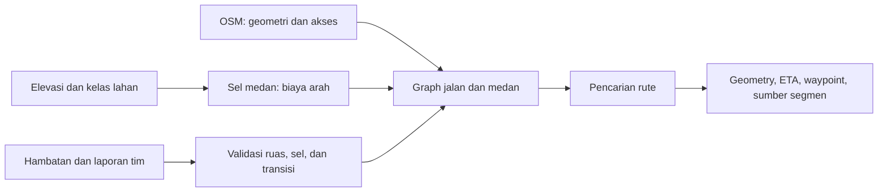

# Kajian routing jalan dan medan NusaSurvey

Tanggal penelusuran: 14 Oktober 2026. Lingkup implementasi tetap `apps/geofence-prototype`; integrasi NusaMesh mengikuti setelah mesin dibuktikan.

## Kesimpulan dan gap prototype

Kebutuhan dalam Prompt_Implementasi_NusaSurvey_SAR.md memungkinkan perjalanan tanpa jalan terpetakan. OSM adalah sumber jaringan dan fitur geografis; OSRM adalah mesin routing. Untuk NusaSurvey, jaringan OSM perlu dihubungkan dengan graph keterlintasan medan, sehingga satu pencarian dapat memilih jalan, keluar menuju medan, dan kembali ke jalan.

Pada audit sebelum implementasi, kode menyediakan `routeMapped` dan `routeTerrain` secara terpisah. Mode pertama mempertahankan geometri ruas OSM, tetapi menolak posisi di luar jaringan. Mode kedua mencari lintasan grid dengan biaya lereng dan friction kelas lahan. Mask preferensi jalan pada grid belum setara dengan mempertahankan geometri jalan asli. Pemilihan dua mode oleh pengguna belum memenuhi perjalanan campuran otomatis.

Dokumen ini merekam kajian dan rancangan. Status bagian yang telah diimplementasikan dicatat pada pembaruan di bawah; keterlintasan lapangan belum dibuktikan.

Pembaruan implementasi 14 Oktober 2026: provider Hybrid sudah dibuat di prototype, menggabungkan ruas OSM, sel medan, dan transisi dengan pemeriksaan supercover serta footprint bangunan. Default navigasi sudah memakainya. Bagian desain di bawah merekam arah arsitektur; STRIDE/LiDAR, Pareto risiko, dan D* Lite masih tahap lanjutan. Lihat [kontrak implementasi](../../../../apps/geofence-prototype/docs/HYBRID.md) dan [validasi](../../../../apps/geofence-prototype/docs/VALIDATION.md).

## Literatur yang diperiksa

### 1. Model jalan kaki STRIDE — jurnal 2024

Campbell, Cutler, dan Dennison. *A singular, broadly-applicable model for estimating on- and off-path walking travel rates using airborne lidar data*. Scientific Reports 14, 21393 (13 September 2024).

Model menggabungkan kemiringan, kepadatan vegetasi, dan kekasaran permukaan untuk memperkirakan kecepatan berjalan di jalur maupun di luar jalur. Studi memakai tiga eksperimen lapangan dan validasi silang antartransek. Masukan detailnya berasal dari LiDAR; kelas hutan WorldCover tidak dapat menggantikan kepadatan vegetasi bawah tajuk. Eksperimen transek pendek juga membatasi penerapan ETA perjalanan panjang. Relevan sebagai arah model manusia, dengan kalibrasi lokal untuk medan, beban, dan durasi perjalanan SAR.

[Artikel lengkap dan DOI](https://www.nature.com/articles/s41598-024-71359-6). Artikel menunjuk [paket R stride](https://github.com/mickeycampbell/stride); source paket belum berhasil dibaca pada penelusuran ini dan belum diimpor sebagai dependency.

### 2. Traversability dan topologi — preprint 2024

Tremblay dkk. *Topological mapping for traversability-aware long-range navigation in off-road terrain*, arXiv:2410.01925, 2 Oktober 2024.

Penulis memakai node topologi dan edge berisi informasi keterlintasan, dengan pengamatan visual dan GPS untuk navigasi robot di hutan. Relevansi untuk NusaSurvey adalah memisahkan perencanaan wilayah luas dari pemeriksaan keterlintasan lokal. Studi robot tersebut bukan validasi kecepatan manusia atau keselamatan tim SAR. Halaman yang diperiksa adalah preprint; status publikasi jurnal belum diverifikasi.

[Abstrak dan tautan full text](https://arxiv.org/abs/2410.01925).

### 3. Model Transformer ETA pegunungan — jurnal 2025, bukan baseline manusia

Qu dkk. *Transformer-based travel time estimation method for plateau and mountainous environments*. Scientific Reports 15, 4235 (4 Februari 2025).

Studi menggunakan lintasan kendaraan, fitur medan/cuaca, dan pembelajaran dari dataset plateau serta pegunungan. Dapat menjadi referensi eksperimen ETA berbasis rekaman perjalanan setelah data lokal terkumpul. Tidak dipilih sebagai model awal jalan kaki SAR: jenis geraknya berbeda dan membutuhkan data pelatihan.

[Artikel dan DOI](https://www.nature.com/articles/s41598-025-88626-9).

### 4. D* Lite — algoritma konferensi 2002

Koenig dan Likhachev, AAAI 2002. Pencarian inkremental memakai hasil pencarian sebelumnya saat graph berubah. Relevan ketika laporan tim menutup ruas atau sel. Ini referensi algoritma dasar, bukan jurnal SAR terbaru; keunggulan runtime pada paket dan perangkat NusaSurvey harus diukur sendiri.

[Publikasi institusi penulis](https://publications.ri.cmu.edu/d-lite).

## Dokumentasi dan batas data

- [GRASS r.walk](https://grass.osgeo.org/grass-stable/manuals/r.walk.html) menyediakan biaya anisotropik: perjalanan naik dan turun berbeda, elevasi digabung dengan friction. Cocok sebagai pembanding numerik untuk model awal. Prototype memiliki implementasi lokal rumus serupa, bukan menjalankan GRASS runtime.
- [Copernicus DEM](https://dataspace.copernicus.eu/explore-data/data-collections/copernicus-contributing-missions/collections-description/COP-DEM) adalah DSM yang mencakup vegetasi dan bangunan. GLO-30 tidak menyediakan detail tanah skala langkah. Jangan menghitung kekasaran meteran dari data 30 m lalu menyebutnya setara LiDAR.
- [ESA WorldCover](https://esa-worldcover.org/en/data-access) menyediakan kelas tutupan lahan 10 m. Kelas lahan menjadi proxy friction, bukan bukti suatu lokasi bisa dilewati.
- Source OSRM yang sudah diimpor pada commit `f2147ead8d9c6a2c724120113d9c56ab85963262` memiliki meshing area pedestrian eksperimental, `visgraph+dijkstra`, default nonaktif. Ini dapat menghubungkan ruang terbuka terpetakan; bukan pemodelan seluruh medan dari DEM. Lihat [source lokal areas.md](../../research/source/osrm/docs/areas.md).

## Desain yang diusulkan

Satu graph berisi tiga jenis edge: ruas OSM asli, perpindahan antar sel medan, dan transisi jalan–medan. Ini sintesis desain NusaSurvey dari kebutuhan dan referensi di atas; bukan algoritma yang diklaim langsung berasal dari satu jurnal.

1. Pertahankan node ID dan seluruh geometri OSM. Sampel elevasi mengikuti ruas tanpa mengganti bentuk ruas menjadi garis antarpusat grid.
2. Bangun sel medan yang memiliki data, biaya arah, dan status boleh dilalui. Air, bangunan, larangan akses, serta poligon bahaya menjadi constraint sesuai profil. Penyeberangan memerlukan koneksi yang diketahui, misalnya jembatan; sel air tidak dibuka karena jalan dekat.
3. Buat titik transisi pada ruas yang benar-benar berdekatan dengan sel. Pecah edge OSM pada titik tersebut. Periksa seluruh segmen penghubung terhadap sel yang dilintasi, hambatan vektor, dan grade; jarak dekat saja tidak cukup. Awal dan tujuan di luar jalan masuk lewat pemeriksaan yang sama.
4. Jalankan Dijkstra sebagai baseline gabungan; tambah A* dengan heuristic admissible setelah ekuivalensi hasil diuji. Hasil boleh jalan → medan → jalan. Simpan jenis, sumber, dan alasan biaya setiap segmen.
5. Pisahkan durasi fisik dari skor preferensi/risiko. Minimalkan waktu dengan constraint terlebih dahulu. Alternatif konservatif boleh memakai batas paparan risiko dan penalti terdefinisi; penalti bukan detik ETA dan kategori risiko bukan probabilitas keselamatan.
6. Saat laporan hambatan masuk, naikkan hazardVersion, tandai hasil lama outdated, dan hitung ulang. Mulai dari pencarian penuh yang benar; bandingkan D* Lite setelah biaya pembaruan graph terukur.
7. Kembalikan ketidakpastian secara eksplisit melalui sumber, umur data, resolusi, model, dan status verifikasi. Rentang ETA statistik memerlukan kalibrasi; jangan mengarang persentase confidence.

Alur UI tetap dua dot → pilih korban → Arahkan → rute dan ETA → Mulai navigasi. Mesin otomatis menyambungkan jalan dan medan; pilihan pengguna berikutnya dapat berupa profil tim atau preferensi perjalanan. Segmen jalan dan medan perlu dibedakan pada peta agar pengguna mengetahui kapan meninggalkan jalur terpetakan.

## Pembuktian sebelum mengganti default

| Skenario | Bukti yang diperlukan |
|---|---|
| Kedua titik di jalan | Setiap segmen jalan cocok dengan geometri OSM asli |
| Korban di luar jalan | Rute campuran mencapai koordinat target melalui transisi tervalidasi |
| Tidak ada jalan | Solver tetap mencari lintasan medan berdasarkan data |
| Jalan dan korban terpisah sungai | Tidak ada koneksi menembus air tanpa crossing yang diizinkan |
| Jalan pada jembatan | Constraint permukaan air tidak memutus jembatan yang memang dapat dilalui; posisi keluar tetap diperiksa |
| Hambatan lebih kecil dari sel | Uji potong segmen terhadap poligon mencegah lolos di antara sampel |
| Data hilang atau wilayah terputus | Status missingData/noTraversablePath, tanpa garis penghubung rekaan |
| Hambatan baru pada rute aktif | Versi dan geometry berubah atau hasil gagal eksplisit |
| Solver dioptimalkan | Biaya dibandingkan dengan Dijkstra; ukur waktu dan memori pada perangkat target |
| ETA manusia | Bandingkan prediksi dengan rekaman perjalanan lokal, arah naik/turun, dan profil beban |

Kemampuan lintas medan berarti dapat merencanakan perjalanan pada medan yang tercakup data dan memenuhi constraint. Itu tidak berarti semua medan pasti dapat dilalui. Prioritas implementasi berikutnya adalah graph gabungan dan validasi transisi; model LiDAR/ML menyusul ketika masukan dan rekaman kalibrasinya tersedia.
